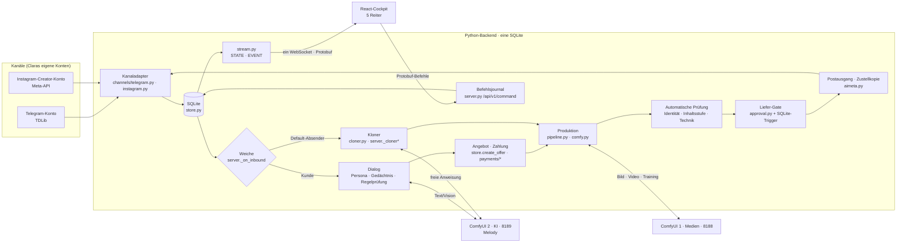
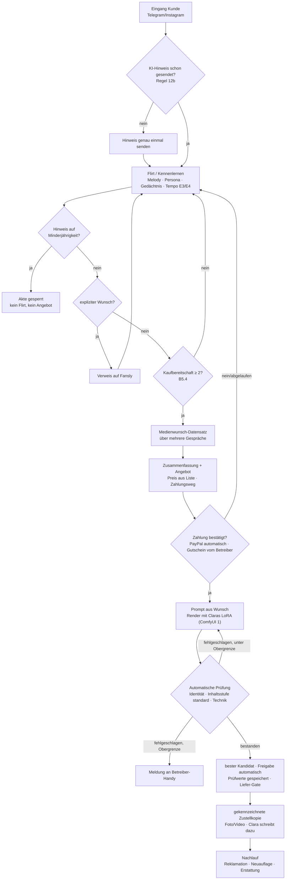
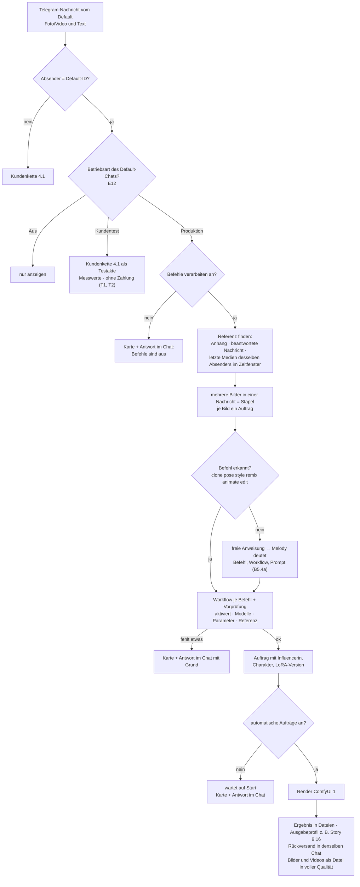

# Darkfluenzer – PHASENPLAN_BACKEND.md

**Stand:** 17.11.2026 (mit Änderungsblatt Einstellungen/Kundentest/Vollautomatik) · **Status:** Entwurf zur Betreiberfreigabe; nach der Freigabe verbindlich. Umgesetzt wird erst nach der Freigabe.
**Prüfbasis:** `main` `7a49b6a` (17.11.2026) und die echten Läufe vom 16./17.11. auf dem Mac (§5).
**Verbindlich sind genau drei Dateien:** diese, `docs/PHASENPLAN_FRONTEND.md` und `docs/bugs_v1.md` (Befundregister).
**Archiv (nicht verbindlich):** `docs/archiv/` mit `PHASENPLAN_V0.md`, `PHASENPLAN_BACK_V1.md`, `PHASENPLAN_FRONT_V1.md`, `ki_modelle.md`, `bugs_v1_20261117_vor_neufassung.md`. Code-Kommentare mit Verweisen auf V0/V1-Abschnitte beziehen sich auf diese Archivfassungen.
**Quellen dieser Fassung:** die bisherigen Pläne, die Konsolidierungen von ChatGPT (BACK/FRONT V2) und Fable, die Betreiberantworten E1–E10 vom 17.11.2026 und der Code.
**Wahrheit für Details:** Code auf `main`, `protocol/schemas/darkfluenzer/v1/*.proto` (Vertrag), `workflows/manifest.toml` (Modelle, Workflows), `config.example.toml` (Konfiguration).

---

## 1. Produktziel

Darkfluenzer ist ein lokaler **Flirt- und Verkaufsbot** auf einem MacBook Pro M4 Max (128 GB). Die vollständig synthetische, erwachsene Influencerin **Clara** flirtet über ihre eigenen Konten auf Instagram und Telegram, später auch auf WhatsApp und Fansly. Sie gewinnt Interessenten und verkauft ihnen personalisierte Fotos und Videos. Weitere Influencerinnen folgen über dieselbe Struktur.

Zwei gleichwertige Geschäftsfunktionen:
1. **Produktion:** maximal fotorealistische Fotos und Videos mit stabiler Identität (Charakter-LoRA), dazu der Referenz-Kloner für den Betreiber.
2. **Verkauf:** Kennenlernen, Flirt, Kaufinteresse, Angebot, Zahlung, Produktion, Zustellung, Nachlauf. Die Chat-KI (Melody in KI-ComfyUI 2) ist dabei der Verkaufskanal.

Clara wirkt menschlich (Tempo, Tippen, Vertrösten), bleibt ehrlich (KI-Hinweis, Regel 12) und führt zum Kauf, ohne zu drängen.

### 1.1 Vollautomatische Kette (Betreiberwunsch 17.11.2026)

**Kunde:**
1. Clara flirtet. Über mehrere Gespräche sammelt die KI, was der Kunde sehen will.
2. Wird der Wunsch konkret, fasst Clara ihn kurz zusammen und nennt Preis und Zahlungsweg.
3. Die Zahlung geht ein und wird automatisch zugeordnet. Bei PayPal geschieht das ohne den Betreiber. Amazon-Gutscheine lassen sich nicht automatisch prüfen, dort bestätigt der Betreiber den Betrag.
4. Das Backend übersetzt den Wunsch in einen Prompt und erzeugt mit Claras LoRA. Die automatische Prüfung bewertet die Kandidaten und wählt den besten.
5. Die gekennzeichnete Zustellkopie geht an den Kunden, Clara schreibt dazu.

Video läuft genauso: erst das Bild, dann die Animation. Der Betreiber gibt die Höchstlänge je Produkt vor.

**Default (Betreiber als Admin):** Der Chat des Defaults hat drei Betriebsarten (E12):
- **Produktion:** Der Betreiber schickt Claras Konto per Telegram Bilder oder Videos mit Befehl oder freier Anweisung. Die KI wählt Workflow und Prompt. Das Ergebnis kommt in denselben Chat zurück, Bilder und Videos als Datei in voller Qualität, auf Wunsch im Story-Format 9:16. Mehrere Bilder in einer Nachricht laufen als Stapel.
- **Kundentest:** Clara behandelt den Betreiber wie einen Kunden. Er sieht die Latenzen, Bilder kommen ohne Zahlung, Testaufträge gehen nur an ihn und erscheinen nie im Wallet (T1, T2).
- **Aus:** Nachrichten werden nur angezeigt.

**Grenzen, offen benannt:**
- Ohne Charakterfotos und das Training (B1) sieht kein Bild verlässlich nach Clara aus.
- Ohne menschliche Kontrolle geht gelegentlich ein fehlerhaftes Bild raus. Dafür gibt es die Reklamation mit kostenloser Neuauflage (C5.8).
- Video ist langsam: LTX 2.5 braucht für 5 s rund 13 bis 19 min (Jobs 63/64). Es läuft immer nur ein Render auf der Medien-Instanz.
- Ob Clara flüssig antwortet, während ein Video rendert, ist nicht gemessen. Das klärt B5.1.

### 1.2 Betreiberentscheidungen (Stand 17.11.2026)

| # | Entscheidung | Stand |
|---|---|---|
| E1 | Nur Textflirt. Sprachnachrichten später (B5.8). Keine expliziten Texte; explizite Wünsche beantwortet Clara mit dem Verweis auf Fansly (Vorlage im Profil). | entschieden |
| E2 | Keine Altersfrage. Kunden erhalten nur `standard`. Hinweise auf Minderjährigkeit sperren Flirt und Angebote weiterhin sofort. Rechtliche Prüfung in D1. | entschieden |
| E3 | Antworten verzögert und unregelmäßig: im Gesprächsfluss schnell; bei Erstkontakt, nach Pausen und zufällig 30 s bis 30 min; nachts langsam (30 bis 60 min). Gelesen erst nach dauerhafter Verarbeitung. | entschieden |
| E4 | Nachts trotzdem zügig, wenn Kaufabsicht erkannt ist. | entschieden |
| E5 | Angebot nur bei Wunsch oder erkannter Kaufabsicht, nicht aufdringlich. | entschieden |
| E6 | Zahlungswege als Liste je Influencerin. Start: PayPal und Amazon-Gutschein. Krypto bleibt vorhanden und zuschaltbar, wird aber nicht ungefragt als Kundenweg aktiviert. | entschieden; Preisliste offen |
| E7 | Zustellung als Foto bzw. Video. Die Originaldatei in voller Qualität ist eine bezahlte Zusatzleistung. Selbstlöschende Medien nur, wo der Kanal es nachweislich kann. | entschieden |
| E8 | Freigabe automatisch nach bestandener Prüfung, Prüfwerte gespeichert, Liefer-Gate bleibt (C5.6a). Das Handy ist der Ausnahmeweg: Meldung und Entscheidung, wenn die automatische Prüfung scheitert (C5.10). Erprobung in C6. | entschieden |
| E9 | Zwei Pläne und `bugs_v1.md` ersetzen alle bisherigen Plandokumente; die alten liegen im Archiv. | entschieden, mit dieser Fassung umgesetzt |
| E10 | Fehlbetrag (z. B. 24,50 € statt 25 €): keine automatische Annahme. Vorschlag: Annahme bis zu einer Grenze aus der Konfiguration nur mit Betreiberbestätigung und Protokolleintrag; Standardgrenze 0 €. | **offen**, Betreiberantwort fehlt |
| E11 | Kundenkette vollautomatisch: Wunsch, Angebot, Zahlung, Produktion, Prüfung, Freigabe und Zustellung ohne Klick. Ausnahme: Amazon-Gutscheine bestätigt der Betreiber. | entschieden |
| E12 | Der Default ist der Admin. Sein Chat hat drei Betriebsarten: Produktion, Kundentest, Aus. | entschieden |
| E13 | Zugangsdaten und Einstellungen werden im Cockpit im Reiter „Einstellungen“ gepflegt (S1). | entschieden |
| E14 | Auf welcher Bild-Engine laufen Kundenbilder? Dafür wird die zweite LoRA je Charakter trainiert. Bis zur Entscheidung gilt B1 nur für die vorhandene Trainings-Engine (SDXL/LUSTIFY, Inhaltsstufe `explizit`, also nur Default-Produktion). | **offen**, Betreiberantwort fehlt |

---

## 2. Regeln

### 2.1 Produktregeln 1–13

Wörtlich aus dem archivierten `PHASENPLAN_V0.md` §2 übernommen. Regel 12 ist um E1/E8 ergänzt, Regel 13 an E1/E2 angepasst; die Änderungen sind mit **[17.11.]** markiert.

1. **Leichte Tendenz zu besserem Bild, aber in angemessener Zeit** (Betreiberentscheidung 15.11.2026): Modell, Identitätsmethode, Modellvariante (z. B. Turbo/Raw, 3B/7B) und Auflösungsweg entscheiden reale A/B-Tests mit den Charakterbildern des Betreibers auf diesem Mac. Unter den Varianten, die das je Ausgabeart gemessene und vom Betreiber bestätigte Zeitbudget einhalten (festgelegt in B2/B4), gewinnt die beste Bildqualität; ist eine Variante deutlich besser, aber langsamer, entscheidet der Betreiber. Ranglisten und Herstellerangaben sind nur Kandidatenquellen.
2. **Identität hat Vorrang:** gleiches Gesicht, gleiche Figur/Anmutung über alle Stufen. LoRA ist Mittel, nicht Ziel; die messbar stabilste Methode oder Kombination gewinnt. „Identität gesperrt“ = Auftrag nutzt verbindlich dieses Profil; Abweichungen werden zurückgewiesen, keine Garantie.
3. **Explizite Bearbeitung nur abgeleitet** (maskiert vom freigegebenen Bild; im Bearbeitungsschritt 0 Pixel außerhalb der Maske, automatisch geprüft). **Video nur vom freigegebenen Foto** bzw. bei Bewegungsübertragung mit dem freigegebenen Charakterbild als Identitätsreferenz.
4. **Face-Swap ausschließlich auf eigenen, synthetisch erzeugten Bildern.** Nie auf fremden Referenzfotos/-videos; fremde Vorlagen liefern nur Pose, Komposition, Licht, Stil bzw. Bewegung. Gesichtszüge abgebildeter Personen werden nie Teil eines Charakterprofils; kein Ersetzen realer Personen in fremden Videos.
5. **Vollständige Reproduzierbarkeit** jedes Bildes/Videos (§9.3).
6. **Lokal, dokumentiert, nativ:** keine Cloud-Generierung, **kein Docker**, keine Electron-Pflicht, keine Parallelarchitektur; jede Modelldatei mit Quelle, Revision, SHA-256 und Nutzungsbedingungen im Manifest. Lizenzbedingungen sind **kein Auswahlkriterium** (Betreiberentscheidung 15.11.2026). Modelle werden nur nach ausdrücklicher Betreiberbestätigung gelöscht; ein Downloadplan ist keine Löschfreigabe.
7. **Präzision je Komponente** (Generierungsmodell, Encoder, VAE/Decoder, Adapter, Hilfsmodelle): beste verfügbare kompatible Originalpräzision; FP32-Komponenten bleiben FP32 (z. B. RelayVSR-Decoder); Umwandlung aus quantisierten Dateien gewinnt keine Genauigkeit zurück; Speicherformat und Rechendatentyp dokumentiert. Dokumentierte Ausnahme: mflux trainiert mit 8-Bit-Basis.
8. **Ein Cockpit:** die bestehende React-Oberfläche (**[17.11.]** sechs Hauptreiter **Übersicht · Nachrichten · ComfyUI · Dateien · Wallet · Einstellungen**, Graphite, ein Stylesheet); Gestaltung und Bedienlogik nach der freigegebenen Klickreferenz (`docs/design/Darkfluenzer_Cockpit_Interaktiv.html`, FRONTEND Anhang A). React spricht nur mit dem Python-Backend; **nie direkt mit Plattform- oder ComfyUI-APIs**.
9. **Zwei ComfyUI-Instanzen** (§3.2) mit getrennten Warteschlangen und gemeinsamer Ressourcensteuerung; keine dritte KI-Engine.
10. **Eigene Kanal-Adapter im Python-Backend** (Betreiberentscheidung 15.11.2026): Instagram und Telegram verbindlich, weitere Kanäle später über dieselbe Adapter-Schnittstelle. Chatwoot entfällt; seine bewährten Muster werden übernommen. Kein zusätzlicher Kanaldienst, keine zweite Datenbank, kein Rust-Gateway.
11. **Ehrliche Erwartung:** Einzelfotos in vielen Szenen praktisch nicht von echten Fotos unterscheidbar ist mit Kandidatenauswahl erreichbar; für jede Szene und für Video garantiert das 2026 kein lokales Modell.
12. **KI-Offenlegung (EU-KI-Verordnung Art. 50, gilt seit 02.08.2026):** Clara schreibt natürlich und persönlich, gibt sich aber nie als Mensch aus. (a) Jede Kanal-Bio enthält einen kurzen KI-Hinweis (pflegt der Betreiber, z. B. „KI-Creatorin · virtuelle Influencerin“). (b) Beim ersten Kontakt je Kanalidentität sendet Clara **genau einmal** eine natürliche Hinweisnachricht (Text im Persona-Profil, nicht im Code), Ereigniskarte `KI-HINWEIS GESENDET`; **das Backend weist jede KI-Antwort ab, solange für diese Kanalidentität kein Hinweis gesendet ist** (manuelle Betreiberantworten nicht betroffen, Default ausgenommen); nach Neustart nie doppelt. (c) Auf die ernst gemeinte Frage, ob sie echt bzw. eine KI ist, antwortet Clara wahrheitsgemäß – feste Persona-Regel, durch keine Betreiber- oder Kundenanweisung abschaltbar. (d) Jede über einen Kanal versandte Datei (Kunden-Zustellkopie, Default-Rückversand) trägt in den Metadaten die Kennzeichnung KI-erzeugt (IPTC/XMP `DigitalSourceType = trainedAlgorithmicMedia`); das Original in Dateien bleibt unverändert; auf Instagram setzt der Betreiber beim Posten das KI-Label. **[17.11.]** Entfernt ein Kanal die Metadaten beim Foto-/Videoversand, muss die Kennzeichnung trotzdem beim Empfänger ankommen (Begleittext oder sichtbare Marke, C5.7). (e) Kundenchats werden nie zum Training oder Feintuning eines Modells verwendet und gehen an keine externe API (Telegram-Bedingungen; nur das lokale LLM in KI-ComfyUI 2).
13. **Inhaltsaufteilung (Betreiberentscheidung 15.11.2026, [17.11.] angepasst):** Über **Instagram und Telegram** gehen an Kunden ausschließlich **nicht explizite** Inhalte (Lifestyle, Mode, Reise, Sport, Strand, Bikini) sowie die Kundengespräche. **Explizite Inhalte** gibt es nur über eine **Adult-Abo-Plattform**, die fotorealistische, vollständig synthetische KI-Personen ausdrücklich erlaubt; **[17.11.]** Plattform ist **Fansly** (Eignung für synthetische Personen in D1 prüfen), explizite Wünsche im Chat beantwortet Clara mit dem Verweis dorthin; Upload durch den Betreiber, Bezahlung und Altersprüfung übernimmt die Plattform. Technisch trägt jedes Artefakt eine **Inhaltsstufe** `standard`/`explizit` (aus Workflow bzw. Auftrag gesetzt, vom Betreiber nur anhebbar; unbekannt gilt als `explizit`); `approval.py` lässt an Kunden über jeden Kanal nur `standard` zu und über Instagram an niemanden `explizit`; nur der Default-Nutzer erhält über Telegram alle eigenen Produktionsergebnisse. Eine automatische Inhaltsprüfung in KI-ComfyUI 2 ergänzt die Stufe, sobald ein Prüfmodell qualifiziert ist (C5.6a); bei Widerspruch Sperre. **[17.11.]** Keine Altersfrage (E2); Hinweise auf Minderjährigkeit → Akte gesperrt, keine Angebote, kein Flirt.

### 2.2 Entwicklungsregeln

Wörtlich aus V0 §2.1, ergänzt um die Betreiberregeln vom 14.–17.11.:

- **NO HARDCODING:** keine fest codierten Modelle, Pfade, Ports, Parameter, Kunden, Workflows, Preise, Zeiten oder Grenzwerte – Konfiguration (`local/config.toml`), Registry (`workflows/manifest.toml`) und SQLite verwenden.
- **NO LEGACY:** keine Altlasten, Kompatibilitätsschichten oder parallelen veralteten Implementierungen; Überholtes sauber ersetzen.
- **NO MOCK:** keine simulierten Ergebnisse, Fake-Daten oder Scheinabnahmen; ausschließlich echte Funktionen und reale Tests – jede Abnahme läuft real auf dem M4 Max.
- **NO DOCKER / NO VM:** native Ausführung auf macOS/Apple Silicon (Python-venvs zulässig).
- **FREE ONLY:** lokal betreibbare, kostenlose Komponenten; keine Cloud-KI-API. Lizenzen werden dokumentiert, sind aber kein Auswahlkriterium.
- **NO JSON als Konfiguration:** TOML und Protobuf; JSON nur, wo externe APIs oder ComfyUI-Workflows es erfordern.
- **NO DUPLICATION:** vorhandene Funktionen wiederverwenden, keine doppelte Architektur.
- **MAIN ONLY:** keine Branches oder Worktrees. **MAX 2 AGENTS.**
- **GIT:** je abgeschlossenem Paket Tests, Commit, Push auf `main`.
- **Geheimnisse nur im macOS-Schlüsselbund** (Konto `darkfluenzer`): `darkfluenzer.telegram.api_id`, `darkfluenzer.telegram.api_hash`, `darkfluenzer.telegram.db_key`, Instagram-Token, Meta-App-Secret, PayPal-Zugang. Nie in `.env`, TOML, Git, Logs, Protobuf oder LLM-Kontext. Eingabe über `darkfluenzer secret set` (verdeckt bzw. stdin, Übergabe an `security -i` über stdin); vorhandene Einträge nur nach ausdrücklicher Bestätigung ersetzen. Telegram-Code und 2FA-Passwort gehen nur temporär an TDLib.
- **Ein Stylesheet:** `frontend/src/shared/graphite.css`, keine Datei je Seite (FRONTEND §1).
- **Datenbank-Migrationen** nur mit vorheriger Sicherung (`darkfluenzer.sqlite3.bak-<Zeit>-vor-migrationNN`), danach `PRAGMA integrity_check` und Fremdschlüsselprüfung.
- **Echte Kettenprüfung (Betreiberregel 17.11.):** Eine Kette gilt erst als funktionierend nach einem Lauf vom echten Eingang bis zum Ergebnis im Chat (Handy → Telegram → Cockpit → ComfyUI → Rückversand). Voraussetzungen (Workflows, Influencerin, Charakter) werden vorher eingerichtet oder offen als fehlend gemeldet. Jede Ablehnung wird im Chat beantwortet, aus dem sie kam, nicht nur als Cockpit-Karte.

### 2.3 PASS-Definition

- Ein **Paket** ist PASS, wenn Backend, Protobuf, Frontend und ein echter Lauf auf dem Mac vorliegen. Einzelne grüne Tests (auch mit FakeComfy/FakeTd) sind Teilnachweise.
- Ein **Auftrag** ist PASS, wenn eine echte Eingangsnachricht mit den richtigen Referenzen und dem richtigen Charaktermodell zu einem korrekten Ergebnis führt, dieses in Dateien gespeichert und an denselben Chat zurückgesendet wurde und der Zustand nach einem Neustart stimmt.
- Status in allen Tabellen: **OFFEN · CODE** (gebaut, kein Mac-Lauf) **· TEIL** (Teil am Mac belegt) **· PASS · BLOCKIERT** (mit Grund).

### 2.4 Arbeitsweise des Bearbeiters

1. Pakete in der Reihenfolge von §6, eines nach dem anderen.
2. Je Paket: betroffenen Code lesen, Befund bestätigen, Test rot, Umsetzung, Tests grün, Mac-Lauf, Protokoll in `bugs_v1.md` §7, Statuszeile in §5, Commit und Push.
3. Vertragsänderungen zuerst in den `.proto`-Dateien (`cd protocol && buf lint && buf generate`), nie eine Nummer wiederverwenden (§10).
4. Widerspricht dieser Plan dem Code, anhalten und den Widerspruch als `SPEC-*` in `bugs_v1.md` eintragen. Nichts erfinden.
5. Prüfungen: Backend `../local/.venv/bin/python -m pytest -q`, `ruff check`, `ruff format --check` in `backend/`; Frontend `npx tsc --noEmit`, `npx vitest run`, `npm run build` in `frontend/`. Neustart: `local/.venv/bin/python -m darkfluenzer restart` (verweigert bei laufenden Jobs). Nach Schemaänderungen das Cockpit im Browser neu laden.

---

## 3. Architektur

### 3.1 Komponenten



| Bereich | Owner (Datei) | Grenze |
|---|---|---|
| HTTP, WebSocket, Befehle | `server.py`, `stream.py`, `protocol/schemas/darkfluenzer/v1/*.proto` | ein Same-Origin-WebSocket `/ws/v1/stream`, Befehle per Protobuf über `/api/v1/command`, kein fachliches Browser-Polling |
| Persistenz | `store.py`, Migrationen (Stand 17) | genau eine fachliche SQLite; Ereignisjournal `events` unveränderlich |
| Medien | `pipeline.py`, `comfy.py`, `models.py`, `workflows/manifest.toml` | Graphen nur in der Registry; Medien über ID und SHA-256 |
| Kanäle | `channels/telegram.py`, `tdjson.py`, `instagram.py` | nur verifizierte Plattform-IDs; Default und Kunden getrennt |
| Betrieb | `runtime.py`, `app.py` (CLI), `launcher/Darkfluenzer.swift`, Schlüsselbund | Swift-Starter startet nur, keine zweite GUI |
| Cockpit | `frontend/src/core/{realtime,state,commands,channels}.ts`, `pages/*.tsx` | siehe FRONTEND |

### 3.2 Zwei ComfyUI-Instanzen und Ressourcen

- **ComfyUI 1 (127.0.0.1:8188, Medien):** Bilder, Inpaint, Refine, Pose/Tiefe, LoRA-Training, Video, Hochskalieren.
- **ComfyUI 2 (127.0.0.1:8189, KI):** Melody (Dialog, freie Anweisungen, Prompts), später Bildverständnis, Inhaltsprüfung, Sprache.
- Beide nutzen dieselbe Installation `local/ComfyUI` (ComfyUI 0.45.3, eigene venv), eigene Ordner und eigene Warteschlangen. Modelle liegen nur unter `local/models` (`extra_model_paths.yaml`, erzeugt von `launcher/setup_comfyui.sh`).
- Die Zulassung (`server._admit`) prüft vor jedem Medienjob den gemessenen freien Speicher gegen die Reserve aus der Konfiguration. Die KI-Bahn hat Vorrang: Kundenantworten dürfen nicht hinter einem Videorender warten (B5.1 misst das).

### 3.3 Protobuf-Rundweg (gilt für jede Funktion im selben Paket)

```text
Python-Owner + SQLite-Commit → Fachversion / Journal-Ereignis
  → Protobuf STATE (Snapshot, latest wins) oder EVENT (Cursor, Catch-up)
  → ein WebSocket → React-Store → richtiger Reiter / richtige Akte
React-Bedienung → Protobuf-Befehl (request_id, Scope, erwartete Revision)
  → Session/CSRF, Prüfung, CAS → einmalige Ausführung → persistiertes Receipt
  → STATE/EVENT → sichtbarer echter Zustand
```

`ACCEPTED` ist kein Erfolg; maßgeblich sind die Receipts `COMPLETED · REJECTED · FAILED · UNKNOWN · CANCELLED`. Dieselbe `request_id` erzeugt höchstens einen Effekt. Bei `UNKNOWN` nie blind ein zweites Mal senden, sondern über Provider-ID abgleichen. Große Dateien nur über die geschützten Medien-Endpunkte, nie im Stream.

### 3.4 Datenmodell und Zustände (Kurzfassung)

- `influencers`/`characters` → Fotos, Datensätze, LoRA-Versionen, Persona; `customers` → `channel_identities` → `channel_conversations` → `channel_messages` (Anhänge, Status); `orders` → `order_stages` → `jobs` → `media` → Freigaben → Zustellungen → Zahlungen.
- **Default** ist `customers.kind = internal`, kein Kunde, nie in Verkaufszahlen.
- **Auftrag:** `created → producing → candidates/selected → approved → delivered → (complaint → closed)`; bezahlte Aufträge tragen `order_id` von der Anlage bis zur Zustellung.
- **Job:** `queued → running → done | failed | cancelled`; Pause der Warteschlange ist dauerhaft (SQLite). Nach Absturz wird anhand der gespeicherten `prompt_id` abgeholt statt neu gerendert.
- **Zustellung:** `queued → sending → sent | failed | unknown`; `unknown` wird abgeglichen, nie blind wiederholt.

---

## 4. Ketten

### 4.1 Kundenkette (Ziel)



### 4.2 Default-Kette (Betreiber per Telegram)



### 4.3 Live-Befund 17.11.2026: warum die Default-Kette nicht lief

Der Betreiber schickte von seinem privaten Telegram (Default 571334304) ein Foto und danach „Clone“. Ergebnis: nur die Cockpit-Karte „Kein Workflow für clone im Default-Kontakt gewählt“. Die Kette brach an vier Stellen:

| # | Stelle in 4.2 | Ursache | Paket |
|---|---|---|---|
| 1 | Vorprüfung | Medien-Workflow und Befehlszuordnung waren leer; niemand hatte sie eingerichtet, die Kette wurde nie vom Handy getestet. | H4, H6 |
| 2 | Antwort im Chat | Die Ablehnung ging nur auf eine Cockpit-Karte, nicht zurück nach Telegram. | H4 (BUG-057) |
| 3 | Referenz finden | Foto und Befehl kamen als zwei Nachrichten im Abstand von 4 s. Der Kloner nimmt Referenzen nur aus derselben oder einer beantworteten Nachricht. | H4 (BUG-075) |
| 4 | Charakter | Influencerin nicht gesetzt, „Charakter 01“ hat 0 Bilder, kein Workflow lädt eine Charakter-LoRA. Ein „clone“ hätte die fremde Person nachgebildet, nicht Clara. | B1, H4 (BUG-052) |

---

## 5. Ist-Stand (17.11.2026)

| Bereich | Stand | Beleg | Offen |
|---|---|---|---|
| Cockpit-Server, Stream, Befehlsjournal, Receipts | PASS | A1 15.11. (`d13e258`) | BUG-024 Zeitlimit |
| ComfyUI-Reiter, Workflow-Übernahme (0 Abweichungen) | PASS | A2 15.11. | einheitliche Videosteuerung (H5) |
| Zwei Instanzen, Zulassung | TEIL | A3 15.11. | echter KI-Lauf (B5.1); Starter startet Instanz 2 nicht (BUG-061) |
| Dateien, Herkunft, Weiterverarbeiten | PASS | A4 15.11. | Video-Vorschau im echten Chrome geprüft (BUG-045 widerlegt) |
| Bildworkflows | TEIL | je ein echter Lauf (§9.2) | keine Engine für Kunden freigegeben; kein LoRA-Lader |
| Video LTX 2.5 | TEIL | Job 63 (960×1280, 121 Frames, 24 fps, Ton, 1128 s, Swap ≤ 44,8 GB); **Job 64 aus dem Cockpit** (3:4, 5 s, 1 Kandidat, 780,9 s, Swap ≤ 42,7 GB) | einheitliche Bedienung (H5), Zeitachse (B4), Vergleich mit Wan |
| Video Wan 2.2 / Remix | OFFEN | Wan-FP16 2408 s (A2); Langvideo nur mit Ersatz-ComfyUI | Abnahme, Langvideo real |
| Abbrechen, Pause | TEIL | 17.11. am Mac: Abbruch in der Startphase (Job 65) und im Lauf (Job 66) → Status abgebrochen, 0 Medien, ComfyUI-Queue leer, Speicher der Instanz 2,9 → 1,9 GB; Pause übersteht Neustart | Auftrag als Ganzes abbrechen (H3) |
| Seed-Grenzen | PASS | 17.11.: „Generieren“ war bei LTX, FLUX-Vorlage, Qwen ×2 still blockiert; behoben `932c9ec`, Job 64 danach | – |
| Charakter-LoRA | OFFEN | Trainingsworkflows registriert, nie gelaufen; 0 Charakterfotos; zwei Ordnerschemata (BUG-078) | B1 (§7.6.1), E14 |
| Telegram (TDLib) | TEIL | 17.11.: Anmeldung, Neustart ohne Code, Eingang vom Zweitkonto, Register, Name, Default per Klick, manuelle Antwort gesendet (ID 5006950400), Default „Hey“ → Rückfrage im Chat | Handoff vom Handy, Datei > 50 MB, H2-Befunde |
| Default-Kette (Kloner) | TEIL | Code für sechs Befehle, Befehl→Workflow-Zuordnung (`7a49b6a`); Live-Lauf 17.11. gescheitert (§4.3) | H4 (Betriebsarten, Stapel, Ausgabeprofil), H6, B1, T1/T2 |
| Instagram | CODE | Adapter + Tests | Meta-App, Tunnel |
| Zahlungen | CODE | Krypto-Beobachter, Gutschein-Erkennung, Zuordnung, Monatsliste | PayPal, echte Zahlung, H2/C5a |
| Kundenauftrag von Hand | CODE | Hinweis, Alter, Angebot, Produktion, Freigabe, Zustellung | kein echter Kunde |
| Einstellungen (Reiter) | OFFEN | Geheimnisse bisher nur per CLI `darkfluenzer secret set` (Telegram) | S1 |
| Chat-KI | OFFEN | Melody Q6_K geladen und SHA-geprüft (17.11. 01:14); Node ComfyUI-LLM-Session geprüft, Setup-Skript vorbereitet (nicht installiert) | B5.1 ff. |

### 5.1 Nachweise der abgenommenen Pakete (aus V0, gekürzt; Volltext im Archiv)

| Paket | Datum, Commit | Messwerte |
|---|---|---|
| Starter (Swift, früher „S1“) | 14.11. | Swift-App startet Backend, öffnet Cockpit, zweiter Doppelklick idempotent |
| A1 Vertrag, Wiederanlauf | 15.11., `d13e258` | Receipt nach Schalter, veraltete Version abgewiesen, dieselbe `request_id` → ein Effekt; SIGKILL mitten im Render → Job 26 nach Neustart abgeholt, genau ein ComfyUI-Auftrag |
| A2 ComfyUI-Reiter | 15.11., `515288f`, `9d9ddf0` | 16 offizielle Vorlagen, `graphToPrompt` 0 Abweichungen; Wan-FP16 2408 s, frei 73,1 → min 18,3 GB, Swap 8,9 → max 46,1 GB |
| A3 Zweite Instanz | 15.11., `3fd3edc` | KI-Instanz unabhängig gestartet/gestoppt; Zulassung wartete sichtbar auf Speicher |
| A4 Dateien | 15.11., `3fd3edc` | Wiederholen bitgleich (SHA = 0033), Weiterverarbeiten mit Eingabe-SHA = 0033 |
| C2d Telegram | 16./17.11., `ab1d9cf` ff. | Schlüsselbund, echte Anmeldung, Neustart ohne Code |
| P0 bugs_v1 | 17.11. 00:23 | BUG-001 bis 006 deployt; BUG-002 live: Weiterleitungs-Header 403 |

---

## 6. Reihenfolge (nach Freigabe)

1. **DOK-1** – mit dieser Fassung erledigt (Pläne neu, Altdokumente im Archiv).
2. **Block H: H0 bis H6** – innerhalb des Blocks die Default-Kette zuerst: H0 → H4 → H5 → H6a → H1 → H2 → H3.
3. **S1 Einstellungen.**
4. **B5.1 bis B5.4** – nach B5.1 zuerst B5.4a (freie Default-Anweisungen), dann B5.2, B5.3, B5.4.
5. **C5.1, C5.2, C5.3, C5.4**, dann **T1**.
6. **C5a, C5.5, C5.6, C5.6a, C5.7**, dann **T2**.
7. **C5.8 bis C5.10, C4, Block D.**
8. **C6** Probephase und Gesamtabnahme.

**Medienlinie parallel**, sobald Charakterfotos vorliegen: B1 (Voraussetzung für H6b und jeden Kundenauftrag), B2, B4, B5.6. Höchstens zwei Agenten, keine gleichzeitigen schweren GPU-Läufe.

---

## 7. Pakete

### 7.1 Block H – Härtung und Default-Kette

**H0 Rückverfolgung.** CLI `darkfluenzer trace --message <id>` bzw. `--order <nr>` (nur lesend): Eingangsnachricht, Kanalidentität, Default-Zuordnung, Schalter, erkannter Befehl, Referenzen, Workflow, Vorprüfung, Auftrag, Stufen, Jobs mit `prompt_id` und Fehler, Medien, Rückversand; die erste Unterbrechungsstelle wird benannt. Abnahme: Ausgabe für den gescheiterten Auftrag vom 17.11. (§4.3) und für einen bestandenen.

**H4 Default-Kette reparieren.** BUG-052, 053, 054, 055, 056, 057, 075. Dateien: `server.py` (`_cloner`, `_cloner_plan`, `_cloner_order`, `_cloner_delivery`), `cloner.py`, `pipeline.py` (`advance_order`), `config.py`.
- **Referenz:** Anhang, beantwortete Nachricht oder die letzten Medien desselben Absenders innerhalb `cloner.reference_window_s` (Konfiguration); mehrere Referenzen an alle Vorlagen-Parameter des Workflows, überzählige sichtbar melden.
- **Vorprüfung** wie beim Render-Befehl (aktiviert, nicht gesperrt, Modelle vorhanden, Parameter gültig), bevor ein Auftrag entsteht.
- **Bindung:** Auftrag trägt Influencerin, Charakterprofil und aktive LoRA-Version; bis B1 fertig ist, zeigt die Karte „ohne Charakter-LoRA“.
- **Kandidaten:** Bild aus `production.candidates_default`, Video aus `production.video_candidates_default` (Vorgabe 1). Genau ein erfolgreicher Kandidat wird automatisch gewählt.
- **Zustände:** Jede Default-Nachricht endet in genau einem Zustand: gestartet · wartet auf Start · abgelehnt mit Grund · zurückgesendet · Rückversand gesperrt. Jeder Zustand erzeugt eine Karte **und** eine Antwort im selben Chat.
- **Einrichtung:** Default-Medien-Workflow und Befehlszuordnung erhalten sinnvolle, im Cockpit sichtbare Vorschläge aus der Registry (keine leeren Pflichtfelder ohne Hinweis).
- **Betriebsart** des Default-Chats je Kanalidentität: Produktion, Kundentest, Aus. Umschalten im Cockpit und per Chat-Wort; die Wörter stehen im Default-Kontakt.
- **Produktion:** Bild mit Befehl oder freier Anweisung ergibt ein bearbeitetes Bild. Freie Anweisungen deutet die KI ab B5.4 (B5.4a); bis dahin gelten die sechs Befehle.
- **Stapel:** Mehrere Bilder in einer Nachricht ergeben je Bild einen Auftrag. Hat der Workflow mehrere Vorlagen-Parameter, werden die Bilder gemeinsam verwendet.
- **Ausgabeprofil** je Befehl oder per Anweisung, zum Beispiel Story 9:16.
- **Rückversand** an den Default über Telegram als Datei in voller Qualität, Bilder und Videos.

**H5 Video-Parametervertrag.** BUG-058. Alle Video-Workflows haben dieselben fachlichen Parameter: `duration_s` (Gesamtlänge), `fps`, `width`, `height`, optional `segment_s`. Das Backend übersetzt je Engine (Wan/Remix in Abschnitte mit letztem Bild als nächstem Start; LTX in Sekunden bzw. Frames, bis zur Engine-Grenze in einem Lauf, darüber Abschnitte). Grenzen je Engine stehen im Manifest und im STATE der Workflows. Abnahme: `ltx25_i2v`, `wan22_i2v`, `wan22_remix_v30_i2v` nehmen dieselben Eingaben an und erzeugen die erwartete Frame-Zahl; das Cockpit zeigt dieselben Felder an derselben Stelle.

**H6 Abnahme der Default-Kette am echten System.** H6a (ohne LoRA, nach H4/H5): Foto + `clone`, Foto + `animate`, Foto und Befehl als zwei Nachrichten, **fünf Bilder in einer Nachricht mit Story-Profil kommen als fünf Dateien im Format 9:16 zurück**, Rückversand in denselben Chat, Zuordnung in Dateien, Abbruch während des Laufs, Neustart mitten im Lauf; danach `pose`, `style`, `remix`, `edit`. H6b (nach B1): dieselben Läufe mit Claras LoRA. Abnahme nach §2.3, Protokoll in `bugs_v1.md` §7.

**H1 Inhaltsstufe schließen.** BUG-047. Stufe = höchste Stufe aus Workflow und allen Eingabebildern (Upload, Vorlage, Galerie, Eltern). Uploads per SHA-256 gegen `media`; unbekanntes Eingabebild in einem abgeleiteten Workflow = `explizit`. Abnahme: explizites Bild über alle Wege, Ergebnis `explizit`, Liefer-Gate sperrt, auch bei manipuliertem Befehl.

**H2 Fehler auf dem Kettenpfad.** BUG-008, 013, 014, 015, 016, 021, 031, 048, 049, 050, 062. Je Befund ein vorher roter Test plus Mac-Lauf, soweit Kanal und Tunnel vorhanden.

**H3 Render-Betrieb.** BUG-007, 043 (Rest), 064. Zeitlimit je Workflow aus der Registry; Befehl „Auftrag abbrechen“ beendet alle Jobs eines Auftrags; Fortschritt langer Läufe (Schritt, Abschnitt) im STATE. Abnahme: laufender LTX-Auftrag mit mehreren Kandidaten abgebrochen; Lauf über 3600 s besteht.

### 7.2 S1 – Einstellungen (Reiter, Schlüsselbund)

- **Dateien:** `keychain.py`, `app.py`, `config.py`, `server.py`, neue `settings.proto`.
- **Katalog** aller Einträge mit Gruppe, Format und Prüfer; derselbe Katalog für Cockpit und CLI `secret set` (schließt BUG-067).
- **Geheimnisse** liegen nur im macOS-Schlüsselbund. Ihr Wert steht nie in SQLite, STATE, Logs oder im Befehlsjournal (Hash ohne Wert, wie bei der Telegram-Anmeldung).
- **Übrige Werte** stehen in `local/config.toml`. Änderungen prüft der Parser aus `config.py`, geschrieben wird atomar; Werte, die einen Neustart brauchen, melden das.
- **STATE 12 Einstellungen:** Gruppen, Einträge, Status (gesetzt, fehlt, ungültig), zuletzt geändert, letzte Prüfung.
- **Befehle:** 60 `secret_set`, 61 `config_update`, 62 `connection_test`.
- **Gruppen:**
  - Kanäle: Telegram (API-ID, API-Hash, Anmeldung, Test-Chats), Instagram (App-ID, App-Secret, Verify-Token, Tunnel-Adresse, Anmeldung); später WhatsApp, Fansly.
  - Zahlung: PayPal (Client-ID, Secret, Webhook-ID, Umgebung), Krypto-Adressen, Kulanzgrenze (E10).
  - KI und Render: Instanzen, Speicherreserve, Hugging-Face-Zugang, falls ein Modell ihn verlangt.
  - Admin und Test: Default-Identität, Betriebsart, Chat-Wörter.
  - Betrieb: Autostart, Sicherung, Ruhezustand.
- **Abnahme:** PayPal-Zugang im Cockpit eintragen, Verbindungsprüfung besteht, der Wert ist danach nirgends lesbar; falsches Format wird abgewiesen.

### 7.3 Block B5 – Chat-KI (Melody)

**Verbindliche Modellentscheidung (16.11.2026):** einziges Chatmodell ist **ReadyArt Melody1437-26B-A4B-v2.0, GGUF Q6_K**: Datei `Melody1437-26B-A4B-v2.0-Q6_K.gguf`, Revision `b22520a5c83db6ff0d12aef1fd461c932ba86fbf`, 22.638.399.456 Byte, SHA-256 `07a3b8b756a212926900b42927e51a3b116c105f878eb5c2b272d689a9a710dc`, Ablage `local/models/llm/melody1437-26b-a4b-v2.0/` (geladen und geprüft 17.11.2026 01:14). Keine weiteren Chatmodelle oder Quantisierungen ohne neue Freigabe. Anforderungen: Flirt ohne Verweigerung im zulässigen Rahmen (E1), TTFT ≤ 2 s und kurze Antwort ≤ 5 s (p50/p95, auch unter Medienlast), natürliches Deutsch, Gedächtnis (B5.3), stabile versionierte Persona, nur ComfyUI 2, später Training und Sprache.

**B5.1 Modell-Laufzeit.** Knotenpaket **ComfyUI-LLM-Session** (kantan-kanto, gepinnt `ec2b293c`, Gemma4-26B-A4B laut Kompatibilitätsliste bestätigt; Code am 17.11. auf Netzwerk-/Prozess-/eval-Aufrufe geprüft: keine) mit `llama-cpp-python==0.3.37` als Metal-Build; Skript `launcher/setup_llm_session.sh`, Modellpfad `LLM: llm` in `setup_comfyui.sh` (BUG-036). Registry-Art `text`, Engine auf Instanz `ai`, Melody als Datei im Manifest, Workflow `clara_chat_melody`. KI-Bahn mit Vorrang; Starter und Backend halten Instanz 2 geladen (BUG-061). Messwerte je Antwort in SQLite. Abnahme: 20 zusammenhängende deutsche Nachrichten, kalt und warm, mit und ohne laufenden Medienrender; p50/p95 von TTFT und Gesamtzeit, Tokens/s, Swap.

**B5.4a Freie Default-Anweisungen (vorgezogen, Pflicht).** Melody deutet eine freie Anweisung des Defaults („mach daraus ein Reel“, „Nr. 2 in 4K“) in Befehl, Workflow, Prompt und Referenzen als geprüftes Schema; ungültige Ausgabe hat keinen Effekt und erzeugt genau eine Rückfrage im Chat. Folgeanweisungen beziehen sich auf den letzten Auftrag. Abnahme: 30 echte Anweisungen vom Handy mit notierter Trefferquote.

**B5.2 Persona und Verkaufsführung.** Versionierte Persona je Influencerin (Charaktertext, Beispieldialoge, Gesprächsstufen neutral/flirtend, Vorlagen für Hinweis, Angebot, Vertrösten, Fansly-Verweis). Flirt weckt Interesse und lenkt auf Bildwünsche; kein Preis ohne Wunsch oder Kaufabsicht (E5). Regelprüfung im Backend vor jedem Versand: Regel 12 c, Minderjährigkeit, keine Aussagen zu Preis, Zahlung oder Freigabe außerhalb der Fakten. Abnahme: Persona-Änderung → neue Revision und andere Antwort; Regelverstoß wird abgefangen.

**B5.3 Gedächtnis.** Vier Ebenen (Kurzzeit, Fakten/Vorlieben, Gesprächsmemos, Langzeit) in SQLite mit FTS5, Quelle und Zeit je Erinnerung, Korrektur mit Protokoll, strikte Kundentrennung; gelöschte Nachrichten entfernen ihre Erinnerungen. Abnahme: 100–200 Gesprächsschritte mit Widerspruch, zwei Kunden, Neustart.

**B5.4 Strukturierte KI-Funktionen.** Kaufbereitschaft (Stufe 0–3 mit Beleg), Medienwunsch mit Quellnachrichten, Prompt je Workflow. Jede Funktion liefert ein geprüftes Schema. Abnahme: je Funktion ≥ 50 deutsche Testfälle mit Trefferquote.

**B5.5** entfällt; ersetzt durch den Kundentest T1 und T2 (§7.4).

**B5.6 Referenzanalyse (FL-5).** Bild oder Vorlage analysieren → bearbeitbarer Prompt (Motiv, Haltung, Perspektive, Kamera, Licht, Kleidung, Hintergrund, Komposition); Kern-Node `TextGenerate` mit Bildeingang ist in ComfyUI vorhanden, das Bildmodell wird vor Nutzung qualifiziert. Pose (SDPose) und Tiefe (DA3) sind bereits registriert.

**B5.7, B5.8** Text-LoRA (nicht aus GGUF) und Sprache später. Spracherkennung (Kandidaten Whisper, Parakeet) und **Sprachausgabe (TTS): Modell noch nicht festgelegt** (Kandidat u. a. Qwen3-TTS); nichts davon ist zur Installation freigegeben. Sprachnachrichten kommen nach dem Textflirt (E1).

### 7.4 Block C5 – Kundenbetrieb und Kundentest

**C5.1 Influencerin vollständig** (BUG-020). Influencerin je Kanalkonto und je Akte; Schalter Text-KI, automatische Antworten, Bildautomatik, Freigabeart (automatisch · Betreiber), Zahlungswege; nie `influencers[0]`.
- Kanalkonten als Liste statt je Plattform ein Abschnitt in der Konfiguration: mehrere Telegram- und Instagram-Konten nebeneinander (z. B. Clara, Lucy, Ken), je Konto eigener Datenordner und eigene Zugangsdaten (Einstellungen, S1).
- Zuordnung: Kanalkonto gehört zu genau einer Influencerin, Influencerin zu genau einem Charakter, Kundenakte zu genau einem Kanalkonto.
- Persona, Preise, Verhalten, Gedächtnis und LoRA gelten je Influencerin und werden nie über Figuren hinweg verwendet.
- Jede Kundenakte trägt Kanalkonto und Influencerin ab dem ersten Eingang; `CustomerSummary` und die Kundenseiten liefern Influencerin (ID, Name, Farbe) und Konto mit, die Kundenliste ist serverseitig nach Influencerin filterbar (FRONTEND §3.2).
- Abnahme: zwei Figuren auf zwei Konten ohne Vermischung; je eine Nachricht an Clara und an Lucy erscheint mit der richtigen Figur, der Filter zeigt nur die eigene.

**C5.2 Erstkontakt** (BUG-077).
- KI-Hinweis automatisch und genau einmal je Kanalidentität.
- Keine Altersfrage. Die Bedingung „Altersangabe“ vor dem Angebot entfällt (`server._create_offer`).
- Hinweise auf Minderjährigkeit sperren Flirt und Angebote sofort und zeigen eine Karte.
- Explizite Wünsche: Verweis auf Fansly aus der Vorlage, kein Auftrag.
- Testbetrieb: die KI antwortet nur freigegebenen Test-Chats.
- Abnahme: Hinweis nie doppelt, auch nach Neustart; Angebot ohne Altersangabe möglich; Sperre greift im Testfall.

**C5.3 Dialogbetrieb.** Antwortmodus je Gespräch: Automatisch · Entwürfe prüfen · Manuell; neue Kundennachricht oder Betreiberantwort macht Entwürfe ungültig; Handy-Übergabe schaltet auf Manuell. Instagram-Antworten über 1000 Byte werden geteilt, KI-Antworten nie mit Human-Agent-Kennzeichnung. Kanalfähigkeiten (Eingang, Ausgang, Gelesen, Tippen, Grenzen, Medienarten) je Adapter beschrieben, damit WhatsApp und Fansly später passen. Abnahme: drei Kunden gleichzeitig ohne Vermischung; überholter Entwurf wird nie gesendet.

**C5.4 Verhalten** (E3/E4). Verhaltensprofil je Influencerin in SQLite, versioniert; ersetzt `reply_delay_*`/`typing_chars_per_s` der Konfiguration. Startwerte (im Profil änderbar): Gesprächsfluss 10–90 s plus Tippzeit; Erstkontakt, nach Pause, zufällig 30 s–30 min; Nacht 30–60 min oder am Morgen; Kaufbereitschaft ab Stufe 2 wie Gesprächsfluss, auch nachts. `scheduled_at` je Antwort, Storno bei neuer Nachricht oder Handoff; Gelesen und Online-Status nach Profil; Tippanzeige nach Antwortlänge; mehrere Kundennachrichten ergeben eine Antwort, lange Antworten gehen als mehrere Nachrichten; Vertrösten aus Vorlagen mit Höchstzahl je Gespräch und Tag. Abnahme: 50 Testnachrichten ergeben die eingestellte Verteilung; zwei Chats bremsen sich nicht; nach Neustart nichts doppelt.

**T1 Kundentest Chat** (braucht C5.4).
- In der Betriebsart Kundentest wird der Default wie ein Kunde behandelt: eigene Testakte (Art `test`), eigenes Gedächtnis, zurücksetzbar.
- Schalter „Verzögerung wie Kunde“ an oder aus.
- Messwerte je Antwort: Wartezeit in der KI-Bahn, Erzeugungszeit, Zeichen je Sekunde, geplante und tatsächliche Sendezeit.
- Abnahme: 20 Nachrichten im Test, Messwerte je Antwort gespeichert, Zurücksetzen leert das Testgedächtnis.

**C5.5 Wunsch und Angebot** (BUG-012, 019, 060).
- Der Wunsch entsteht über mehrere Gespräche als Datensatz am Auftrag; jede Angabe trägt ihre Quellnachricht; höchstens eine Rückfrage oder ein Vorschlag.
- Vor dem Angebot fasst Clara den Wunsch in einem Satz zusammen. Das Angebot geht automatisch raus: Faktenblock aus dem Backend (Produkt-ID, Preislistenrevision, Betrag, Frist), Formulierung aus der Vorlage, Zahlungswege aus der Liste der Influencerin.
- Nicht aufdringlich: nach Ablehnung Sperrzeit aus dem Profil, begrenzte Zahl von Verkaufsimpulsen je Tag.
- Zusatzleistungen als Preispositionen: Originaldatei, selbstlöschend. Video: Höchstlänge je Preisposition, vom Admin gesetzt.
- Abnahme: Preis immer aus der Liste; abgelaufenes Angebot nimmt keine Zahlung mehr automatisch an.

**C5.6 Produktion nach Zahlung** (BUG-022, 023, 051). Dank und Lieferzeit aus gemessenen Laufzeiten; Prompt aus B5.4; Start automatisch; nur freigegebene Engines mit der LoRA der Figur; „Neu erzeugen“ als neue Kandidatenstufe ohne neue Zahlung, mit Obergrenze. Abnahme: bezahlter Testauftrag läuft ohne Klick bis zur Freigabe.

**C5.6a Automatische Prüfung und Freigabe** (E8, E11).
- Prüfungen je Kandidat, Ergebnis gespeichert:
  1. Identität: Ähnlichkeit zum Referenzsatz über der Schwelle (`identity.py`, Schwelle aus der Konfiguration).
  2. Inhaltsstufe: Ein lokaler Bildklassifikator bestätigt „nicht explizit“; sonst wird die Stufe angehoben und der Kandidat gesperrt. Das Modell dafür braucht die Freigabe des Betreibers.
  3. Technik: Auflösung, Format, nicht leer; bei Video Frame-Zahl und Dauer.
- Auswahl: bester Identitätswert unter den bestandenen Kandidaten.
- Systemfreigabe: Eintrag mit Freigeber „system“ und den Prüfwerten. Der SQLite-Trigger lässt ihn nur zu, wenn alle Prüfwerte gespeichert und bestanden sind. Das Liefer-Gate bleibt sonst unverändert.
- Fehlschlag: automatisch neu erzeugen bis zur Obergrenze aus der Konfiguration, dann Zustand „wartet auf Betreiber“ und Meldung nach C5.10.
- Schalter je Influencerin: Freigabeart „automatisch“ oder „Betreiber“.
- Abnahme: 20 Testaufträge ohne Klick zugestellt; ein Bild mit fremdem Gesicht und ein explizites Testbild werden nie zugestellt.

**C5.7 Freigabe und Zustellung** (BUG-017, 059). Standard: Versand als Foto oder Video; mit Zusatzleistung Originaldatei als Dokument mit neutralem Namen; selbstlöschend über TDLib, soweit der Privatchat es erlaubt (real prüfen); Kennzeichnung kommt beim Empfänger an (Begleittext oder sichtbare Marke, wenn der Kanal Metadaten entfernt); Zustellkopie je Kanalgrenze, nie unter 1K; WebP/WebM vorher umwandeln oder abweisen. Abnahme: Foto und Video je Kanal genau einmal zugestellt, Kennzeichnung nachweisbar.

**T2 Kundentest mit Bild ohne Zahlung** (braucht C5.7).
- Das Angebot entsteht normal. Statt der Zahlung gilt die Testfreigabe, automatisch oder per Wort (Startwert „Cash“, im Default-Kontakt änderbar).
- Der Auftrag hat die Quelle `test`: kein Zahlungsdatensatz, nicht im Wallet, nicht in der Monatsliste.
- Zustellung nur an die verifizierte Default-Identität. Das Liefer-Gate und ein SQLite-Trigger erlauben Quelle `test` nur für dieses Ziel.
- Messwerte je Auftrag: Prompt, Wartezeit, Renderzeit, Prüfung, Zustellung.
- Abnahme: ganze Kette ohne Zahlung; ein Testauftrag lässt sich nicht an eine Kundenidentität zustellen; das Wallet bleibt leer.

**C5.8 Nachlauf** (BUG-051). Reklamation als Karte, Neuauflage als abgeleiteter Auftrag, Erstattung als protokollierter Befehl mit Provider-Beleg (`refund_requested` ist keine Erstattung), Abschluss mit Eintrag ins Gedächtnis. Abnahme: Erstattung sperrt jede weitere Zustellung.

**C5.9 Wechsel Instagram zu Telegram.** Einmal-Code mit Ablauf, Prüfung im Backend, gleiche Akte. Abnahme: zwei Plattformen, eine Akte.

**C5.10 Freigabe vom Handy** (Ausnahmeweg, E8).
- Scheitert die automatische Prüfung, erhält der Default über Telegram die Vorschau und antwortet mit Freigeben, Neu oder Erstatten.
- Nur von der verifizierten Default-Identität; dieselben Gates wie im Cockpit.
- Abnahme in C6: Entscheidung vom Handy wirkt genau einmal; fremde Absender haben keine Wirkung.

### 7.5 Block C5a – Zahlungen

- **C5a.1 Krypto** (BUG-009, 010, 011): robuste Beobachter, Blockzeit statt Erkennungszeit; je eine kleine echte Zahlung.
- **C5a.2 PayPal:** Zahlungslink je Auftrag, Webhook über den öffentlichen Eingang (`server.public_port`), Statusabfrage bei PayPal, Zugang im Schlüsselbund (`secret set` erweitert, BUG-067); `paid` nur mit Provider-Beleg.
- **C5a.3 Lebenszyklus:** verspätet, doppelt, zu hoch → „nicht zugeordnet“; Fehlbetrag nach E10.
- **C5a.4 Gutscheine** (BUG-050): Erkennung ohne Fehlmaskierung, Original geschützt abrufbar; Einlösung und Betrag bestätigt der Betreiber in zwei Schritten; Codes maskiert, nie in Logs, STATE oder LLM.

### 7.6 Medienlinie (parallel)

- **B1 Charakter-LoRA** – ausgeschrieben in §7.6.1.
- **B2 Bildidentität und Ausgabe:** Identitätsprofil mit Referenzsatz, A/B-Vergleich, 2K/4K (Hochskalieren nie als nativ ausgeben), Instagram-Profile 1080×1440, Reels 1080×1920.
- **B4 Video** (FL-2, FL-4): Wan-Abnahme, Vergleich LTX/Wan mit Messwerten, Registry gegen Platte (BUG-028, 029, 030). **Zeitachse:** Schlüsselbilder je Zeitpunkt (z. B. 0/5/10/15 s) mit Referenzbild aus Dateien, Prompt des folgenden Abschnitts, Kamera/Bewegung, Übergangsstärke. Bis zur Engine-Grenze ein LTX-Lauf mit `LTXVAddGuide` je Schlüsselbild (im ComfyUI-Kern vorhanden; `LTXVContextWindows` für Prompt je Fenster), darüber eine Abschnittskette mit `WanFirstLastFrameToVideo` (Start- und Endbild je Abschnitt) und Zusammensetzen mit Ton/FPS-Prüfung. Bewegungsübertragung mit Wan Animate 2 (Node vorhanden, Modell vor Nutzung qualifizieren). Abnahme: 15-s-Video mit vier Schlüsselbildern, Bilder zu diesen Zeitpunkten entsprechen den Referenzen, Übergänge ohne Sprung, Neustart mitten im Lauf.
- **C1/C3 Rest:** Vorlagenbibliothek mit Analyse (B5.6); alle sechs Befehle und freie Anweisungen bis zum Rückversand (H6).

#### 7.6.1 B1 Charakter-LoRA (FL-3)

BUG-052, 068, 069, 078. Braucht H3 (Zeitlimit je Workflow, BUG-007).

**Ziel:** Der Betreiber legt Fotos in einen Ordner, klickt „Trainieren“ und erhält eine LoRA, die alle Aufträge dieser Figur verwenden. Beliebig viele Figuren, strikt getrennt.

**So läuft es für den Betreiber:**
1. Fotos in `local/characters/clara/photos/` ablegen (mindestens 15, besser 25–40, nur diese Person) – oder im Cockpit per Ziehen/Ablegen hinzufügen; das kopiert in denselben Ordner (Betreiberanforderung FL-3).
2. Im Cockpit unter ComfyUI → Charakter jedes Foto mit Prüfergebnis sehen und „Trainieren“ klicken.
3. Nach dem Training Probebilder sehen und „Aktiv setzen“. Ab dann nutzt jeder Auftrag dieser Figur das Modell.
4. Für Lucy oder Ken mit „Neuer Charakter“ eine Figur anlegen: eigener Ordner, eigenes Modell, strikt getrennt.

**Vorher zu wissen:**
- Auf dem Mac lief noch kein Training. Der erste Lauf ist der Nachweis; Dauer und Speicherbedarf sind offen.
- Eine LoRA passt nur zu einer Bild-Engine. Trainieren lässt sich heute nur SDXL (LUSTIFY), eingestuft als `explizit`, also nur für die Default-Produktion. Für Kundenbilder braucht es die Engine-Entscheidung E14 und ein zweites Training; ob es auf dem Mac läuft, ist offen.
- Video braucht zunächst kein eigenes Modell, weil es aus dem fertigen Bild entsteht.
- Ein Training belegt den Mac über Stunden und blockiert die Warteschlange: Start nur per Knopf, nie automatisch.

**B1.1 Ordner (einziges Schema)**

```
local/characters/<kürzel>/
  photos/      Fotos des Betreibers; der einzige Ordner, den er anfasst
  reference/   5 bis 10 Gesichtsfotos für die Identitätsprüfung
  datasets/    ds_<id>/, automatisch und versioniert
  training/    <lauf>/ mit Protokoll, Zwischenständen und Probebildern
local/models/loras/characters/<kürzel>/<engine>/v001.safetensors
```

- Kürzel in Kleinbuchstaben, fest ab Anlage (`clara`, `lucy`, `ken`). Der Anzeigename bleibt frei änderbar.
- Migration: Profil 1 aus `local/character/` und Profile aus `local/characters/<nr>/` in dieses Schema verschieben; die alten Pfade entfallen (BUG-078).
- Liegt neben einem Foto eine gleichnamige `.txt`, ist sie dessen Beschreibung. Sonst gilt „photo of <trigger> <klasse>“.

**B1.2 Charakterprofil (SQLite)**

Felder: Kürzel, Name, Trigger (eindeutig, z. B. `dfclara`), Klasse (`woman`, `man`), Mindestzahl Fotos, Probe-Prompts, aktive LoRA je Engine. Trigger, Klasse und Beschreibung gehen in die Datensatz-ID ein.

**B1.3 Ablauf**

1. Fotos ablegen. Der Beobachter prüft jede Datei (brauchbar, zu klein, Dublette, unlesbar, nicht unterstützt, noch im Kopieren) und meldet das im STATE 5.
2. „Trainieren“ im Cockpit oder `darkfluenzer character train <kürzel> --engine <engine>`. Der Datensatz entsteht mit `training.build_dataset`; Originale bleiben unberührt, gleiche Fotos ergeben dieselbe Version.
3. Das Training läuft als Job auf ComfyUI 1 über den Trainingsworkflow der Engine. Zeitlimit aus der Registry. Zwischenstände werden gesichert, soweit der Trainingsknoten das kann.
4. Ergebnis: Datei nach `local/models/loras/characters/…`, SHA-256, Eintrag in `lora_versions` (Charakter, Engine, Version, Datensatz-ID, Trigger, Parameter, Job, Dauer, Status „trainiert“).
5. Probebilder: die Probe-Prompts des Profils mit der neuen LoRA in drei Stärken, dazu der Identitätswert gegen `reference/`.
6. „Aktiv setzen“: genau eine aktive Version je Charakter und Engine. Ältere Versionen bleiben wählbar.

Kein automatischer Start beim Ablegen von Fotos.

**B1.4 Verwendung**

- Registry: neuer Parametertyp `lora` (Lader-Knoten und Stärke). Die Prüfung „Workflow lädt nur Engine-Dateien“ lässt diesen Laufzeitwert zu, wenn Datei, Engine und SHA zu `lora_versions` passen.
- Ohne LoRA (Betreiberwahl im Cockpit) entfernt das Backend den Lader und reicht dessen Eingänge durch, wie bei „umgangen“ in `comfy.ui_to_api`.
- Auftrag: Influencerin, Charakter, aktive LoRA der Engine des Workflows. Kunden- und Default-Aufträge ohne aktive LoRA werden mit Grund abgelehnt.
- Eine LoRA, die nicht zum Charakter des Auftrags gehört, weist das Backend ab.
- Die Herkunft jedes Mediums nennt LoRA-Version und SHA.
- Start mit einer Bild-LoRA je Charakter. Video entsteht aus dem Bild; eine Video-LoRA kommt später.

**B1.5 Aufräumen**

Alter diffusers-Trainer und CLI `character train-sdxl` entfallen. `dfchar` und `woman` verschwinden aus dem Code.

**B1.6 Abnahme**

- Erster echter Lauf mit Claras Fotos über `lustify_sdxl_lora_train`; Dauer und Speicher notiert.
- Zweiter Charakter mit eigenem Ordner: Ein Auftrag für Figur A lädt nie die LoRA von Figur B (Test und Lauf).
- Neue Fotos ergeben eine neue Datensatz- und LoRA-Version; die alte bleibt aktiv, bis umgeschaltet wird.
- Abbruch und Neustart mitten im Training hinterlassen keinen halben Eintrag.
- Der Default-Auftrag aus H6 läuft mit der LoRA; die Herkunft nennt die Version.

### 7.7 Block D und Abnahme

- **D1 Recht** (Sperre vor dem ersten zahlenden Kunden): KI-Offenlegung, Jugendschutz ohne Altersfrage (E2), Verbraucherrecht für digitale Inhalte, Impressum/Datenschutz, Steuer, Plattformbedingungen für Flirt und Verkauf, Fansly für synthetische Personen. Produktteile: Pflichttexte im Profil, Auskunft und Löschung je Akte (Befehl `customer_erase`).
- **D2 Betrieb** (BUG-035, 061, 065, 066): Autostart, beide Instanzen, kein Ruhezustand im Betrieb, verschlüsselte Sicherung, Rückfallweg bei gesperrtem Konto.
- **D3 Release-Einheit:** Backend, Frontend und Protokoll zusammen; geöffnete Cockpits laden nach einem Schema-Wechsel automatisch neu (BUG-076); altes Release bleibt startbar.
- **C4 Default über Instagram-DM:** geteilter Beitrag/Reel als Referenz, sofern Meta die Datei liefert; sonst ehrliche Meldung. Kein Scraping.
- **C6 Probephase und Gesamtabnahme:** ganze Kundenkette real mit Testkunden, automatische Prüfung und Freigabe, Freigabe vom Handy, Lasttest mit Render, zwei Chats und Zustellung.
- **C8 Weitere Kanäle (später):** WhatsApp und Fansly über den Kanalvertrag aus C5.3, je mit eigener Freigabe.

### 7.8 Zuordnung der Funktionslücken FL-1 bis FL-7 (Betreibermeldung 17.11.)

| FL | Inhalt | Paket |
|---|---|---|
| FL-1 | Telegram-Eingang, Kundenregister, Antwort | großteils behoben 17.11.; Rest H2 |
| FL-2 | LTX/Video manuell aus dem Cockpit | Job 64 PASS; einheitliche Bedienung H5 |
| FL-3 | Charakter-LoRA mit Referenzbildern | B1 |
| FL-4 | Zeitgesteuerter Szenenverlauf | B4 |
| FL-5 | Referenzanalyse → Prompt | B5.6 |
| FL-6 | Default-Befehle per Telegram | H4, H6, B5.4a |
| FL-7 | Abbrechen | großteils PASS 17.11.; Rest H3 |

---

## 8. Datenmodell (additiv, je Paket mit Migration und Sicherung)

- **Neue Tabellen:** Persona-Versionen, Verhaltensprofile, Erinnerungen (FTS5), KI-Läufe mit Messwerten, Medienwünsche, `lora_versions` (B1.3), Prüfwerte je Kandidat, Zeitachsen-Schlüsselbilder.
- **Charakterprofil:** Kürzel (fest), Name, Trigger, Klasse, Mindestzahl Fotos, Probe-Prompts, aktive LoRA je Engine; Kanalkonten als Liste mit Zuordnung Konto → Influencerin → Charakter (C5.1).
- **Neue Spalten:** Influencerin je Akte und Kanalkonto, Antwortmodus und Kaufbereitschaft je Konversation, stabile ID je Preisposition, Zahlungswege je Influencerin, Trigger und Klasse je Charakter, Influencerin und LoRA-Version je Auftrag, `scheduled_at` je ausgehender Nachricht.
- **Neue Zustände:** Nachricht „Entwurf“; Auftrag „abgelaufen“, „reklamiert“, „abgeschlossen“, „wartet auf Betreiber“.
- **Default und Test:** Betriebsart und Chat-Wörter am Default-Kontakt, Ausgabeprofil je Befehl, Auftragsquelle `test`, Testakte (Art `test`), Prüfwerte je Kandidat, Freigeber `system`, Höchstlänge je Preisposition.

## 9. Modelle, Workflows, Reproduzierbarkeit

### 9.1 Modellpolitik

Nur Modelle aus `workflows/manifest.toml` mit Quelle, Revision, SHA-256 und Ablage. Kandidaten werden nach Qualität, Deutsch/Flirt (Chat), Latenz, Identitätstreue und M4-Eignung gewählt (Regel 1, 6). Neue Downloads nur nach Betreiberfreigabe; Löschen nur nach ausdrücklicher Bestätigung. Die bisherige Modell- und Downloadliste liegt im Archiv (`ki_modelle.md`).

### 9.2 Registrierte Workflows (17.11.2026)

Status `PASS` = ein echter Lauf mit Registrierungsprüfung; das ist **keine** Freigabe für Kundenaufträge (die Engine-Gates stehen auf `evaluation`).

| Art | PASS | OFFEN |
|---|---|---|
| Bild | LUSTIFY SDXL Text zu Bild, Inpaint, Verfeinern; LUSTIFY v10 (Krea); Krea 2 Turbo; Krea 2 Raw + Turbo-LoRA; FLUX 3 Klein Text zu Bild und Foto nach Vorlage; Qwen-Image 2512 und 2.1; SeedVR2 Hochskalieren | LUSTIFY Bearbeiten mit SAM 3.1; Ausgabe Instagram-Format |
| Analyse | Pose (SDPose), Tiefe (Depth Anything 3) | – |
| Video | LTX 2.5 Bild zu Video | Wan 2.2 Bild zu Video, Wan 2.2 Remix v3.0 |
| Training | – | LUSTIFY Charakter-LoRA, Krea 2 Charakter-LoRA |
| Text | – | `clara_chat_melody` (B5.1) |

Die Registrierung weist seit 17.11. Graph-Standardwerte außerhalb der deklarierten Grenzen oder Auswahl ab (`models.graph_problems`).

### 9.3 Reproduzierbarkeit

Jedes Medium trägt Graph-Snapshot, Workflow-Version, alle Parameter (Prompt, Negativ, Seed, Sampler, Scheduler, CFG, Schritte), Modell-/VAE-/Encoder-/LoRA-Hashes, Eingabe-Medien mit SHA-256, Eltern-/Kind-Verweise, native und ausgegebene Auflösung, FPS, Frames, Ton und den Speicherverlauf des Laufs.

## 10. Vertragsnummern

Frei laut `stream.proto` und `commands.proto` am 17.11.2026: Befehle 31–33, 36 und ab 49 (48 = `default_sender_assign`); STATE ab 11; EVENT ab 31. Vor Vergabe erneut prüfen, nie eine Nummer wiederverwenden.

| Paket | STATE | EVENT | Befehle |
|---|---|---|---|
| H3 | 2 additiv | – | 59 `order_cancel` |
| H5 | 3 additiv | – | – |
| B5.1 | 11 KI-Status | 31 KI-Ergebnis | 49 `studio_chat`, 50 `studio_session_reset` |
| B5.2 | 9 additiv | – | 35 additiv, 51 `llm_settings_update` |
| B5.3 | – | 32 Gedächtnis geändert | 52 `memory_edit` |
| C5.3 | – | 27 additiv | 31, 32, 33; 30 additiv |
| C5.4 | 9 additiv | – | 53 `behavior_update`, 54 `outbox_control` |
| C5.5, C5.6 | 4 additiv | 23 additiv | 55 `order_wish_update`, 58 `order_regenerate`; 46 additiv |
| C5.8 | – | – | 56 `order_aftercare` |
| C5.9 | – | – | 36 `link_identity` |
| D1 | – | – | 57 `customer_erase` |
| S1 | 12 Einstellungen | – | 60 `secret_set`, 61 `config_update`, 62 `connection_test` |
| T1, T2 | – | 31 additiv | 37 additiv, 63 `test_reset` |
| C5.6a | 4 additiv | 23 additiv | 35 additiv |
| B1 | 5 additiv | – | 25 additiv, 64 `lora_activate`, 65 `reveal_folder` |

## 11. Kanäle und Zustellung (Kurzvertrag)

- **Telegram:** Claras echtes Nutzerkonto über TDLib (`tdjson`, TDLib 1.8.70 aus gepinntem Quellcode), kein Bot. TDLib ohne Nachrichten-, Datei- und Chatinfo-Datenbank; lokal liegt nur die verschlüsselte Sitzung. Testbetrieb mit `test_chat_ids`; Nachholen nach Neustart je Chat ab der gespeicherten Nachrichten-ID, für Chats ohne Position nur die ungelesenen Nachrichten. Gelesen erst nach Speichern und Verarbeitung. Bis zur eigenen SIM spielt das Betreiberkonto Claras Rolle.
- **Instagram:** offizielle Instagram-API mit Instagram-Login, signierte Webhooks, Medien sofort sichern, 24-h-Fenster mit Human-Agent-Ausnahme nur für Betreiberantworten; öffentlicher Eingang nur auf `server.public_port` (Webhook, OAuth, signierte Medien), das Cockpit lehnt Weiterleitungs-Header ab.
- **Default:** interne Identität je Kanal; „Als Default festlegen“ an einer Kanalidentität (Befehl 48) zieht samt Verlauf um. Betriebsarten Produktion · Kundentest · Aus (E12); Verkaufsdialog nur im Kundentest, ohne Zahlung und nie im Wallet.
- **Zustellung:** Kopie inhaltsadressiert und gekennzeichnet (`aimeta.py`), Liefer-Gate in SQLite, genau einmal; Regel 13 entscheidet den Kanal.

## 12. Vom Betreiber zu liefern

Charakterfotos in `local/characters/clara/photos/` (mindestens 15, besser 25–40, nur diese Person), Claras SIM und Telegram-Konto, Meta-App und Tunnel, PayPal-Geschäftskonto, Preisliste und Zahlungswege je Influencerin, Höchstlänge je Videoprodukt, Klickprototyp des KI-Studios (falls vorhanden), Antworten zu E10 und E14.
