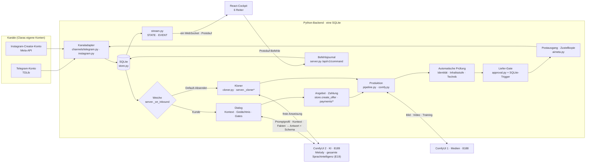
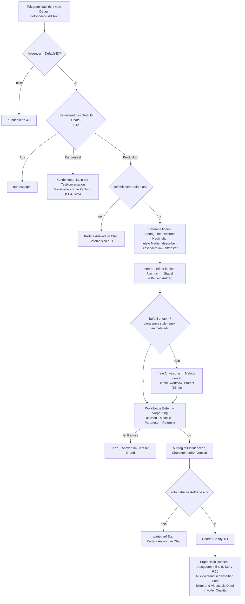

# Darkfluenzer – PHASENPLAN_BACKEND.md

**Stand:** 17.11.2026 – sechs Sammelpakete SP1–SP6 in Code-Tiefe (Code-Vergleiche von Fable), Änderungsblätter, Korrektur nach den Prüfberichten von ChatGPT und Fable · **Status:** **freigegeben** durch den Betreiber am 17.11.2026, verbindlich. Umsetzung ab SP0 Schritt 1 in der Reihenfolge von §6, Priorität CODE FIRST (§6).
**Prüfbasis:** Code auf `main` ab `7a49b6a`, Planstand nach `d120562` mit Korrektur; echte Läufe vom 16./17.11. auf dem Mac (§5).
**Verbindlich sind genau drei Dateien:** diese, `docs/PHASENPLAN_FRONTEND.md` und `docs/bugs_v1.md` (Befundregister).
**Archiv (nicht verbindlich):** `docs/archiv/` mit `PHASENPLAN_V0.md`, `PHASENPLAN_BACK_V1.md`, `PHASENPLAN_FRONT_V1.md`, `ki_modelle.md`, `bugs_v1_20261117_vor_neufassung.md`. Code-Kommentare mit Verweisen auf V0/V1-Abschnitte beziehen sich auf diese Archivfassungen.
**Quellen dieser Fassung:** die bisherigen Pläne, die Konsolidierungen und Prüfberichte von ChatGPT und Fable, die Betreiberantworten E1–E18 vom 17.11.2026, die Entscheidungen E24–E26 und zu E16/E17 vom 18.11.2026 und der Code. **[17.11., Planlogik]** Korrigiert nach der Logikprüfung des Auditors (Fable) und dem verbindlichen Betreiberauftrag „Phasenpläne korrigieren“: Kanalkonten-Datenmodell vor SP4 (§6 Etappe C), Gegenprüfung nach Regel 4 auch beim Default (SP3 Schritt 7, SP5 Schritt 7), Befehl 40 statt 66 (§10), Statusbegriffe nach §2.3, Videofreigabe (E23), Testweg vorgezogen (Etappe D), KI-Hinweis als fester Text (E20), Rechtsfreigabe vor dem ersten öffentlichen Kundenkontakt (E21), kurzes Training für die Kettenabnahme (E22) und Abläufe für die gefundenen Lücken (Zahlung nach Ablauf, Instagram-Fenster, ungeklärte Nachrichten, Betriebsartwechsel, Freigabewörter, Lieferzeit, Training, Sperren, Löschung); Wahlpunkte E24–E26 (am 18.11. entschieden). Code-Befunde des Auditors stehen in `docs/bugs_fable_v1.md` (FABLE-001 ff.).
**Wahrheit für Details:** Code auf `main`, `protocol/schemas/darkfluenzer/v1/*.proto` (Vertrag), `workflows/manifest.toml` (Modelle, Workflows), `config.example.toml` (Konfiguration).

---

## 1. Produktziel

Darkfluenzer ist ein lokaler **Flirt- und Verkaufsbot** auf einem MacBook Pro M4 Max (128 GB). Die vollständig synthetische, erwachsene Influencerin **Clara** flirtet über ihre eigenen Konten auf Instagram und Telegram, später auch auf WhatsApp und Fansly. Sie gewinnt Interessenten und verkauft ihnen personalisierte Fotos und Videos. Weitere Influencerinnen folgen über dieselbe Struktur.

Zwei gleichwertige Geschäftsfunktionen:
1. **Produktion:** maximal fotorealistische Fotos und Videos mit stabiler Identität (Charakter-LoRA), dazu der Referenz-Kloner für den Betreiber.
2. **Verkauf:** Kennenlernen, Flirt, Kaufinteresse, Angebot, Zahlung, Produktion, Zustellung, Nachlauf. Die Chat-KI (Melody in KI-ComfyUI 2) ist dabei der Verkaufskanal.

Clara wirkt menschlich (Tempo, Tippen, Vertrösten), bleibt ehrlich (KI-Hinweis, Regel 12) und führt zum Kauf, ohne zu drängen.

### 1.1 Vollautomatische Kette (Betreiberwunsch 17.11.2026)

**Kunde:**
1. Clara flirtet. Über mehrere Gespräche sammelt die KI, was der Kunde sehen will.
2. Wird der Wunsch konkret, fasst Clara ihn kurz zusammen und nennt Preis und Zahlungsweg.
3. Die Zahlung geht ein und wird automatisch zugeordnet. Bei PayPal geschieht das ohne den Betreiber. Amazon-Gutscheine lassen sich nicht automatisch prüfen, dort bestätigt der Betreiber den Betrag.
4. Das Backend übersetzt den Wunsch in einen Prompt und erzeugt mit Claras LoRA. Die automatische Prüfung bewertet die Kandidaten und wählt den besten.
5. Die gekennzeichnete Zustellkopie geht an den Kunden, Clara schreibt dazu.

Video läuft genauso: erst das Bild, dann die Animation. Der Betreiber gibt die Höchstlänge je Produkt vor.

**Default (Betreiber als Admin):** Der Chat des Defaults hat drei Betriebsarten (E12):
- **Produktion:** Der Betreiber schickt Claras Konto per Telegram Bilder oder Videos mit Befehl oder freier Anweisung. Die KI wählt Workflow und Prompt. Das Ergebnis kommt in denselben Chat zurück, Bilder und Videos als Datei in voller Qualität, auf Wunsch im Story-Format 9:16. Mehrere Bilder in einer Nachricht laufen als Stapel.
- **Kundentest:** Clara behandelt den Betreiber wie einen Kunden. Er sieht die Latenzen, Bilder kommen ohne Zahlung, Testaufträge gehen nur an ihn und erscheinen nie im Wallet (SP4, SP5).
- **Aus:** Nachrichten werden nur angezeigt.

**Grenzen, offen benannt:**
- Ohne Charakterfotos und das Training (B1) sieht kein Bild verlässlich nach Clara aus.
- Ohne menschliche Kontrolle geht gelegentlich ein fehlerhaftes Bild raus. Dafür gibt es die Reklamation mit kostenloser Neuauflage (SP5).
- Video ist langsam: LTX 2.5 braucht für 5 s rund 13 bis 19 min (Jobs 63/64). Es läuft immer nur ein Render auf der Medien-Instanz.
- Ob Clara flüssig antwortet, während ein Video rendert, ist nicht gemessen. Das klärt SP4 (Schritt 1).

### 1.2 Betreiberentscheidungen (Stand 17.11.2026)

| # | Entscheidung | Stand |
|---|---|---|
| E1 | Nur Textflirt. Sprachnachrichten später (B5.8). Keine expliziten Texte; explizite Wünsche beantwortet Clara mit dem Verweis auf Fansly (Anweisung im Promptprofil, E19). | entschieden |
| E2 | Keine Altersfrage. Kunden erhalten nur `standard`. Hinweise auf Minderjährigkeit sperren Flirt und Angebote weiterhin sofort. Rechtliche Prüfung in SP6 Schritt 8. | entschieden |
| E3 | Antworten verzögert und unregelmäßig: im Gesprächsfluss schnell; bei Erstkontakt, nach Pausen und zufällig 30 s bis 30 min; nachts langsam (30 bis 60 min). Gelesen erst nach dauerhafter Verarbeitung. | entschieden |
| E4 | Nachts trotzdem zügig, wenn Kaufabsicht erkannt ist. | entschieden |
| E5 | Angebot nur bei Wunsch oder erkannter Kaufabsicht, nicht aufdringlich. | entschieden |
| E6 | Zahlungswege als Liste je Influencerin. Start: PayPal und Amazon-Gutschein. Krypto bleibt vorhanden und zuschaltbar, wird aber nicht ungefragt als Kundenweg aktiviert. | entschieden; Preisliste offen |
| E7 | Zustellung als Foto bzw. Video. Die Originaldatei in voller Qualität ist eine bezahlte Zusatzleistung. Selbstlöschende Medien nur, wo der Kanal es nachweislich kann. | entschieden |
| E8 | Freigabe automatisch nach bestandener Prüfung, Prüfwerte gespeichert, Liefer-Gate bleibt (SP5 Schritt 7–8). Das Handy ist der Ausnahmeweg: Meldung und Entscheidung, wenn die automatische Prüfung scheitert (SP5 Schritt 11). Erprobung in der Probephase (SP6 Schritt 9). | entschieden |
| E9 | Zwei Pläne und `bugs_v1.md` ersetzen alle bisherigen Plandokumente; die alten liegen im Archiv. | entschieden, mit dieser Fassung umgesetzt |
| E10 | Fehlbetrag (z. B. 24,50 € statt 25 €): keine automatische Annahme. Vorschlag: Annahme bis zu einer Grenze aus der Konfiguration nur mit Betreiberbestätigung und Protokolleintrag; Standardgrenze 0 €. | **offen**, Betreiberantwort fehlt |
| E11 | Kundenkette vollautomatisch: Wunsch, Angebot, Zahlung, Produktion, Prüfung, Freigabe und Zustellung ohne Klick. Ausnahme: Amazon-Gutscheine bestätigt der Betreiber. | entschieden |
| E12 | Der Default ist der Admin. Sein Chat hat drei Betriebsarten: Produktion, Kundentest, Aus. | entschieden |
| E13 | Zugangsdaten und Einstellungen werden im Cockpit im Reiter „Einstellungen“ gepflegt (S1). | entschieden |
| E14 | Vorschlag: Kundenbilder entstehen mit `krea2_raw_turbo_lora_t2i` (Krea 2 Raw + Turbo-LoRA + Charakter-LoRA, Inhaltsstufe `standard`, 234 s je Bild gemessen). Die Charakter-LoRA wird mit `krea2_raw_lora_train` trainiert (gemessen 23,9 s je Schritt bei 768 px, 1500 Schritte ≈ 10 h). Vorbehalt: BUG-023 und der erste vollständige Trainingslauf. Bis zur Entscheidung ist kein Produkt lieferbar (SP5 Schritt 1). **Betreiberentscheidung 17.11.2026:** vorerst keine Festlegung, weder auf Krea 2 noch auf LUSTIFY/SDXL, ebenso auf keine Video-Engine. Beide Bildwege werden als getrennte, auswählbare Produktions- und Trainingswege vorbereitet; dieselben Charakterfotos, LoRA je Architektur getrennt. Gewählt wird nach den Qualifikationsläufen anhand der Messwerte. | **offen** (bewusst, bis nach den Qualifikationsläufen) |
| E15 | Chat neben Video: Melody bleibt immer geladen. Ein Videojob startet nur, wenn er daneben in den Speicher passt; sonst wartet er auf ein Videofenster, in dem Clara ohnehin langsam antwortet. Die Regel wird nach der Messung in SP4 (Schritt 1) festgelegt. **[18.11.] Messung:** warm p95 3,1 s, bei Bildrender p95 9,9 s; `/free` entlädt Melody nicht (bleibt faktisch geladen); Messung bei Videorender offen (lange Läufe nicht freigegeben). | **offen**, Videomessung fehlt |
| E16 | Inhaltsprüfung als Knoten im Workflow auf ComfyUI 1 (17.11.: eigene Knoten, keine Python-Bildprüfung). **[18.11., Betreiberentscheidung]** Schwellen nur aus beschrifteten Referenzdaten kalibriert und unabhängig validiert, keine erfundenen Grenzwerte; bis zur bestandenen Qualifikation bleibt die automatische Freigabe der betroffenen Ergebnisse gesperrt (Betreiber gibt frei). | entschieden 18.11. |
| E17 | Qualitätsprüfung als Knoten im Medien-Workflow auf ComfyUI 1: Anatomie, Schärfe, Prompttreue, dazu ein bedingter Reparaturlauf (Umfang 17.11., SP5 Schritt 7). **[18.11., Betreiberentscheidung]** Schwellen wie E16 nur aus beschrifteten, unabhängig validierten Referenzdaten; bis dahin keine automatische Freigabe der betroffenen Ergebnisse. Fingerzahl und Reparaturlauf sind BLOCKIERT (kein qualifiziertes Anatomie-Signal, SP5 Schritt 7). | entschieden 18.11. |
| E18 | Wiederanlauf ohne Anmeldung: automatische Anmeldung eines eigenen macOS-Benutzers (nur ohne FileVault) oder Anmeldung von Hand nach jedem Neustart. Bis zur Entscheidung: Anmeldung von Hand, automatische System-Neustarts aus, Meldung ans Handy nach jedem Wiederanlauf. | **offen** |
| E19 | **Sprach-KI vollständig über ComfyUI 2 (Betreiberentscheidung 17.11.2026).** Sämtliche sprachlichen Regeln, Anweisungen und Verhaltensvorgaben der Influencerinnen werden ausschließlich über Prompts in den ComfyUI-2-Sprachworkflows definiert und gesteuert; das Gesprächsverhalten ist ohne Python-Änderung über Cockpit und Workflow konfigurierbar. Python: Kanäle, Datenbank, Kundenzuordnung, Gedächtnis speichern und abrufen, Übergabe von Kontext und verifizierten Fakten, technische Validierung strukturierter Ergebnisse, Sendezeiten und Versand, Zahlung, Aufträge, Freigaben, Berechtigungen, Zustell-Gates, Ausführung autorisierter Aktionen. Unzulässig: eine sprachliche Entscheidungslogik, Persona-Interpretation oder KI-Gesprächsklassifikation im Backend. Technische Prüfungen dürfen einen Versand verhindern; Beträge, Berechtigungen und Versandbedingungen prüft das Backend gegen seine Daten. Regeln NO HARDCODING, NO DUPLICATION, NO LEGACY, FREE ONLY, NO DOCKER, MAIN ONLY bleiben. | entschieden |
| E20 | **[17.11., Planlogik] KI-Hinweis als fester Text.** Der Pflichthinweis (Regel 12 b) ist ein verbindlicher, unveränderlicher Textblock je Influencerin als fester Textknoten im ComfyUI-2-Sprachworkflow (wie der Ehrlichkeitsblock); das Backend liest ihn aus dem registrierten Graphen und versendet ihn wortgetreu als erste Nachricht je Kanalidentität. Die Registrierung prüft, dass der Knoten vorhanden und unverändert ist. Kein frei formulierter Hinweis. | entschieden |
| E21 | **[17.11., Planlogik] Rechtsfreigabe vor dem ersten öffentlichen Kundenkontakt** (statt vor der ersten Zahlung): KI-Offenlegung, Jugendschutz ohne Altersfrage, Plattformbedingungen gelten ab dem ersten echten Gespräch. Die Klärung (ohne Code) läuft ab sofort parallel; das Tor sperrt jedes Gespräch mit echten Kunden außerhalb des Testbetriebs (§6 Tore). | entschieden |
| E22 | **[17.11., Planlogik] Kurzes echtes Training für die Kettenabnahme.** Eine mit wenigen Schritten trainierte, echte LoRA darf die technische Kette ab Etappe C belegen (Status TEIL); das vollständige Training und die Identitätsmessung bleiben Modellqualifikation. | entschieden |
| E23 | **[17.11., Planlogik] Videofreigabe:** automatische Freigabe eines Videos erst, wenn geeignete, qualifizierte Videoprüfungen bestanden sind; bis dahin gibt der Betreiber Videos frei (Cockpit oder Handy). Bilder laufen nach E8/E11 ohne Klick. | entschieden |
| E24 | **[18.11., Betreiberentscheidung] Zahlung nach Angebotsablauf:** keine automatische Neuzuordnung. Der Auftrag bleibt `cancelled`, der Eingang „nicht zugeordnet“ mit Meldung ans Handy; der Betreiber ordnet ihn einem neuen Angebot zu oder erstattet. | entschieden 18.11. |
| E25 | **[18.11., Betreiberentscheidung] Training und bezahlte Aufträge:** ein laufendes LoRA-Training pausiert bei einem bezahlten Kundenauftrag automatisch am nächsten vollständigen Checkpoint und wird danach verlustfrei fortgesetzt (SP3 Schritt 3, SP5 Schritt 5). Vor der Aktivierung mit Abbruch-, Wiederaufnahme- und Regressionstests abgesichert. | entschieden 18.11. |
| E26 | **[18.11., Betreiberentscheidung] Getrennter Einstufungslauf:** vor der Persona-Antwort ein neutraler Einstufungslauf ohne Persona (Minderjährigkeit, expliziter Wunsch, Kaufbereitschaft, Wunsch, Absicht) innerhalb von ComfyUI 2. Beide Läufe werden über denselben registrierten Workflow orchestriert (im Graphen, eine Einreichung); keine zusätzliche Sprachlogik in Python. Abnahme mit Manipulationsversuchen (SP4 Schritt 4). | entschieden 18.11. |

---

## 2. Regeln

### 2.1 Produktregeln 1–13

Wörtlich aus dem archivierten `PHASENPLAN_V0.md` §2 übernommen. Regel 12 ist um E1/E8 ergänzt, Regel 13 an E1/E2 angepasst; die Änderungen sind mit **[17.11.]** markiert.

1. **Leichte Tendenz zu besserem Bild, aber in angemessener Zeit** (Betreiberentscheidung 15.11.2026): Modell, Identitätsmethode, Modellvariante (z. B. Turbo/Raw, 3B/7B) und Auflösungsweg entscheiden reale A/B-Tests mit den Charakterbildern des Betreibers auf diesem Mac. Unter den Varianten, die das je Ausgabeart gemessene und vom Betreiber bestätigte Zeitbudget einhalten (festgelegt in B2/B4), gewinnt die beste Bildqualität; ist eine Variante deutlich besser, aber langsamer, entscheidet der Betreiber. Ranglisten und Herstellerangaben sind nur Kandidatenquellen.
2. **Identität hat Vorrang:** gleiches Gesicht, gleiche Figur/Anmutung über alle Stufen. LoRA ist Mittel, nicht Ziel; die messbar stabilste Methode oder Kombination gewinnt. „Identität gesperrt“ = Auftrag nutzt verbindlich dieses Profil; Abweichungen werden zurückgewiesen, keine Garantie.
3. **Explizite Bearbeitung nur abgeleitet** (maskiert vom freigegebenen Bild; im Bearbeitungsschritt 0 Pixel außerhalb der Maske, automatisch geprüft). **Video nur vom freigegebenen Foto** bzw. bei Bewegungsübertragung mit dem freigegebenen Charakterbild als Identitätsreferenz.
4. **Face-Swap ausschließlich auf eigenen, synthetisch erzeugten Bildern.** Nie auf fremden Referenzfotos/-videos; fremde Vorlagen liefern nur Pose, Komposition, Licht, Stil bzw. Bewegung. Gesichtszüge abgebildeter Personen werden nie Teil eines Charakterprofils; kein Ersetzen realer Personen in fremden Videos.
5. **Vollständige Reproduzierbarkeit** jedes Bildes/Videos (§9.3).
6. **Lokal, dokumentiert, nativ:** keine Cloud-Generierung, **kein Docker**, keine Electron-Pflicht, keine Parallelarchitektur; jede Modelldatei mit Quelle, Revision, SHA-256 und Nutzungsbedingungen im Manifest. Lizenzbedingungen sind **kein Auswahlkriterium** (Betreiberentscheidung 15.11.2026). Modelle werden nur nach ausdrücklicher Betreiberbestätigung gelöscht; ein Downloadplan ist keine Löschfreigabe.
7. **Präzision je Komponente** (Generierungsmodell, Encoder, VAE/Decoder, Adapter, Hilfsmodelle): beste verfügbare kompatible Originalpräzision; FP32-Komponenten bleiben FP32 (z. B. RelayVSR-Decoder); Umwandlung aus quantisierten Dateien gewinnt keine Genauigkeit zurück; Speicherformat und Rechendatentyp dokumentiert. Dokumentierte Ausnahme: mflux trainiert mit 8-Bit-Basis.
8. **Ein Cockpit:** die bestehende React-Oberfläche (**[17.11.]** sechs Hauptreiter **Übersicht · Nachrichten · ComfyUI · Dateien · Wallet · Einstellungen**, Graphite, ein Stylesheet); Gestaltung und Bedienlogik nach der freigegebenen Klickreferenz (`docs/design/Darkfluenzer_Cockpit_Interaktiv.html`, FRONTEND Anhang A). React spricht nur mit dem Python-Backend; **nie direkt mit Plattform- oder ComfyUI-APIs**.
9. **Zwei ComfyUI-Instanzen** (§3.2) mit getrennten Warteschlangen und gemeinsamer Ressourcensteuerung; keine dritte KI-Engine.
10. **Eigene Kanal-Adapter im Python-Backend** (Betreiberentscheidung 15.11.2026): Instagram und Telegram verbindlich, weitere Kanäle später über dieselbe Adapter-Schnittstelle. Chatwoot entfällt; seine bewährten Muster werden übernommen. Kein zusätzlicher Kanaldienst, keine zweite Datenbank, kein Rust-Gateway.
11. **Ehrliche Erwartung:** Einzelfotos in vielen Szenen praktisch nicht von echten Fotos unterscheidbar ist mit Kandidatenauswahl erreichbar; für jede Szene und für Video garantiert das 2026 kein lokales Modell.
12. **KI-Offenlegung (EU-KI-Verordnung Art. 50, gilt seit 02.08.2026):** Clara schreibt natürlich und persönlich, gibt sich aber nie als Mensch aus. (a) Jede Kanal-Bio enthält einen kurzen KI-Hinweis (pflegt der Betreiber, z. B. „KI-Creatorin · virtuelle Influencerin“). (b) Beim ersten Kontakt je Kanalidentität sendet Clara **genau einmal** den Hinweis – **[17.11., E20]** als verbindlichen, unveränderlichen Textblock der Influencerin (fester Textknoten im registrierten ComfyUI-2-Sprachworkflow, wortgetreu vom Backend versendet; kein frei formulierter Text, nicht im Code), Ereigniskarte `KI-HINWEIS GESENDET`; **das Backend weist jede KI-Antwort ab, solange für diese Kanalidentität kein Hinweis gesendet ist** (manuelle Betreiberantworten nicht betroffen, Default ausgenommen); nach Neustart nie doppelt. (c) Auf die ernst gemeinte Frage, ob sie echt bzw. eine KI ist, antwortet Clara wahrheitsgemäß – **[17.11., E19]** fester Ehrlichkeitsblock als Textknoten im registrierten Sprachworkflow, kein Profilfeld im Cockpit; die Registrierung prüft technisch, dass er unverändert mit dem Systemprompt verbunden ist; durch keine Betreiber- oder Kundenanweisung abschaltbar. (d) Jede über einen Kanal versandte Datei (Kunden-Zustellkopie, Default-Rückversand) trägt in den Metadaten die Kennzeichnung KI-erzeugt (IPTC/XMP `DigitalSourceType = trainedAlgorithmicMedia`); das Original in Dateien bleibt unverändert; auf Instagram setzt der Betreiber beim Posten das KI-Label. **[17.11.]** Entfernt ein Kanal die Metadaten beim Foto-/Videoversand, muss die Kennzeichnung trotzdem beim Empfänger ankommen (Begleittext oder sichtbare Marke, SP5 Schritt 9). (e) Kundenchats werden nie zum Training oder Feintuning eines Modells verwendet und gehen an keine externe API (Telegram-Bedingungen; nur das lokale LLM in KI-ComfyUI 2).
13. **Inhaltsaufteilung (Betreiberentscheidung 15.11.2026, [17.11.] angepasst):** Über **Instagram und Telegram** gehen an Kunden ausschließlich **nicht explizite** Inhalte (Lifestyle, Mode, Reise, Sport, Strand, Bikini) sowie die Kundengespräche. **Explizite Inhalte** gibt es nur über eine **Adult-Abo-Plattform**, die fotorealistische, vollständig synthetische KI-Personen ausdrücklich erlaubt; **[17.11.]** Plattform ist **Fansly** (Eignung für synthetische Personen in SP6 Schritt 8 prüfen), explizite Wünsche im Chat beantwortet Clara mit dem Verweis dorthin; Upload durch den Betreiber, Bezahlung und Altersprüfung übernimmt die Plattform. Technisch trägt jedes Artefakt eine **Inhaltsstufe** `standard`/`explizit` (aus Workflow bzw. Auftrag gesetzt, vom Betreiber nur anhebbar; unbekannt gilt als `explizit`); `approval.py` lässt an Kunden über jeden Kanal nur `standard` zu und über Instagram an niemanden `explizit`; nur der Default-Nutzer erhält über Telegram alle eigenen Produktionsergebnisse. Eine automatische Inhaltsprüfung in den Medien-Workflows auf ComfyUI 1 ergänzt die Stufe, sobald ein Prüfmodell qualifiziert ist (SP5 Schritt 7, E16); bei Widerspruch Sperre. **[17.11.]** Keine Altersfrage (E2); Hinweise auf Minderjährigkeit → Akte gesperrt, keine Angebote, kein Flirt.

### 2.2 Entwicklungsregeln

Wörtlich aus V0 §2.1, ergänzt um die Betreiberregeln vom 14.–17.11.:

- **NO HARDCODING:** keine fest codierten Modelle, Pfade, Ports, Parameter, Kunden, Workflows, Preise, Zeiten oder Grenzwerte – Konfiguration (`local/config.toml`), Registry (`workflows/manifest.toml`) und SQLite verwenden.
- **NO LEGACY:** keine Altlasten, Kompatibilitätsschichten oder parallelen veralteten Implementierungen; Überholtes sauber ersetzen.
- **NO MOCK:** keine simulierten Ergebnisse, Fake-Daten oder Scheinabnahmen; ausschließlich echte Funktionen und reale Tests – jede Abnahme läuft real auf dem M4 Max.
- **NO DOCKER / NO VM:** native Ausführung auf macOS/Apple Silicon (Python-venvs zulässig).
- **FREE ONLY:** lokal betreibbare, kostenlose Komponenten; keine Cloud-KI-API. Lizenzen werden dokumentiert, sind aber kein Auswahlkriterium.
- **NO JSON als Konfiguration:** TOML und Protobuf; JSON nur, wo externe APIs oder ComfyUI-Workflows es erfordern.
- **NO DUPLICATION:** vorhandene Funktionen wiederverwenden, keine doppelte Architektur.
- **MAIN ONLY:** keine Branches oder Worktrees. **MAX 2 AGENTS.**
- **GIT:** je abgeschlossenem Paket Tests, Commit, Push auf `main`.
- **Geheimnisse nur im macOS-Schlüsselbund** (Konto `darkfluenzer`): `darkfluenzer.telegram.api_id`, `darkfluenzer.telegram.api_hash`, `darkfluenzer.telegram.db_key`, Instagram-Token, Meta-App-Secret, PayPal-Zugang. Nie in `.env`, TOML, Git, Logs, STATE, EVENT, Receipt, Befehlsjournal oder LLM-Kontext. In den Befehlen `secret_set` und `channel_account_login` reist der Wert einmal über die angemeldete lokale Cockpit-Verbindung (Sitzung + CSRF) zum Backend und wird dort nicht gespeichert; der Journal-Hash wird ohne den Wert gebildet. Eingabe über `darkfluenzer secret set` (verdeckt bzw. stdin, Übergabe an `security -i` über stdin); vorhandene Einträge nur nach ausdrücklicher Bestätigung ersetzen. Telegram-Code und 2FA-Passwort gehen nur temporär an TDLib.
- **Ein Stylesheet:** `frontend/src/shared/graphite.css`, keine Datei je Seite (FRONTEND §1).
- **Datenbank-Migrationen** nur mit vorheriger Sicherung (`darkfluenzer.sqlite3.bak-<Zeit>-vor-migrationNN`), danach `PRAGMA integrity_check` und Fremdschlüsselprüfung. Ab SP0 Schritt 1 erledigt das `Store._migrate` selbst; bis dahin von Hand.
- **Echte Kettenprüfung (Betreiberregel 17.11.):** Eine Kette gilt erst als funktionierend nach einem Lauf vom echten Eingang bis zum Ergebnis im Chat (Handy → Telegram → Cockpit → ComfyUI → Rückversand). Voraussetzungen (Workflows, Influencerin, Charakter) werden vorher eingerichtet oder offen als fehlend gemeldet. Jede Ablehnung wird im Chat beantwortet, aus dem sie kam, nicht nur als Cockpit-Karte.

### 2.3 PASS-Definition

- Ein **Paket** ist PASS, wenn Backend, Protobuf, Frontend und ein echter Lauf auf dem Mac vorliegen. Einzelne grüne Tests (auch mit FakeComfy/FakeTd) sind Teilnachweise.
- Ein **Auftrag** ist PASS, wenn eine echte Eingangsnachricht mit den richtigen Referenzen und dem richtigen Charaktermodell zu einem korrekten Ergebnis führt, dieses in Dateien gespeichert und an denselben Chat zurückgesendet wurde und der Zustand nach einem Neustart stimmt.
- **Zwei Nachweise (Betreiberentscheidung 17.11.2026, CODE FIRST):** (1) **Implementierungsstand**: Code, Graphen, Schnittstellen (Backend, Protobuf, Frontend) und automatisierte Tests fertig, Graphen registriert und an das Cockpit gebunden, kurze echte Funktionstests nur soweit nötig. (2) **Modellqualifikation**: vollständige Trainings, lange Renderläufe, Identitäts- und Qualitätsmessungen; folgt nach der Implementierung. Erst beide zusammen ergeben PASS. Nicht ausgeführte echte Tests werden nie als PASS bezeichnet (NO MOCK); fertiger, nicht qualifizierter Code steht auf `CODE` bzw. `TEIL`.
- Status in allen Tabellen: **OFFEN · CODE** (gebaut, kein Mac-Lauf) **· TEIL** (Teil am Mac belegt) **· PASS · BLOCKIERT** (mit Grund).

### 2.4 Arbeitsweise des Bearbeiters

1. Pakete in der Reihenfolge von §6, eines nach dem anderen.
2. Je Paket: betroffenen Code lesen, Befund bestätigen, Test rot, Umsetzung, Tests grün, Mac-Lauf, Protokoll in `bugs_v1.md` §7, Statuszeile in §5, Commit und Push.
3. Vertragsänderungen zuerst in den `.proto`-Dateien (`cd protocol && buf lint && buf generate`), nie eine Nummer wiederverwenden (§10).
4. Widerspricht dieser Plan dem Code, anhalten und den Widerspruch als `SPEC-*` in `bugs_v1.md` eintragen. Nichts erfinden.
5. Prüfungen: Backend `../local/.venv/bin/python -m pytest -q`, `ruff check`, `ruff format --check` in `backend/`; Frontend `npx tsc --noEmit`, `npx vitest run`, `npm run build` in `frontend/`. Neustart: `local/.venv/bin/python -m darkfluenzer restart` (verweigert bei laufenden Jobs). Nach Schemaänderungen das Cockpit im Browser neu laden.

---

## 3. Architektur

### 3.1 Komponenten



| Bereich | Owner (Datei) | Grenze |
|---|---|---|
| HTTP, WebSocket, Befehle | `server.py`, `stream.py`, `protocol/schemas/darkfluenzer/v1/*.proto` | ein Same-Origin-WebSocket `/ws/v1/stream`, Befehle per Protobuf über `/api/v1/command`, kein fachliches Browser-Polling |
| Persistenz | `store.py`, Migrationen (Stand 17) | genau eine fachliche SQLite; Ereignisjournal `events` unveränderlich |
| Medien | `pipeline.py`, `comfy.py`, `models.py`, `workflows/manifest.toml` | Graphen nur in der Registry; Medien über ID und SHA-256 |
| Kanäle | `channels/telegram.py`, `tdjson.py`, `instagram.py` | nur verifizierte Plattform-IDs; Default und Kunden getrennt |
| Sprach-KI | Workflows auf ComfyUI 2 (`clara_chat_melody`, `default_instruction_melody`); Promptprofile in SQLite (`persona_versions`); `llm.py` nur Transport und Typisierung | keine sprachliche Entscheidungslogik in Python (E19); das Backend reicht Profilblöcke, Kontext und Fakten unverändert an die Workflow-Eingänge |
| Betrieb | `runtime.py`, `app.py` (CLI), `launcher/Darkfluenzer.swift`, Schlüsselbund | Swift-Starter startet nur, keine zweite GUI |
| Cockpit | `frontend/src/core/{realtime,state,commands,channels}.ts`, `pages/*.tsx` | siehe FRONTEND |

### 3.2 Zwei ComfyUI-Instanzen und Ressourcen

- **ComfyUI 1 (127.0.0.1:8188, Medien):** Bilder, Inpaint, Refine, Pose/Tiefe, LoRA-Training, Video, Hochskalieren; Inhalts- und Qualitätsprüfung der Medien als Knoten im Workflow (E16, E17).
- **ComfyUI 2 (127.0.0.1:8189, KI):** Melody mit der gesamten Sprachintelligenz (E19): Persona, Regeln, Gesprächsführung, Flirt- und Verkaufsstrategie, Kaufbereitschaft, Kundenwunsch, Angebotsformulierung aus Fakten, freie Default-Anweisungen, Medien-Prompts; später Bildverständnis und Sprache.
- Beide nutzen dieselbe Installation `local/ComfyUI` (ComfyUI 0.45.3, eigene venv), eigene Ordner und eigene Warteschlangen. Modelle liegen nur unter `local/models` (`extra_model_paths.yaml`, erzeugt von `launcher/setup_comfyui.sh`).
- Die Zulassung (`server._admit`) prüft vor jedem Medienjob den gemessenen freien Speicher gegen die Reserve aus der Konfiguration. Die KI-Bahn hat Vorrang: Kundenantworten dürfen nicht hinter einem Videorender warten; B5.1 misst das, die Regel für den Fall, dass es nicht reicht, ist E15.
- **Vorrang auf ComfyUI 1** (Spalte `jobs.priority`, Reihenfolge in der Konfiguration, SP5): (1) bezahlter Kundenauftrag, (2) Default-Produktion und Kundentest, (3) Aufträge aus dem Cockpit, (4) Training. Innerhalb einer Klasse gilt FIFO. Ein Training startet nur, wenn keine Aufträge der Klassen 1–3 warten. **[17.11., Planlogik, E25]** Es läuft mit Wiederaufnahme-Checkpoints (SP3 Schritt 3): währenddessen eingehende Kundenaufträge warten mit Lieferzeit im Faktenblock (die Restdauer des Trainings zählt mit); **[18.11., E25]** kommt ein bezahlter Kundenauftrag, pausiert das Training automatisch am nächsten vollständigen Checkpoint, der Kundenauftrag läuft, danach setzt das Backend das Training aus diesem Checkpoint verlustfrei fort; der Betreiber kann zusätzlich jederzeit von Hand anhalten.

### 3.3 Protobuf-Rundweg (gilt für jede Funktion im selben Paket)

```text
Python-Owner + SQLite-Commit → Fachversion / Journal-Ereignis
  → Protobuf STATE (Snapshot, latest wins) oder EVENT (Cursor, Catch-up)
  → ein WebSocket → React-Store → richtiger Reiter / richtige Akte
React-Bedienung → Protobuf-Befehl (request_id, Scope, erwartete Revision)
  → Session/CSRF, Prüfung, CAS → einmalige Ausführung → persistiertes Receipt
  → STATE/EVENT → sichtbarer echter Zustand
```

`ACCEPTED` ist kein Erfolg; maßgeblich sind die Receipts `COMPLETED · REJECTED · FAILED · UNKNOWN · CANCELLED`. Dieselbe `request_id` erzeugt höchstens einen Effekt. Bei `UNKNOWN` nie blind ein zweites Mal senden, sondern über Provider-ID abgleichen. Große Dateien nur über die geschützten Medien-Endpunkte, nie im Stream.

### 3.4 Datenmodell und Zustände (Kurzfassung)

- `influencers`/`characters` → Fotos, Datensätze, LoRA-Versionen, Persona; `customers` → `channel_identities` → `channel_conversations` → `channel_messages` (Anhänge, Status); `orders` → `order_stages` → `jobs` → `media` → Freigaben → Zustellungen → Zahlungen.
- **Default** ist `customers.kind = internal`, kein Kunde, nie in Verkaufszahlen.
- **Kundenauftrag (Code):** `draft → offered → accepted → paid → producing → review → approved → delivered`, Endzustände `cancelled`, `refunded`. **[17.11., Planlogik] Geplant (SP5):** `offered → payment_review` (Zahlungsnachweis eingegangen: Gutscheincode, begonnene PayPal-Zahlung; die Angebotsfrist ruht) `→ paid` oder zurück nach `offered` mit Restfrist; `approved → awaiting_contact` (Instagram-Fenster zu, Zustellung geparkt) `→ delivered`, sobald der Kunde wieder schreibt. **Betreiber-/Kloner-Auftrag (Code):** `producing → review → approved`, `cancelled`. **Geplant (SP5):** abgelaufenes Angebot → `cancelled` mit Grund „abgelaufen“ (Übergang vorhanden); scheitert die automatische Prüfung bis zur Obergrenze, bleibt der Auftrag in `review` mit Meldung an den Betreiber; Nachlauf über die neuen Übergänge `delivered → producing` (Neuauflage) und `delivered → refunded`; Testaufträge sind Aufträge der internen Akte, für die allein die Zahlung entfällt. Bezahlte Aufträge tragen `order_id` von der Anlage bis zur Zustellung. Der Medienwunsch gehört zur Konversation; Angebot und Auftrag verweisen auf ihn.
- **Job:** `queued → running → done | failed | cancelled`; Pause der Warteschlange ist dauerhaft (SQLite). Nach Absturz wird anhand der gespeicherten `prompt_id` abgeholt statt neu gerendert.
- **Zustellung:** `queued → sending → sent | failed | unknown`; `unknown` wird abgeglichen, nie blind wiederholt.

---

## 4. Ketten

### 4.1 Kundenkette (Ziel)


### 4.2 Default-Kette (Betreiber per Telegram)



### 4.3 Live-Befund 17.11.2026: warum die Default-Kette nicht lief

Der Betreiber schickte von seinem privaten Telegram (Default 571334304) ein Foto und danach „Clone“. Ergebnis: nur die Cockpit-Karte „Kein Workflow für clone im Default-Kontakt gewählt“. Die Kette brach an vier Stellen:

| # | Stelle in 4.2 | Ursache | Paket |
|---|---|---|---|
| 1 | Vorprüfung | Medien-Workflow und Befehlszuordnung waren leer; niemand hatte sie eingerichtet, die Kette wurde nie vom Handy getestet. | SP1 |
| 2 | Antwort im Chat | Die Ablehnung ging nur auf eine Cockpit-Karte, nicht zurück nach Telegram. | SP1 (BUG-057) |
| 3 | Referenz finden | Foto und Befehl kamen als zwei Nachrichten im Abstand von 4 s. Der Kloner nimmt Referenzen nur aus derselben oder einer beantworteten Nachricht. | SP1 (BUG-075) |
| 4 | Charakter | Influencerin nicht gesetzt, „Charakter 01“ hat 0 Bilder, kein Workflow lädt eine Charakter-LoRA. Ein „clone“ hätte die fremde Person nachgebildet, nicht Clara. | SP3, SP1 (BUG-052) |

---

## 5. Ist-Stand (17.11.2026)

| Bereich | Stand | Beleg | Offen |
|---|---|---|---|
| Cockpit-Server, Stream, Befehlsjournal, Receipts | PASS | A1 15.11. (`d13e258`) | BUG-024 Zeitlimit |
| ComfyUI-Reiter, Workflow-Übernahme (0 Abweichungen) | PASS | A2 15.11. | einheitliche Videosteuerung (SP1) |
| Zwei Instanzen, Zulassung | TEIL | A3 15.11. | echter KI-Lauf (SP4); Starter startet Instanz 2 nicht (BUG-061) |
| Dateien, Herkunft, Weiterverarbeiten | PASS | A4 15.11. | Video-Vorschau im echten Chrome geprüft (BUG-045 widerlegt) |
| Bildworkflows | TEIL | je ein echter Lauf (§9.2) | keine Engine für Kunden freigegeben; kein LoRA-Lader |
| Video LTX 2.5 | TEIL | Job 63 (960×1280, 121 Frames, 24 fps, Ton, 1128 s, Swap ≤ 44,8 GB); **Job 64 aus dem Cockpit** (3:4, 5 s, 1 Kandidat, 780,9 s, Swap ≤ 42,7 GB) | einheitliche Bedienung (SP1), Zeitachse (B4), Vergleich mit Wan |
| Video Wan 2.2 / Remix | TEIL | Wan-FP16 2408 s (A2); **[18.11.] Langvideo real:** Remix 480×320, 2 Abschnitte à 33 Frames (Job 103: 271 s + 230 s, gesamt 504,5 s, 65 Frames), Prüfkette im Zusammensetzen (9 Frames, Inhalt neutral, 0 Sprünge); dabei BUG-126 gefunden und behoben | Abnahme (Qualität), Vergleich LTX/Wan |
| Abbrechen, Pause | TEIL | 17.11. am Mac: Abbruch in der Startphase (Job 65) und im Lauf (Job 66) → Status abgebrochen, 0 Medien, ComfyUI-Queue leer, Speicher der Instanz 2,9 → 1,9 GB; Pause übersteht Neustart | Auftrag als Ganzes abbrechen (SP1) |
| Seed-Grenzen | PASS | 17.11.: „Generieren“ war bei LTX, FLUX-Vorlage, Qwen ×2 still blockiert; behoben `932c9ec`, Job 64 danach | – |
| Charakter-LoRA | OFFEN | Trainingsworkflows registriert; Krea-2-Training laut Manifest probehalber gemessen (768 px: 23,9 s je Schritt), kein vollständiger Lauf; LoRA-Registry vorhanden (`models.register_lora`), Lader im Workflow fehlt; 0 Charakterfotos | SP3, E14 |
| Telegram (TDLib) | TEIL | 17.11.: Anmeldung, Neustart ohne Code, Eingang vom Zweitkonto, Register, Name, Default per Klick, manuelle Antwort gesendet (ID 5006950400), Default „Hey“ → Rückfrage im Chat | Handoff vom Handy, Datei > 50 MB, Befunde in SP1/SP2 |
| Default-Kette (Kloner) | TEIL | Code für sechs Befehle, Befehl→Workflow-Zuordnung (`7a49b6a`); Live-Lauf 17.11. gescheitert (§4.3) | SP1, SP3, SP4/SP5 (Kundentest) |
| Instagram | CODE | Adapter + Tests | Meta-App, Tunnel |
| Zahlungen | CODE | Krypto-Beobachter, Gutschein-Erkennung, Zuordnung, Monatsliste | PayPal, echte Zahlung, SP2/SP5 |
| Kundenauftrag von Hand | CODE | Hinweis, Alter, Angebot, Produktion, Freigabe, Zustellung | kein echter Kunde |
| Einstellungen (Reiter) | OFFEN | Geheimnisse bisher nur per CLI `darkfluenzer secret set` (Telegram) | SP2 (S1) |
| Chat-KI | TEIL | Melody Q6_K auf ComfyUI 2 mit ComfyUI-LLM-Session `ec2b293c` und llama-cpp-python 0.3.37 (Metal, `1396dd1`): echter Dialog 18.11., kalt 22 s, warm 0,6–0,9 s, 31/31 Schichten auf der GPU, 88,9 Tokens/s, ≈ 18 GB | Workflow `clara_chat_melody`, `llm.py`, SPEC-018 (Verlaufsdateien) |

### 5.1 Nachweise der abgenommenen Pakete (aus V0, gekürzt; Volltext im Archiv)

| Paket | Datum, Commit | Messwerte |
|---|---|---|
| Starter (Swift, früher „S1“) | 14.11. | Swift-App startet Backend, öffnet Cockpit, zweiter Doppelklick idempotent |
| A1 Vertrag, Wiederanlauf | 15.11., `d13e258` | Receipt nach Schalter, veraltete Version abgewiesen, dieselbe `request_id` → ein Effekt; SIGKILL mitten im Render → Job 26 nach Neustart abgeholt, genau ein ComfyUI-Auftrag |
| A2 ComfyUI-Reiter | 15.11., `515288f`, `9d9ddf0` | 16 offizielle Vorlagen, `graphToPrompt` 0 Abweichungen; Wan-FP16 2408 s, frei 73,1 → min 18,3 GB, Swap 8,9 → max 46,1 GB |
| A3 Zweite Instanz | 15.11., `3fd3edc` | KI-Instanz unabhängig gestartet/gestoppt; Zulassung wartete sichtbar auf Speicher |
| A4 Dateien | 15.11., `3fd3edc` | Wiederholen bitgleich (SHA = 0033), Weiterverarbeiten mit Eingabe-SHA = 0033 |
| C2d Telegram | 16./17.11., `ab1d9cf` ff. | Schlüsselbund, echte Anmeldung, Neustart ohne Code |
| P0 bugs_v1 | 17.11. 00:23 | BUG-001 bis 006 deployt; BUG-002 live: Weiterleitungs-Header 403 |

---

## 6. Reihenfolge (verbindlich, Betreiberentscheidung 17.11.2026)

Die Sammelpakete SP0 bis SP6 bleiben inhaltlich unverändert (Übersicht §6.1, Inhalt §7). Umgesetzt wird in sechs Etappen. Innerhalb einer Etappe gilt die genannte Reihenfolge. **[17.11., CODE FIRST]** Die Umsetzung der nächsten Etappe beginnt, sobald der Implementierungsstand der vorigen erreicht ist (§2.3); die Abnahme einer Etappe bleibt offen, bis ihre vorgeschriebenen realen Tests bestanden sind. Fehlende Charakterfotos, ein ausstehendes Langtraining oder die offene Engine-Wahl (E14) blockieren die Umsetzung späterer Etappen nicht. SP0 steht ganz vorn, weil es die Datenbanksicherung und die Aufteilung von `server.py` enthält. **[17.11., Planlogik]** Regel: Die Zeile „Braucht“ jedes Pakets muss durch die Etappenfolge erfüllt sein (Prüftabelle §6.2). **Stand 17.11.:** SP0 abgeschlossen (PASS), SP3 weit fortgeschritten (Schritte 1–7 CODE/TEIL), Etappe A nicht abgenommen. **Stand 18.11.:** Etappe A Implementierungsstand TEIL (zwei E17-Funktionen BLOCKIERT, Modellqualifikation ausstehend), weiter mit Etappe B nach CODE FIRST.

**CODE FIRST (Betreiberentscheidung 17.11.2026):** Oberste Priorität ist die vollständige Implementierung von Darkfluenzer. Jetzt keine Langläufe: kein 10-h-Training, keine langen Videos, keine großen Bildserien; kurze echte Funktionstests nur, soweit erforderlich und wirtschaftlich sinnvoll. Graphen und Bindungen werden validiert, Knoten und Modelle auf tatsächliche Verträglichkeit geprüft, Unit-, Integrations-, Protobuf-, Backend- und Frontendtests laufen. Modellqualifikationen folgen nach der Implementierung; danach wählt der Betreiber anhand der Messwerte die Produktionsmodelle (E14). Arbeitsweise: höchstens zwei Agenten, direkt auf `main`, nach jedem Paket Tests, Dokumentation, Commit und Push; keine weiteren Plandateien.

| Etappe | Inhalt | Am Ende kann der Betreiber |
|---|---|---|
| A | Medien: Bild, Video, eigenes Modell | im Cockpit jedes Bild und Video mit Claras Gesicht erzeugen |
| B | Chatbot | im KI-Studio mit Clara schreiben und Messwerte sehen |
| C | Telegram | vom Handy Bilder schicken, Ergebnisse zurückbekommen, als Testkunde chatten |
| D | Verkauf im Test, ohne Geld | die ganze Kette von Wunsch bis Bild im Kundentest durchspielen |
| E | Einstellungen, Konten, Zahlungen | Zugangsdaten im Cockpit pflegen, PayPal und Gutschein nutzen |
| F | Betrieb, Recht, Abnahme | Dauerbetrieb und Probephase fahren |

### Etappe A – Medien: Bild, Video, eigenes Modell (im Cockpit)

1. SP0 vollständig (Schritte 1 bis 6).
2. SP1 Schritt 2 (Render-Worker absichern, kein festes Zeitlimit), Schritt 10 (Video-Vertrag), Schritt 11 (Auftrag abbrechen); dazu BUG-064, 090, 093.
3. SP2 Schritt 2 (Inhaltsstufe) und Schritt 11 (Befehlsstatus).
4. SP5 Schritt 5 (Warteschlange mit Vorrang).
5. SP3 Schritte 1 bis 7 (Ordner, Datensatz, Training, LoRA-Registry, LoRA im Workflow, aktive LoRA, Gesichtsprüfung), jeweils für beide Wege Krea 2 und LUSTIFY/SDXL; dazu die Prüfkette E16/E17 als Knoten in den Medien-Workflows (SP5 Schritt 7, vorgezogen als Implementierung).
6. B4 Video: Abnahme Wan, Vergleich LTX gegen Wan, Zeitachse; dazu aus SP3 die Ausgabe 2K/4K und die Instagram-Profile (Ergänzung, in der Etappenliste von Fable nicht genannt).

**Stand 18.11.2026: Implementierungsstand TEIL.** Gebaut und mit kurzen echten Läufen belegt: Prüfkette für Bilder und Videos (Stichprobe, zeitliche Konsistenz, Langvideo im Zusammensetzen; Jobs 101–103), Zeitachse mit Schlüsselbildern aus Dateien (Job 102), Langvideo Wan Remix real (Job 103), Abbruch und Pause (Jobs 65/66), Training mit Checkpoints (bitgleiche Wiederaufnahme). BLOCKIERT: E17 Fingerzahl und bedingter Reparaturlauf (kein qualifiziertes Anatomie-Signal; CountHallu-Zähler besteht die Probe nicht). Ausstehende **Modellqualifikation**: Charakterfotos fehlen (Betreiber), vollständiges Training je Weg, Identitätsschwelle, aktive LoRA mit Bild über der Schwelle, 15-s-Video mit vier Schlüsselbildern, Kalibrierung der Prüfschwellen E16/E17 an beschrifteten Referenzdaten mit unabhängiger Validierung (bis dahin keine automatische Freigabe).

**Abnahme A – Implementierungsstand:**
- Jeder registrierte Bild- und Video-Workflow, beide Trainingswege eingeschlossen, ist mit allen Parametern, LoRA-Eingängen und Formaten an das Cockpit gebunden, registriert und mit kurzen echten Läufen geprüft; Videos mit einheitlicher Steuerung.
- Die Prüfkette E16/E17 ist als Knoten in den Medien-Workflows gebaut und mit kurzen Läufen geprüft; Messwerte kommen im Backend an.
- Abbruch und Neustart im Lauf sind bestanden (mit kurzen Läufen).
- Automatisierte Tests grün.

**Abnahme A – Modellqualifikation (nach der Implementierung):**
- Ein vollständiges Training je Weg ist gelaufen.
- Claras LoRA ist aktiv, und ein Bild liegt mit dem Identitätswert über der Schwelle.
- Ein 15-s-Video mit vier Schlüsselbildern ist erzeugt.

**Braucht vom Betreiber:** Charakterfotos und E14 erst für die Modellqualifikation; die Umsetzung läuft ohne sie.

### Etappe B – Chatbot (im KI-Studio)

1. SP4 Schritte 1 bis 5 (KI-Laufzeit, Promptprofile, Gates statt Python-Regelprüfung, strukturierte Ergebnisse aus dem Workflow, Gedächtnis).

**Stand 18.11.2026: Implementierungsstand erreicht (Schritte 1–5 umgesetzt, Commits 99d0760 … SP4 Schritt 5).** Offen für die Qualifikation: Messung unter Videolast (E15), voller Testsatz der Einstufung mit dem Betreiberprofil, Gedächtnistest 100–200 Schritte; Betreiberangaben: Influencerin und Promptprofil, KI-Hinweistext (E20/E21).

**[17.11., Planlogik]** Der KI-Studio-Klickprototyp liegt nicht im Repository; bis er vorliegt, gelten FRONTEND §3.4 und F7.9 ohne Prototyp-Vergleich.

**Abnahme B:**
- 20 Nachrichten im Chat-Test mit Messwerten.
- Promptprofile sind versioniert angelegt; eine Änderung im KI-Studio wirkt ohne Neustart im nächsten Testlauf, ein früherer Stand lässt sich wieder aktivieren.
- Die Testsätze der strukturierten Funktionen sind mit Trefferquote gelaufen.
- Der Gedächtnistest ist bestanden.
- Die Messung Chat neben Bild- und Videorender ist notiert.

**Danach entscheidet der Betreiber E15.**

### Etappe C – Telegram

0. **[17.11., Planlogik]** SP2 Schritt 9a: Datenmodell der Kanalkonten (`channel_accounts`, Adapter je Konto, Default-Identität und Betriebsart je Konto, Zuordnung Konto → Influencerin, Aktenregel, Übernahme der bisherigen Konfiguration). Erst danach Betriebsart, Dialogbetrieb, Kundentest und C5.1. Die Pflege im Cockpit (Schritt 9b) bleibt in Etappe E.
1. SP2 Schritte 1, 3, 4, 5, 6, 7 (Aufsicht, Kundenereignisse, ein TDLib-Empfänger, Eingang vervollständigen, ungeklärter Versand, KI-Hinweis).
2. SP1 Schritte 1, 3, 4, 5, 6, 7, 8, 9, 12 (Rückverfolgung, Reihenfolge und Alben, Referenzen, Vorprüfung und Antwort, Optionen, Aufträge, Rückversand, Postausgang, Betriebsart).
3. SP3 Schritte 8 und 9 (Kloner-Methode je Befehl, Abnahme mit Figur).
4. SP4 Schritte 6, 7, 8 (Dialogbetrieb, Verhalten, Kundentest Chat) und die freien Default-Anweisungen aus Schritt 4; dazu C5.1 (Schalter der Influencerin, Bindung an den Charakter; Ergänzung, in der Etappenliste von Fable nicht genannt).

**Abnahme C:** die Abnahmeliste von SP1 mit einer echten Charakter-LoRA – **[17.11., E22]** eine kurz trainierte LoRA genügt für den Kettennachweis (TEIL), die Abnahme mit voll trainierter LoRA gehört zur Modellqualifikation; dazu der Kundentest Chat vom Handy mit Messwerten.

**Meilenstein:** Der Betreiber erzeugt vom Handy Bilder und Videos für Instagram (Stapel, Story 9:16) und chattet als Testkunde mit Clara. Der Testbetrieb bleibt an; Clara antwortet nur dem Default und freigegebenen Test-Chats.

### Etappe D – Verkauf im Test, ohne Geld

1. **[17.11., Planlogik]** SP5 in dieser Reihenfolge: Schritt 1 (Produkte), 2 (Angebot mit Faktenblock und Lieferzeit), **12 (Testweg, vorgezogen: einziger echter Weg ohne Geld, NO MOCK)**, 6 (Produktion), 9 (Zustellung, zunächst mit Betreiberfreigabe), danach 7 (Prüfung), 8 (Systemfreigabe) und 11 (Handy-Ausnahmeweg). So läuft die Kette früh echt durch, die Automatik kommt darauf.

**Abnahme D:** Kundentest von Wunsch über Angebot und Testfreigabe bis zum zugestellten Bild und Video. Bis die Prüfschwellen E16/E17 an beschrifteten Referenzdaten kalibriert und unabhängig validiert sind (18.11.), gibt der Betreiber frei, im Cockpit oder vom Handy; Videos bis zu bestandenen Videoprüfungen immer mit Betreiberfreigabe (E23).

### Etappe E – Einstellungen, Konten, Zahlungen

1. SP2 Schritte 9b, 10, 12 (Pflege der Kanalkonten im Cockpit, Einstellungen, Starter; das Datenmodell 9a liegt in Etappe C) und die restliche Frontend-Härtung.
2. Instagram am echten Konto (Meta-App, Tunnel).
3. SP5 Schritt 3 (öffentlicher Eingang, PayPal), SP2 Schritt 8 und SP5 Schritt 4 (Gutschein, Fehlbetrag), SP5 Schritt 10 (Nachlauf); dazu C5a.1 Krypto, falls zugeschaltet (Ergänzung, in der Etappenliste von Fable nicht genannt).

**Abnahme E:**
- Zugangsdaten sind im Cockpit eingetragen und geprüft.
- Zwei Konten laufen nebeneinander.
- Eine echte PayPal-Zahlung eines Testkunden ist samt Erstattung durchgelaufen.
- Ein Gutschein ist bestätigt.

### Etappe F – Betrieb, Recht, Abnahme

1. SP6 Schritte 1 bis 9 (Dienst, Ruhezustand, Betriebsmeldungen, Sicherung, Aufräumen, Beobachter, Release, Recht, Probephase).

### Tore

- Automatik für echte Kunden bleibt aus, bis KI-Hinweis und Sperre bei Minderjährigkeit abgenommen sind (Etappe C).
- Echte Kunden außerhalb des Testbetriebs erst, wenn alle P0-Befunde aus `bugs_v1.md` geschlossen sind, darunter BUG-050 (Gutscheintext, Etappe E) – Ergänzung zur Wahrung der P0-Regel.
- **[17.11., E21]** Der erste öffentliche Kundenkontakt (jedes Gespräch mit echten Kunden außerhalb des Testbetriebs, auch ohne Zahlung) erst nach der Rechtsfreigabe aus SP6 Schritt 8. Die Klärung selbst braucht keinen Code und läuft ab sofort parallel.
- B5.6 Referenzanalyse (SP3) beginnt, sobald der Betreiber ein Bildmodell freigibt; sie gehört dann zu der Etappe, die gerade läuft.
- Später, je mit eigener Freigabe: SP7 Instagram-Signale, Telegram-Bot-Adapter, zweiter Rechner, Wechsel Instagram zu Telegram (C5.9), Default über Instagram (C4), WhatsApp und Fansly (C8).

### 6.1 Sammelpakete (Übersicht)

| Paket | Inhalt (bisherige Nummern) | Steht am Ende |
|---|---|---|
| **SP0 Struktur und Laufzeit-Fundament** (§7.0, ausgeschrieben) | Migration mit Sicherung (bisher SP6 Schritt 0), Aufteilung von Backend und Frontend, Rechenknoten-Schnittstelle, Kanalvertrag, Entlastung des Hauptstrangs, Journal | gleiche Tests grün, kein geändertes Verhalten, Hauptstrang bleibt pünktlich |
| **SP1 Default-Kette** (§7.1, ausgeschrieben) | H0, H4, H5, H6a; aus H2 BUG-008/013/014; aus H3 Zeitlimit, Auftrag abbrechen, BUG-064 | Bild mit Befehl vom Handy, Datei kommt zurück |
| **SP2 Fundament** (§7.2, ausgeschrieben) | H1, H2-Rest, S1 mit Kanalkonten als Liste, Kontenteil von C5.1, Frontend-Härtung | kein stiller Stillstand, alle P0 zu, mehrere Konten, Einstellungen im Cockpit |
| **SP3 Charakter und Medien** (§7.6, ausgeschrieben) | B1, B2, H6b, C1/C3-Rest; dazu unverändert B4 (mit H3-Rest) und B5.6 | „clone“ liefert Clara mit Prüfwert, Video mit Zeitachse |
| **SP4 Clara chattet** (§7.3, ausgeschrieben) | B5.1–B5.4, B5.4a, C5.2–C5.4, T1; C5.1 (Influencerin-Block) | Kundentest-Chat mit Messwerten, Clara antwortet Kunden selbst |
| **SP5 Verkauf automatisch** (§7.5, ausgeschrieben) | C5a, C5.5–C5.8, C5.6a, C5.10, T2; dazu unverändert Krypto (C5a.1) | Zahlung rein, Bild raus, ohne Klick |
| **SP6 Betrieb, Recht, Abnahme** (§7.7, ausgeschrieben) | D1–D3, C6; später mit eigener Freigabe C4, C5.9, C8, SP7, Telegram-Bot-Adapter, zweiter Rechner | unbeaufsichtigter Dauerbetrieb, Probephase bestanden |

### 6.2 Abhängigkeiten gegen Etappen (Prüftabelle, [17.11., Planlogik])

| Paket bzw. Teil | Braucht | erfüllt durch | Etappe |
|---|---|---|---|
| SP3 Schritte 1–7 | SP1 kein festes Zeitlimit, SP2 Inhaltsstufe | SP1 Schritt 2, SP2 Schritt 2 | A vor A5 |
| SP3 Schritte 8, 9 | SP1 Kloner-Kette | SP1 Schritte in C | C nach SP1 |
| SP4 Schritte 1–5 | KI-Instanz, Promptprofile je Influencerin (keine Kanalkonten) | SP4 selbst | B |
| SP4 Schritte 6–8, C5.1 | SP2 Kanalkonten (Datenmodell), Aufsicht, Kundenereignisse | SP2 Schritte 9a, 1, 3 | C (9a zuerst) |
| SP5 Schritte 1, 2, 12, 6, 9, 7, 8, 11 | SP2 Inhaltsstufe, SP3 LoRA und Gesichtsprüfung, SP4 Dialog und Wunsch | A, C | D |
| SP5 Schritte 3, 4, 10 | SP2 Einstellungen (Zugänge) | SP2 Schritt 10 | E |
| SP6 Schritt 8 Produktteile | SP2 Kanalkonten, SP4 `ai_runs` | C | F; Rechtsklärung parallel ab sofort (E21) |

---

## 7. Pakete

### 7.0 SP0 Struktur und Laufzeit-Fundament

**Ziel:** Der Code ist in Module geteilt, schwere Arbeit läuft nicht mehr im Hauptstrang, und die Stellen für zweiten Rechner und zweiten Telegram-Weg sind vorbereitet. Am Verhalten ändert sich nichts.
**Schließt:** BUG-105 (Migration ohne Sicherung), 106, 107.

1. **Migration mit Sicherung** (bisher SP6 Schritt 0, hierher verschoben). Vor jeder Migration eine Kopie der Datenbank `darkfluenzer.sqlite3.bak-<Zeit>-vor-migrationNN` über die SQLite-Sicherungsschnittstelle, danach `PRAGMA integrity_check` und `PRAGMA foreign_key_check`; bei Fehler Abbruch mit Hinweis auf die Sicherung. Test: Migration mit absichtlichem Fehler lässt die Datenbank unverändert, die Sicherung liegt vor.
2. **Backend aufteilen.** Zielbaum:

```
backend/src/darkfluenzer/
  app.py  config.py  keychain.py
  web/       http.py  stream.py  commands.py  mappers.py
  core/      registry.py  render.py  orders.py  cloner.py  messages.py
             dialog.py  persona.py  memory.py  behavior.py  llm.py
             sales.py  checks.py  delivery.py  characters.py
             settings.py  ops.py
  nodes/     base.py  local.py  remote.py  comfy.py
  media/     pipeline.py  gallery.py  models.py  training.py  identity.py  aimeta.py
  channels/  base.py  telegram.py  tdjson.py  instagram.py
  payments/  paypal.py  vouchers.py  chain.py  addresses.py
  store/     db.py  schema.py  migrations/  customers.py  messages.py
             orders.py  payments.py  media.py  jobs.py  commands.py  profiles.py
  v1/
```

| Heute | Künftig |
|---|---|
| `server.py`: Routen, `_Guard`, `create_app`, `create_public_app`, `serve` | `web/http.py` |
| `server.py`: `command`, `_execute` | `web/commands.py` |
| `server.py`: `_media_item`, `_fill_order`, `_conversation_item`, `_customer_summary`, `_payment`, `read_*` | `web/mappers.py` |
| `server.py`: `render_worker`, `_admit`, `_measure`, `observe`, `_jobs_active`, `_resources`, `_instances` | `core/render.py` |
| `server.py`: `_set_enabled`, `_open`, `_adopt`, `_create`, `_delete`, `_workflows` | `core/registry.py` |
| `server.py`: `_cloner*`, `_reply_internal` | `core/cloner.py` |
| `server.py`: `_send_reply`, `_mark_read`, `_send_ai_notice`, Default-Kontakt-Befehle, `_on_inbound` | `core/messages.py` |
| `server.py`: `_create_offer`, `_offer_*`, Zahlungs- und Gutscheinbefehle, `_wallet_state` | `core/sales.py` |
| `server.py`: `_approve_artifact`, `_retry_delivery`, `_delivery_*`, `_queue_delivery` | `core/delivery.py` |
| `server.py`: `_character_update`, `_characters`, `_influencer_update`, `_influencers` | `core/characters.py` |
| `pipeline.py`: `create_order`, `advance_order`, `select_candidate`, `retry_stage` | `core/orders.py` |
| `pipeline.py`: `run_render`, `_render`, `_render_video`, `_adopt_lora` | `media/pipeline.py` |
| `pipeline.py`: `media_candidates`, `scan_media`, `delete_media` | `media/gallery.py` |
| `runtime.py`, Ordnerzugriffe auf ComfyUI | `nodes/local.py` |
| `comfy.py` | `nodes/comfy.py` |
| `store.py` | `store/`, nach Themen geteilt: `Store` aus Mixins je Thema (`profiles.py` für Influencerinnen, Charaktere und Default-Kontakt); `store/__init__.py` behält die öffentlichen Namen (umgesetzt 17.11.) |

   **Umgesetzt 17.11.2026** (Commits `0074cae`, `e82882f`, `5190a4d` und `f9b4aab`): `nodes/` (comfy, local), `media/` (models, training, identity, aimeta, pipeline, gallery), `core/orders.py`, `store/` als Mixins je Thema, `server.py` → `web/` (http, commands, mappers, stream) und `core/` (base, render, registry, orders, cloner, messages, sales, delivery, characters). Abweichungen von der Tabelle, wegen der Importrichtung: `_fill_order`, `_unix_ms` und `_param_text` bleiben in `core/` (Zustandsbauer in `core/` brauchen sie); das Grundgerüst liegt in `core/base.py`; die fertige Klasse `Cockpit` setzt `web/http.py` aus den Mixins zusammen; das Textmodul des Kloners heißt `core/cloner_text.py`. Prüfskript: `tests/test_layers.py`. Mechanik belegt per AST-Vergleich je verschobenem Element (abweichend nur angepasste relative Importe und der weggefallene Modulpräfix `orders.` in drei Methoden).
   Regeln: rein mechanisch verschieben; je Modul ein Commit; `web/` kennt keine Fachlogik; `core/` importiert nie `web/`; Tests ändern sich nur in den Importen. Die Dateinamen in den Paketen SP1 bis SP6 beziehen sich auf den heutigen Stand; nach SP0 gilt die Zuordnung dieser Tabelle.
3. **Rechenknoten-Schnittstelle (`nodes/base.py`).** Alles, was heute direkt auf Prozesse und Ordner einer ComfyUI zugreift, läuft über diese Schnittstelle: starten, stoppen, Zustand, Speicher messen, Eingabe hochladen, Trainingsdatensatz ablegen, LoRA abholen, Ausgabe holen und entfernen, Editor-Kopie, Modellstatus. `nodes/local.py` ist die heutige Logik. `nodes/remote.py` bleibt leer. **Umgesetzt 17.11.2026:** `Node` mit `start`, `stop`, `status`, `memory`, `swap_mb`, `stage_dataset`, `take_lora`, `output_dir`, `editor_file`, `install_editor_copy`, `remove_editor_copy`; `node_for(cfg, inst)` liefert `LocalNode`; Renderbahnen, Registry, Pipeline, Galerie und CLI greifen nur noch darüber zu. Hochladen, Abholen, Verlauf und Warteschlange laufen über HTTP (`ComfyClient(node.url)`) und sind schon knotenunabhängig; der Modellstatus bleibt beim gemeinsamen Modellordner dieses Macs. Tests: `tests/test_nodes.py`.
4. **Kanalvertrag (`channels/base.py`).** Eine Schnittstelle für alle Kanäle: Zustand, Eingang, Versand, Versandprüfung, Antwortfenster, Gelesen, Tippen und eine Liste der Fähigkeiten (Dokument, selbstlöschend, Größen). Telegram und Instagram erfüllen sie. **Umgesetzt 17.11.2026:** `channels/base.Channel` mit `Capabilities` (Dokument, selbstlöschend, Antwortfenster, Gelesen, Tippen, Textgrenze, Anhanggrößen aus der Konfiguration); Versandprüfung, Human-Agent und Antwortfenster laufen in `core/` und `web/` nur noch über den Vertrag; ein Kanal ohne Fenster meldet offen; Gelesen und Tippen melden bis SP4 „nicht unterstützt“. Tests: `tests/test_channel_contract.py`.
5. **Hauptstrang entlasten.**
   - Datei-Hashes, Kennzeichnung (`aimeta.mark`) und Dateikopien laufen in Arbeiter-Threads. Heute läuft das in `_reply_internal` im Hauptstrang (BUG-106).
   - Lange Datenbankabfragen laufen in einem eigenen Strang mit eigener Verbindung.
   - Die Verzögerung des Hauptstrangs wird gemessen und in der Betriebsanzeige gezeigt.
   - **Umgesetzt 17.11.2026:** `_reply_internal`, `_cloner_delivery` und das Liefer-Gate sind asynchron; Hash, Kennzeichnung und Kopie laufen im Arbeiter-Thread, der Zustellanhang wird vor der Transaktion berechnet. Die MP4-Kennzeichnung (`aimeta`) arbeitet blockweise ohne Ganzdatei-Puffer, sonst blockiert sie den Hauptstrang trotz Thread über die GIL (Ergebnis byte-gleich zum bisherigen Verfahren). Messung `watch_loop` (`server.loop_probe_s`, `server.loop_lag_window_s`), STATE `resources` Felder 6 und 7, Anzeige „Hauptstrang x ms (max y)“. Abnahme: 500-MB-Video, Hauptstrang unter 100 ms (vorher 899 ms), `tests/test_mainloop.py` mit `DF_MAINLOOP_MB=500`. Lange Datenbankabfragen: mit Schritt 6 nach Messung.
6. **Journal.**
   - `media_candidates` liest nur Ereignisse nach der gemerkten Position. Heute liest es je Runde alle abgeschlossenen Jobs (BUG-107).
   - Der Ordner-Scan läuft in großem Abstand.
   - Index auf `events(entity, event, id)`.
   - Medien-ID und laufende Nummer kommen aus einer Zählertabelle statt aus dem Maximum über das Journal.
   - **Umgesetzt 17.11.2026 (Migration 18):** Index `events_entity_event`, Tabelle `counters` (Stand aus dem Journal übernommen), Galerie-Abgleich ab gemerkter Position (`adapter_state` gallery/job_cursor, Abfrage `finished_jobs_after`), Ordner-Scan alle `server.folder_scan_s` (Vorgabe 30 s), Job-Ausgaben jede Runde. Messung mit 1 Mio. Ereignissen: Beobachterrunde vorher 1054 ms, jetzt unter 50 ms; `add_media` vorher 44 ms, jetzt unter 10 ms (`tests/test_journal.py`, `DF_JOURNAL_EVENTS=1000000`). Der Galerie-Abgleich läuft im eigenen Strang mit eigener Verbindung (Rest von Schritt 5). Echte Datenbank auf Version 18 migriert, Sicherung vor Migration 18 angelegt.

**Frontend im selben Paket:** FRONTEND §4.0.

**Stand 17.11.2026: SP0 PASS nach §2.3 (Backend, Frontend, echte Läufe; eine Modellqualifikation braucht SP0 nicht).** Tests vor der Aufteilung 136, danach dieselben 136 grün plus neue (jetzt 150); Importrichtung `tests/test_layers.py`; Herzschlag bei 500-MB-Video unter 100 ms; 1 Mio. Ereignisse: Runde unter 50 ms; Frontend-Ansichten unverändert.

**Abnahme:**
- Gleiche Zahl grüner Tests vor und nach der Aufteilung.
- Ein Prüfskript belegt die Importrichtung.
- Während ein 500-MB-Video gekennzeichnet wird, bleibt der Herzschlag des Cockpits pünktlich.
- Mit einer Million Ereignissen in einer Testdatenbank bleibt eine Beobachterrunde schnell.

### 7.1 SP1 Default-Kette lauffähig

Ersetzt H0, H4, H5, H6a sowie aus H2 BUG-008/013/014 und aus H3 Zeitlimit, Auftrag abbrechen und BUG-064. Grundlage: Code-Vergleich von Fable (17.11.) mit `cloner.py`, `pipeline.py`, `telegram.py` und der Cockpit-Klasse in `server.py`.

**Ziel:** Der Betreiber schickt per Telegram Bilder mit Befehl und bekommt die Ergebnisse als Datei in denselben Chat zurück. Jede Nachricht endet sichtbar, auch im Fehlerfall.
**Schließt:** BUG-007, 008, 013, 014, 053 bis 058, 064, 075, 079 bis 083, 086, 090, 093; BUG-052 bis auf die LoRA (SP3).
**Dateien:** `server.py`, `cloner.py`, `pipeline.py`, `models.py`, `channels/telegram.py`, `store.py`, `config.py`, `app.py`, `workflows/manifest.toml`, `commands.proto`, `channel.proto`, `comfy.proto`.
**Vorgaben (Betreiber kann ändern):** In der Default-Produktion entsteht ein Kandidat je Bild. Im Modus „Direkt“ mit mehreren Kandidaten kommen alle zurück, und der Auftrag ist danach geschlossen.

**Umsetzung in dieser Reihenfolge**

1. **Rückverfolgung (`app.py`).** CLI `darkfluenzer trace --message <id>` und `--order <nr>`, nur lesend: Nachricht, Identität, Default-Zuordnung, Schalter, Befehl, Referenzen, Workflow, Vorprüfung, Auftrag, Stufen, Jobs mit `prompt_id` und Fehler, Medien, Rückversand. Die erste Unterbrechung wird benannt.
2. **Render-Worker absichern (`server.render_worker`).**
   - Heute: `advance_order`, `_cloner_delivery`, die Pushes und `_admit` laufen ungeschützt. Ein Fehler beendet die Schleife der Instanz.
   - Neu: ganzer Schleifenkörper in `try/except Exception` mit Log; Nachbearbeitung in eigener Funktion `_after_job`.
   - Test: `_cloner_delivery` wirft, der nächste Job läuft trotzdem.
   - **Kein zeitbasierter Abbruch eines laufenden ComfyUI-Auftrags (Betreiberentscheidung 17.11., korrigiert nach Prüfung 17.11.).** Das feste Zeitlimit (`timeout_s = 3600`) entfällt ersatzlos. Verbindungsverlust und Stillstand sind Zustände zur Wiederherstellung, keine automatische Abbruchentscheidung.
   - Das Backend prüft regelmäßig den tatsächlichen Status des Auftrags in ComfyUI (Warteschlange, Verlauf). Ein Lauf endet durch Ergebnis, Fehler von ComfyUI, Abbruch durch den Betreiber, oder wenn ComfyUI erreichbar ist und den Auftrag länger als `production.comfy_lost_s` weder in der Warteschlange noch im Verlauf kennt.
   - Bei Verbindungsverlust gilt der Zustand `UNKNOWN`; nach der Wiederverbindung wird der Auftrag abgeglichen. Derselbe Auftrag wird nie automatisch erneut gestartet, solange sein ursprünglicher Status ungeklärt ist.
   - Kommt länger als `production.stall_notice_s` kein Fortschritt, erscheint ein Hinweis im Cockpit und beim Default. Der Lauf geht weiter.
   - Das Cockpit zeigt die voraussichtliche Dauer aus den bisherigen Messungen dieses Workflows, als Schätzung und nicht als zugesagte Endzeit.
   - **Stand 17.11.:** Zeitlimit raus (6189956); Warten bei Verbindungsverlust und Abgleich nach Wiederverbindung (101bfc5); Render-Worker abgesichert (`_run_job`, `_after_job`, cc5a2cb); STATE `jobs.active` mit `unknown`, `stalled_s`, `estimate_s`, `elapsed_s`, `remaining_s` (Felder 8–12): der laufende Job bleibt bei Verbindungsverlust sichtbar, Stillstand ab `production.stall_notice_s` (Vorgabe 900 s) als Hinweis im Cockpit und genau einmal an den Default (Kloner-Aufträge), Schätzung als Median gleicher Läufe (`production.estimate_runs`, gleiche Schritte/Größe/Länge), Restzeit aus dem Fortschritt. Echter Lauf: Warteschlange „noch ~32 s (Schätzung)“, wartende „~2 min“.
3. **Telegram-Eingang der Reihe nach (`telegram._on_update`, `_message`).**
   - Heute: je Nachricht eine eigene Aufgabe. Ein Befehl überholt das Foto, dessen Download noch läuft.
   - Neu: eine Warteschlange und ein Arbeiter je `chat_id`; `_reconcile` nutzt sie mit. `media_album_id` wird als `album_id` an der Nachricht gespeichert (Migration). Anhänge mit Status `pending` werden nach dem Start erneut geladen, nach drei Fehlversuchen `failed` mit Grund.
   - Test: Foto mit verzögertem Download, dann Befehl; Neustart mit `pending`.
4. **Referenzen sammeln (neu: `server._cloner_refs`).** Reihenfolge: eigene Anhänge samt Album; beantwortete Nachricht samt Album; sonst Medien desselben Absenders in dieser Konversation aus den letzten `cloner.reference_window_s`, die noch keinem Auftrag zugeordnet sind. Nachrichten mit `album_id` werden erst ausgewertet, wenn das Album `cloner.album_settle_s` ruhig ist. Nie Medien anderer Absender.
5. **Plan, Vorprüfung, Antwort (`server._cloner`, `_cloner_plan`, `_on_inbound`).**
   - Heute: Befehle aus → stiller Rücksprung. Fehlender Workflow, „edit nur für eigene Bilder“ und „wartet auf Start“ → nur Karte. Keine Prüfung, ob der Workflow startbar ist.
   - Neu: `_cloner_plan` prüft zusätzlich `_lane_of(wf)` und `_not_startable(wf)`. Jeder Ausgang läuft über eine Funktion `_cloner_state`, die Karte **und** Chat-Antwort schreibt. Zustände: `started`, `waiting_start`, `rejected`, `returned`, `return_blocked`, `failed`, `cancelled`. `_on_inbound` fängt jede Ausnahme und meldet `failed`. Der Hinweis „Befehle sind aus“ kommt höchstens einmal je `cloner.notice_interval_s`.
6. **Optionen aus dem Wunsch (neu: `cloner.options`).** Liest einen Formatnamen der Engine (`Engine.formats`, z. B. `9:16`) und eine Dauer (`8s`); der Rest bleibt Wunsch. Vorgabe ist das Ausgabeprofil je Befehl im Default-Kontakt. Format setzt `width` und `height`, wenn der Workflow beide hat, sonst Ablehnung mit Grund. Dauer setzt `duration_s`. Die Wan-Engines bekommen benannte Formate im Manifest (BUG-093). Die Fertigstellen-Stufe trägt eigene Werte am Auftrag, z. B. die Höhe 1920 für Story über `output_instagram` (BUG-090).
7. **Aufträge anlegen (`server._cloner_order`).**
   - Heute: nur `refs[0]`, immer `production.candidates_default`, kein Eltern-Medium, keine Figur.
   - Neu: bei einem Upload-Parameter je Referenz ein Auftrag (Stapel), bei mehreren Vorlagen-Parametern gemeinsam (mehr Bilder als Parameter → Ablehnung mit Grund). Kandidaten aus `production.cloner_candidates` (Vorgabe 1), Video aus `production.video_candidates_default` (1), immer 1 bei Workflows ohne Seed. Ist die Referenz ein eigenes Medium (`media_by_sha`), wird sie als `parent_media_id` übergeben. Der Auftrag speichert Influencerin und Charakter des Default-Kontakts; die Karte sagt „ohne Charakter-LoRA“ bis SP3. Video als Referenz: Ablehnung mit Grund bis B4.
8. **Abschluss und Rückversand (`pipeline.advance_order`, `server._cloner_delivery`).**
   - Heute: die Stufe wartet immer auf Auswahl; im Modus Direkt bleibt der Auftrag offen; eine Wiederholung sendet alles erneut.
   - Neu: genau ein erfolgreicher Kandidat wird automatisch gewählt. Modus Direkt mit mehreren: alle senden, Stufe ohne Auswahl schließen, Auftrag auf `review`. Rückversand je Auftrag und Medium genau einmal (Tabelle `cloner_returns`). Fehlschlag oder Abbruch melden `failed` oder `cancelled` mit Grund. Ein bitgleiches Ergebnis zählt als Kandidat.
9. **Postausgang (`telegram.outbox_worker`, `_pace`).** Sendungen an den Default gehen ohne Verzögerung und ohne Tippanzeige raus, vor wartenden Kundensendungen. Der Takt je Gespräch folgt in SP4.
10. **Video-Vertrag (`models.py`, `pipeline.video_plan`, `server._workflows`, Manifest).**
    - Heute: Wan und Remix haben einen `video`-Abschnitt und bekommen `duration_s` und `segment_s` vom Backend. LTX hat einen eigenen Parameter `duration`.
    - Neu: `VideoSpec.mode` mit `frames` (wie heute) und `seconds` (LTX: `duration_s` wird auf den Sekunden-Eingang geschrieben, ein Lauf bis zur Engine-Grenze). LTX bekommt einen `video`-Abschnitt, sein Parameter `duration` entfällt. `segment_s` erscheint nur bei `frames`. Damit zeigen alle Video-Workflows dieselben Felder an derselben Stelle (FRONTEND `VideoSettings`). **Umgesetzt 17.11.2026:** `VideoSpec.mode` (`frames` | `seconds`, `seconds_max`), LTX mit `video`-Abschnitt (Sekunden-Eingang `398:362`, Grenze 20 s), Parameter `duration` entfernt; Registrierung prüft den Sekunden-Eingang; Abschnittslänge nur bei `frames`. Echter Lauf: Job 82 (LTX, 2 s) → Sekunden-Eingang 2, Video 2,04 s bei 24 fps.
11. **Auftrag abbrechen (neu: Befehl 59 `order_cancel`).** Bricht alle wartenden und laufenden Jobs eines Auftrags ab, mit der Logik aus `_cancel`. Ein Chat-Wort im Default-Kontakt bricht den laufenden Auftrag dieses Chats ab. **Umgesetzt 17.11.2026 (Cockpit-Teil):** Befehl 59, `_cancel_job` als gemeinsame Logik, Betreiber- und Kloner-Aufträge gehen auf abgebrochen, bezahlte Kundenaufträge bleiben offen; Knopf „Auftrag abbrechen“ an der Auftragskarte. Echter Lauf: DF-O-000008, Jobs 83–85 entfernt. **Offen:** das Chat-Wort, zusammen mit den Chat-Wörtern des Default-Kontakts in Etappe C.
12. **Betriebsart (Default-Kontakt, Befehl 37 additiv).** `production`, `test`, `off` je Kanalidentität. `off`: nur anzeigen. `test`: bis SP4 die Antwort „Kundentest noch nicht verfügbar“.

**Einrichtung vor der Abnahme:** Der Default-Chat steht in `test_chat_ids`, sonst verwirft der Testbetrieb jede Nachricht (571334304 ist eingetragen). Je Befehl ist ein Workflow gesetzt. Für volle Auflösung Referenzen als Datei senden, denn Foto-Nachrichten liefert Telegram verkleinert.

**Frontend im selben Paket:** Karte je Zustand; Default-Kontakt mit Betriebsart, Kandidatenzahl, Ausgabeprofil je Befehl und Chat-Wörtern; `VideoSettings`; „Auftrag abbrechen“.

**Abnahme am echten System (ersetzt H6a; technische Kettenabnahme, kein Auftrags-PASS nach §2.3)**

1. Foto mit „clone“: eine Datei kommt zurück.
2. Foto, 4 s später „clone“: ein Auftrag mit diesem Foto.
3. Album mit fünf Bildern und „style 9:16“: fünf Dateien im Format 9:16.
4. Foto mit „animate 5s“: ein Video als Datei.
5. „clone“ ohne Workflow, mit ausgeschalteten Befehlen und mit fehlendem Modell: je eine Antwort mit Grund.
6. Abbruch im Lauf: Antwort „abgebrochen“, Warteschlange leer.
7. Neustart im Lauf: der Auftrag läuft weiter, genau eine Datei kommt zurück.
8. `trace` zeigt jeden dieser Läufe vollständig.

### 7.2 SP2 Fundament

Ersetzt H1, H2-Rest, S1 und den Kontenteil von C5.1. Grundlage: Code-Vergleich von Fable (17.11.) mit dem Rest von `server.py`, `tdjson.py`, `vouchers.py`, `keychain.py`, `commands.ts`, `state.ts` und dem Großteil von `store.py`.

**Ziel:** Kein stiller Stillstand mehr, die Inhaltsstufe ist dicht, mehrere Konten sind möglich, Zugangsdaten werden im Cockpit gepflegt.
**Schließt:** BUG-015, 016, 021, 024 (Backend-Teil), 031, 047, 048, 049, 050, 062, 067, 087 bis 089.
**Dateien:** `server.py`, `store.py`, `pipeline.py`, `models.py`, `channels/telegram.py`, `channels/tdjson.py`, `channels/instagram.py`, `payments/vouchers.py`, `keychain.py`, `config.py`, `app.py`, `launcher/Darkfluenzer.swift`, neue `settings.proto`, `channel.proto`, `commands.proto`.

**Umsetzung in dieser Reihenfolge**

1. **Daueraufgaben beaufsichtigen (`server.create_app`, `lifecycle`).**
   - Heute: `outbox_worker`, `adapter.run` und `wallet.run` laufen als nackte Aufgaben. Ein unerwarteter Fehler beendet sie still.
   - Neu: jede Daueraufgabe läuft in einer Aufsicht, die den Fehler protokolliert, im STATE des Kanals oder der Datenquelle anzeigt und mit wachsender Pause neu startet.
   - Test: Fehler in `_send`, die nächste Nachricht geht trotzdem raus.
   - **Umgesetzt 18.11.2026:** `core/supervise.py` – jede Daueraufgabe (Kanalempfang und Postausgang je Konto, Wallet-Beobachter, Beobachter, Render- und Fortschritts-Worker, Hauptstrang-Messung) läuft unter Aufsicht: Fehler oder unerwartetes Ende werden protokolliert, im Kanal-STATE (`error`, auch bei verbundenem Kanal) bzw. als Wallet-Quelle „Beobachter“ gemeldet, Neustart mit wachsender Pause (`[server] task_restart_s`, `task_restart_max_s`); die Meldung verschwindet mit der Erholung (Konto bereit, Sendung durch, Wallet-Runde gelungen). Nachweis: `tests/test_supervise.py` (Neustart, Pausen 2/4 s, Abbruch bleibt Abbruch; Fehler in `_send` → nächste Nachricht geht raus, Meldung im STATE und nach Erholung weg); echter Neustart: Telegram meldet sich unter Aufsicht wieder an.
2. **Inhaltsstufe an einer Stelle (`pipeline.create_render`).**
   - Heute: Stufe aus Workflow und `parent_media_id`.
   - Neu: zusätzlich jede Eingabedatei eines Upload-Parameters. SHA-256 der Datei, Suche in `media`: Treffer ergibt dessen Stufe, kein Treffer `explizit`. Masken sind ausgenommen (Kennzeichen am Parameter im Manifest). „Wiederholen“ erbt die Stufe des Ursprungsjobs.
   - Folge: Ergebnisse aus fremden Vorlagen sind `explizit` und gehen nur über Telegram an den Default.
   - Test: explizites Bild als Upload, als Vorlage, als Medien-ID ohne Eltern und über „Wiederholen“.
   - **Umgesetzt 17.11.2026:** `create_render` nimmt die höchste Stufe aus Workflow, Ausgangsmedium, jeder Eingabedatei (Galerie-Treffer über SHA-256, sonst `explizit`) und beim Wiederholen der Stufe des Ursprungsjobs; Masken über `tier_exempt` im Manifest ausgenommen. Test rot vor/grün nach der Änderung. Echter Lauf: LTX (standard) mit explizitem Galeriebild → Job 86 `explizit`.
3. **Kundenereignisse (`store.customer_events`).**
   - Heute: nur `created`, `named`, `read`, `age`, `updated`. Ein Eingang schreibt ein Nachrichtenereignis.
   - Neu: die Abfrage liefert zusätzlich die Nachrichtenereignisse `added`, die `customer_id` tragen. Keine Datenbankänderung.
   - **Umgesetzt 18.11.2026:** `customer_events` liefert zusätzlich jedes `message added` mit `customer_id` (Eingang, eigene Sendung, Systemkarte); keine Datenbankänderung. Nachweis: `test_known_customer_message_reaches_customer_events_bug048` (mit der alten Abfrage rot). Mac-Lauf mit echter zweiter Nachricht NOT_RUN.
4. **Ein TDLib-Empfänger (`channels/tdjson.py`).**
   - Heute: je `TdJson` ein Thread, der `td_receive` aufruft und Ereignisse anderer Clients verwirft. Nach dem Abmelden entsteht ein zweiter Thread.
   - Neu: genau ein Empfangsthread je Prozess, der nach `@client_id` an registrierte Clients verteilt. `TdJson.close()` meldet ab.
   - Test: zwei Clients erhalten je ihre Ereignisse; Abmelden und Anmelden ohne Verlust.
   - **Umgesetzt 18.11.2026:** `tdjson.Receiver` – genau ein Empfangsthread je Prozess und Bibliothek, verteilt nach `@client_id`; eine Instanz meldet sich beim Zustand `closed` ab, `TdJson.close()` schließt sie, offene Anfragen scheitern dann sichtbar. Der Adapter startet nach dem Abmelden eine neue Instanz am selben Thread und schließt seine Instanz beim Beenden bzw. wartet beim Neustart unter Aufsicht auf deren Freigabe. Telegram-Konten laufen je Konto (eigenes TDLib-Verzeichnis `data_dir/accounts/<Kürzel>` und eigener Datenbankschlüssel; das übernommene Konto behält beide); Versand, Zustellung, Rückversand und Fensterprüfung nehmen den Adapter des Kontos der Konversation; Befehl 39 additiv `key`, die Kanalkarte sendet bei 39/40 das Kürzel. Nachweis: `tests/test_tdjson.py`, `tests/test_accounts.py`; echter Neustart mit Wiederanmeldung; Chrome-E2E isoliert mit zwei Telegram-Konten. NOT_RUN: echtes Ab-/Anmelden (Code des Betreibers) und zweites echtes Konto (Abnahme Punkt 1, Konto anlegen mit 9b).
5. **Telegram-Eingang vervollständigen (`channels/telegram.py`).**
   - Chats aus `telegram.ignored_chat_ids` (Vorgabe 777000) werden nie gespeichert.
   - `updateMessageContent` und `updateDeleteMessages` ändern den Verlauf: neuer Text mit Ereignis, Löschmarke an der Nachricht. Ob der Inhalt gelöschter Nachrichten entfernt wird, klärt SP6 Schritt 8.
   - Ausgang: die Beschriftung steht nur am ersten Anhang.
6. **Ungeklärter Versand (`telegram.py`, `instagram.py`, `store.py`; SPEC-009).**
   - Heute: `unknown` wird nie geklärt. Nach einem Neustart legt der Abgleich die eigene Nachricht als fremde an und erzeugt „ÜBERGABE AN BETREIBER“.
   - Neu: vor `record_external_outgoing` Abgleich mit Nachrichten derselben Konversation im Status `unknown` (gleicher Text oder gleiche Datei); Treffer wird `sent` mit der Plattform-ID. Instagram hält seine offene Liste in `adapter_state`.
   - Eine Sendung im Status `unknown` wird nie allein durch Zeitablauf zu `failed`. `sent` wird sie durch den Abgleich mit Echo oder Verlauf. `failed` wird sie nur mit Beleg der Plattform, dass sie nicht angekommen ist: der Verlauf des Chats ab der Sendezeit enthält keine passende eigene Nachricht.
   - Ohne Beleg bleibt sie `unknown`, mit Karte. Der Betreiber entscheidet von Hand: „als gesendet markieren“ oder „erneut senden“ mit Warnhinweis. Zustellungen an Kunden werden aus `unknown` nie automatisch wiederholt.
7. **KI-Hinweis (`store.queue_ai_notice`).** Erneut möglich, wenn die verknüpfte Nachricht `failed` ist; nie bei `queued`, `sending`, `sent` oder `unknown`.
8. **Gutscheine (`payments/vouchers.py`, `store.record_inbound`).** Erkennung nur mit Bindestrichen oder zusammenhängend in Großschreibung; Leerzeichen trennen nie. Neue Spalte `vouchers.original_text`. „Ablehnen“ im Wallet stellt den Text im Verlauf wieder her.
9. **Kanalkonten als Liste.** **[17.11., Planlogik]** Zweigeteilt: **9a Datenmodell** (Tabelle, Adapter je Konto, Default-Identität und Betriebsart je Konto, Konto → Influencerin, Aktenregel, Übernahme der Konfiguration, Webhook-Verteilung) kommt in Etappe C vor SP4 Schritt 6–8; **9b Pflege im Cockpit** (Konten anlegen, zuordnen, entfernen) bleibt in Etappe E.
   - Heute: je Plattform ein Konfigurationsabschnitt und ein Adapter (`Cockpit.telegram`, `Cockpit.instagram`). `default_contact` führt je Plattform eine Absender-ID. `channel_identities.account` und `adapter_state.account` tragen das Konto schon.
   - Neu: Tabelle `channel_accounts` (Kürzel, Plattform, Plattform-Konto-ID, Influencerin, Testbetrieb, Test-Chats, Status). `Cockpit.adapters` je Konto, `_adapter(platform, account)`, STATE 8 listet alle Konten. Default-Identität und Betriebsart je Konto. Konten anlegen, zuordnen und entfernen über den vorhandenen Befehl 40 `channel_account_update`, additiv erweitert (Konto-Kürzel, Aktionen anlegen/zuordnen/entfernen, Influencerin); **[17.11., Planlogik]** die frühere Vergabe „66 `channel_account_update`“ war doppelt und entfällt, 66 bleibt frei.
   - Die Abschnitte `[telegram_account]` und `[instagram]` entfallen; ihr Inhalt wird beim ersten Start als Konto übernommen.
   - Schlüsselbund: App-Zugänge je Plattform, Sitzungsschlüssel und Token je Konto.
   - Der Instagram-Webhook verteilt nach der Konto-ID im Ereignis.
   - `influencers[0]` wird nirgends mehr verwendet (heute in `_send_ai_notice`).
   - Regel: alle Identitäten einer Akte gehören zu Konten derselben Influencerin; dieselbe Person bei zwei Influencerinnen ergibt zwei Akten.
   - **[17.11., Planlogik] Sperren je Plattform-Identität:** „minderjährig vermutet“ und die Löschung hängen an Plattform und Nutzer-ID und gelten für alle Akten mit genau dieser Identität, auch bei einer anderen Influencerin. Plattformübergreifend wirken sie nur bei nachweislich identischer Identität (Verknüpfung per Einmal-Code, C5.9), nie aufgrund von Ähnlichkeit.
   - `channel_accounts.customer_transport`: `tdlib` oder `business_bot`. Je Konto beantwortet immer nur ein Weg die Kundenchats (Bot-Adapter später, SP6 Schritt 10).
   - **Umgesetzt 18.11.2026 (9a):** Tabelle `channel_accounts` (Migration 30: Kürzel, Plattform, unveränderliche Plattform-Konto-ID, Influencerin, Testbetrieb, Test-Chats, Betriebsart, Default-Absender, Kundentransport, Status); beim ersten Start werden `[telegram_account]`/`[instagram]` samt Default-Absender und Influencerin des Default-Kontakts als Konto übernommen (Abschnitte bleiben bis zu den Einstellungen in SP2 Schritt 10 für Zugänge gültig); Konto-ID wird nach der Anmeldung gebunden, ein anderes angemeldetes Konto wird abgewiesen; `Cockpit.adapters` je Konto, `_adapter(platform, account)`; Testbetrieb und Test-Chats des Telegram-Adapters aus dem Konto; STATE 8 je Konto (Kürzel, Influencerin, Betriebsart, Transport, Default-Absender); Befehl 40 additiv `assign_influencer` (Konto → Influencerin); KI-Hinweis nimmt die Influencerin des Kontos der Identität (kein `influencers[0]` mehr); Sperre „minderjährig vermutet“ gilt für alle Akten mit derselben Plattform-Identität und wird von neuen Akten geerbt. Je Plattform läuft vorerst ein Adapter; ein zweites Telegram-Konto braucht den einen TDLib-Empfänger (Schritt 4), die Webhook-Verteilung nach Konto-ID folgt mit dem zweiten Instagram-Konto. Echt: Migration am echten System, Telegram-Konto übernommen und an 493976404 gebunden, Anmeldung unverändert. Nachweis: `tests/test_accounts.py`, angepasste Kanal-/Telegram-/Auftragstests, Chrome-E2E `tests/settings.spec.ts` (Zuordnen, Neuladen).
10. **Einstellungen (S1).**
    - Katalog aller Einträge mit Gruppe, Format und Prüfer, gemeinsam für Cockpit und CLI.
    - Gruppen:
      - Kanäle: Telegram (API-ID, API-Hash, Anmeldung, Test-Chats), Instagram (App-ID, App-Secret, Verify-Token, Tunnel-Adresse, Anmeldung); später WhatsApp, Fansly.
      - Zahlung: PayPal (Client-ID, Secret, Webhook-ID, Umgebung), Krypto-Adressen, Kulanzgrenze (E10).
      - KI und Render: Instanzen, Speicherreserve, Hugging-Face-Zugang, falls ein Modell ihn verlangt.
      - Admin und Test: Default-Identität, Betriebsart, Chat-Wörter.
      - Betrieb: Autostart, Sicherung, Ruhezustand.
    - Befehle 60 `secret_set`, 61 `config_update`, 62 `connection_test`; STATE 12.
    - `_command` leert den Wert vor dem Hash, wie bei `channel_account_login`.
    - `keychain.store_secret` lehnt `"`, `\` und Zeilenumbruch heute still ab: den Wert vor dem Speichern kodieren oder mit klarer Meldung abweisen.
    - `config_update` schreibt `local/config.toml` atomar über den Parser aus `config.py`; Werte, die einen Neustart brauchen, melden das.
11. **Befehlsstatus (neu: `GET /api/v1/command/<request_id>`; SPEC-011).** Liefert die Quittung aus dem Journal; oder „in Bearbeitung“, solange die Kennung in der laufenden Ausführung steht; 404 nur, wenn beides nicht zutrifft. 404 heißt nicht „nie angekommen“: die Oberfläche sendet dann denselben Befehl mit derselben `request_id` erneut; das Backend führt ihn höchstens einmal aus. Grundlage für BUG-024. **Umgesetzt 17.11.2026:** Route mit `CommandReceipt` (laufend = `ACCEPTED`), Wartezeit `server.command_wait_s` als Kopfzeile `X-Command-Wait-S` der Sitzung, bis der STATE Einstellungen (S1) sie übernimmt; Frontend wartet mit Zeitlimit, fragt den Status ab, sendet bei 404 denselben Befehl mit derselben `request_id`, Knopf gesperrt bis zum Endzustand.
12. **Starter (`launcher/Darkfluenzer.swift`).** Rückgabe von `down` je Instanz auswerten.

**Frontend im selben Paket:** FRONTEND §4.1.

**Abnahme am echten System**

1. Zwei Telegram-Konten sind angemeldet. Nachrichten an beide landen in getrennten Akten mit der richtigen Influencerin. Abmelden und Anmelden eines Kontos ohne Neustart verliert nichts.
2. Ein Fehler im Versand ist im Kanalstatus sichtbar, die Aufgabe läuft weiter.
3. Ein explizites Bild über vier Wege ergibt ein explizites Ergebnis.
4. Die zweite Nachricht eines bekannten Kunden zählt in Liste und Übersicht, ohne die Akte zu öffnen.
5. Versand bei getrennter Verbindung: nach der Wiederverbindung als gesendet erkannt, keine Übergabe-Karte, kein Doppelversand; eine Sendung ohne Beleg bleibt `unknown` mit Karte und wird nicht automatisch wiederholt.
6. PayPal-Zugang im Cockpit eingetragen und geprüft; der Wert ist nirgends lesbar; ein Wert mit Sonderzeichen funktioniert oder wird klar abgewiesen.
7. 20 normale Sätze mit Zahlen bleiben unverändert; ein abgelehnter Fehltreffer wird wiederhergestellt.

### 7.3 SP4 Clara chattet

**Verbindliche Modellentscheidung (16.11.2026):** einziges Chatmodell ist **ReadyArt Melody1437-26B-A4B-v2.0, GGUF Q6_K**: Datei `Melody1437-26B-A4B-v2.0-Q6_K.gguf`, Revision `b22520a5c83db6ff0d12aef1fd461c932ba86fbf`, 22.638.399.456 Byte, SHA-256 `07a3b8b756a212926900b42927e51a3b116c105f878eb5c2b272d689a9a710dc`, Ablage `local/models/llm/melody1437-26b-a4b-v2.0/` (geladen und geprüft 17.11.2026 01:14). Keine weiteren Chatmodelle oder Quantisierungen ohne neue Freigabe. Anforderungen (**[17.11.] geändert auf Vorschlag aus dem SP4-Code-Vergleich**; ersetzt „erstes Token ≤ 2 s, kurze Antwort ≤ 5 s“ vom 16.11., weil ComfyUI Text erst am Ende liefert und Clara ohnehin verzögert antwortet): Flirt ohne Verweigerung im zulässigen Rahmen (E1); die Antwort ist vor der geplanten Sendezeit fertig (Gesamtzeit p95, Startwert 20 s, auch bei laufendem Bildrender); natürliches Deutsch; Gedächtnis; stabile versionierte Persona; nur ComfyUI 2. Die Zeit bis zum ersten Token wird nur gemessen, wenn der Knoten sie liefert. Laufzeit-Knoten: **ComfyUI-LLM-Session** (kantan-kanto, gepinnt `ec2b293c`, Gemma4-26B-A4B laut Kompatibilitätsliste bestätigt; Code am 17.11. auf Netzwerk-/Prozess-/eval-Aufrufe geprüft: keine) mit `llama-cpp-python==0.3.37` als Metal-Build; Skript `launcher/setup_llm_session.sh`, Modellpfad `LLM: llm` in `setup_comfyui.sh` (BUG-036).

Ersetzt B5.1 bis B5.4, B5.4a, C5.2, C5.3, C5.4 und T1. Grundlage: Code-Vergleich von Fable (17.11.) mit `comfy.py` und `instagram.py`; **[17.11.] korrigiert nach E19** (Sprach-KI vollständig über ComfyUI 2).

**Architektur (E19):** Das gesamte Gesprächsverhalten jeder Influencerin steht in Prompts der ComfyUI-2-Sprachworkflows und ist über das KI-Studio ohne Python-Änderung einstellbar. Das Backend speichert Promptprofile, Verlauf und Gedächtnis, übergibt Kontext und verifizierte Fakten, typisiert das Ergebnis, prüft es gegen autorisierte Aktionen und versendet zur geplanten Zeit. Es enthält keine sprachliche Entscheidungslogik.

**Geprüfte Knoten (17.11.2026, nichts darüber hinaus behauptet):**
- Kern von ComfyUI 0.45.3 auf Instanz 2 (`object_info`): `TextGenerate`/`TextGenerateV2` (ein `prompt`, ein `system_prompt`, Sampling), Textknoten `PrimitiveStringMultiline`, `StringFormat`, `StringConcatenate`, Ausgabeknoten `PreviewAny` und `SaveText`. Ein Lader für GGUF fehlt im Kern; Melody Q6_K läuft deshalb nur über das Knotenpaket.
- `LLMSessionChatNode` aus ComfyUI-LLM-Session `ec2b293c` (Code gelesen, noch nicht installiert): Eingänge `user_text`, `session_id`, `model`, `mmproj`, `system_prompt`, `max_tokens`, `temperature`, `top_p`, `n_gpu_layers`, `n_ctx`, optional u. a. `repeat_penalty`, `repeat_last_n`, `max_turns`, `summarize_old_history`, `reset_session`, `enable_thinking`, `history_dir`; genau eine Textausgabe `assistant_text`. Der Knoten führt je `session_id` einen eigenen Verlauf als JSON-Datei unter `output/llm_session_sessions/`.
- Welches Chat-Template llama.cpp für Melody anwendet und ob die Systemrolle ankommt, belegt erst der Probelauf in Schritt 1.

**Ziel:** Clara beantwortet Kunden selbst, mit Promptprofil, Gedächtnis und menschlichem Tempo. Der Betreiber stellt ihr Verhalten im KI-Studio ein, testet es dort und als Testkunde und sieht je Lauf Messwerte und den tatsächlich verwendeten Prompt.
**Schließt:** BUG-017 (Textteil), 061 (KI-Instanz), 077, 085, 095 bis 098; SPEC-016 bis 021.
**Braucht:** SP2 (Kanalkonten-Datenmodell Schritt 9a, Aufsicht, Kundenereignisse) – erst für die Schritte 6–8; die Schritte 1–5 (Etappe B) brauchen keine Kanalkonten.
**Dateien:** neue `llm.py` (Einreichen, Text lesen, Schema typisieren), `dialog.py` (Ablauf und Gates), `persona.py` (Promptprofile speichern und versionieren, keine Zusammenstellung), `memory.py` (speichern und abrufen), `behavior.py` (Sendezeiten ausführen); `server.py`, `store.py`, `comfy.py`, `models.py`, `channels/telegram.py`, `channels/instagram.py`, `config.py`, `launcher/*`, `workflows/manifest.toml`, Graphen `workflows/ai/clara_chat_melody.*` und `workflows/ai/default_instruction_melody.*`, neue `ai.proto`, `channel.proto`, `commands.proto`.

**Umsetzung in dieser Reihenfolge**

1. **KI-Laufzeit und Sprachworkflow (`models.py`, Manifest, `llm.py`, `server._admit`, Graph).**
   - ComfyUI 2 bleibt die einzige Sprachmodell-Laufzeit. Knotenpaket nach den Regeln für Erweiterungen: fester Stand `ec2b293c`, Code durchgesehen, Modelldatei mit SHA-256 im Manifest, kein automatischer Download (`launcher/setup_llm_session.sh`).
   - Registry: Engine-Art `text`, Instanz `ai`; Melody als Datei mit Revision und SHA-256.
   - Workflow `clara_chat_melody` mit logisch getrennten, wirksamen Eingängen, je ein eigener Textknoten (`PrimitiveStringMultiline`) und Parameter im Manifest: **Systemprompt**, **Persona**, **Positive Regeln**, **Negative Regeln**, **Gesprächsstrategie** (Flirt, Gesprächsführung, Kaufinteresse, Verkauf), **Beispiele**, **Gesprächskontext**, **Gedächtnis**, **Geschäftsfakten**, dazu die **Modellparameter**, die der Knoten wirklich hat (`max_tokens`, `temperature`, `top_p`, `repeat_penalty`, `repeat_last_n`, `n_ctx`, `enable_thinking`).
   - Zusammensetzen nur im Graphen (`StringFormat` bzw. `StringConcatenate`) zu `system_prompt` und `user_text`. Negative Regeln sind ein eigener Block im Systemprompt, weil ein Text-LLM keinen Negativprompt hat. Der Ehrlichkeitsblock (Regel 12 c) ist ein fester Textknoten im Graphen.
   - Nachweis je Lauf: Der Graph gibt den zusammengesetzten Prompt zusätzlich über einen Ausgabeknoten aus (`PreviewAny` oder `SaveText`; ob der Text im Verlauf lesbar ist, belegt der Probelauf). Die Registrierung (`models.graph_problems`) weist einen Graphen ab, in dem ein Profilfeld an keinen Eingang gebunden ist oder der Ehrlichkeitsblock fehlt oder abweicht. Keine dekorativen Cockpit-Felder.
   - Kein Verlauf im Knoten: Der Gesprächskontext kommt allein aus SQLite als Eingang. Je Lauf eine neue `session_id` mit `reset_session`; der Probelauf belegt, dass keine Kundendaten in einer Verlaufsdatei bleiben, sonst löscht `llm.py` die Datei des Laufs (SPEC-018, Regel 12 e).
   - **[18.11.2026] Probelauf:** Der Knoten legt je Sitzung eine Verlaufsdatei (JSON + `.bak`) unter `output/llm_session_sessions/` an, auch mit `reset_session`, `max_turns` 0 und ausgeschaltetem persistentem Cache; `history_dir` lenkt alle Schreibzugriffe um. Deshalb setzt `llm.py` je Lauf `history_dir` auf einen eigenen Ordner im ComfyUI-2-temp, löscht ihn nach dem Lauf und entfernt Reste beim Start; erst mit bestandenem Test (keine Datei bleibt) werden Kundengespräche aktiviert.
   - **Umgesetzt 18.11.2026 (SPEC-018 PASS):** `nodes/llm.py` (`run_graph`, `session_dir`, `sweep`, `sweep_when_done`): isolierter Ordner je Lauf mit flock-Sperre, Löschen im finally, Sweep beim Start, nach jedem Lauf und nach einem Abbruch sobald der Auftrag endet; am Mac belegt (Erfolg, Fehler, Zeitüberschreitung mit spätem Schreiben, 3 parallele Kunden, Neustart).
   - **Umgesetzt 18.11.2026 (Teil a, KI-Studio-Kette):** Registry mit Engine-Art `text` (Instanz `ai`), Melody als Datei mit Revision und SHA-256 (`melody1437_q6k`), Engine `melody_chat`; Workflow `clara_chat_melody` (`workflows/ai/`, 39 Knoten): je Profilblock und Kontexteingang (`context`, `memory`, `facts`, `message`) ein `PrimitiveStringMultiline`, Zusammensetzen nur über `StringConcatenate`, neutraler Einstufungslauf (Knoten 31, Systemprompt = Einstufungsblock) vor der Persona-Antwort (60), deren Nutzertext Verlauf, Einstufung und Nachricht enthält (E26, eine Einreichung), fester Ehrlichkeitsblock (13) im Systemprompt, Ausgaben `PreviewAny` für Antwort, Einstufung, Systemprompt und Nutzertext; Modellparameter `max_tokens`, `temperature`, `top_p`, `repeat_penalty`, `repeat_last_n`, `n_ctx` (beide Läufe); `enable_thinking` bleibt aus (keine Wahrheitswerte als Parameter). `models.graph_problems` weist ab: Profil-/Kontexteingang ohne eigenen Textknoten oder ohne Weg in einen Sprachknoten, Ehrlichkeitsblock verändert oder nicht mit dem Systemprompt verbunden, Einstufung nicht im Nutzertext der Antwort, Ausgaben ohne `PreviewAny`. `llm.generate` (leere Blöcke = Graph-Wert, Typen und Grenzen aus der Registry, Workflow- und Modell-SHA), Sprachworkflows nie als Renderjob; Tabelle `ai_runs` und `studio_sessions` (Migration 27); Befehle 49 `studio_chat` (asynchron, Receipt) und 50 `studio_session_reset`; EVENT 31 `ai.result`; STATE 9 additiv `studio_session`, Ehrlichkeitsblock aus dem registrierten Graphen statt aus dem Code; `[ai] studio_turns`, `run_timeout_s`. Nachweis: Unit/Integration `tests/test_ai_studio.py` (Ersatz-ComfyUI wertet den Graphen aus; Gegenprobe ohne Prüfung rot); echter Mac-Lauf `llm.generate` auf ComfyUI 2 (warm 1,3–2,6 s, Ehrlichkeitsfrage wahrheitsgemäß, Einstufung als JSON, keine Sitzungsreste); Chrome-E2E `frontend/tests/kistudio.spec.ts` am isolierten Cockpit mit echter ComfyUI 2 (Influencerin und Profil über die GUI, zwei Nachrichten, Verlauf, neue Sitzung, Neuladen). Beobachtung: ohne Hinweis im Systemprompt gibt die Persona das Einstufungs-JSON mit aus – der Systemprompt muss den Aufbau des Nutzertexts nennen (Profilinhalt, Betreiber). Offen in Schritt 1 nach Teil c: Messung bei laufendem Videorender (E15); KI-Hinweis-Knoten (E20) erst mit freigegebenem Text (E21). Workflow-Status bleibt OFFEN bis zur Messung.
   - **Umgesetzt 18.11.2026 (Teil b):** `[comfyui_ai] keep_loaded` (Standard aus; `_admit` entlädt eine so markierte Instanz nie, ihr Speicher bleibt in der Messung belegt) – ob Melody immer geladen bleibt, entscheidet E15 nach der Messung, die echte Konfiguration ist unverändert; nach jedem Sprachlauf gilt die Engine der KI-Instanz als geladen (STATE resources, Zulassung); Sprachläufe melden ihre `prompt_id` (`on_submit`) und erscheinen in der KI-Warteschlange als „Sprach-KI · <Workflow>“ (ActiveJob `origin = llm`) statt als Auftrag aus der ComfyUI-Oberfläche; `darkfluenzer comfy start` ohne `--instance` startet jede konfigurierte Instanz (der Starter ruft genau diesen Befehl, BUG-061), eine scheiternde hält die andere nicht auf; das Backend wärmt einmal je Start der KI-Instanz auf (`ai_runs` „warmup“, `[ai] warmup`, `warmup_tokens`); STATE 11 `ai.status` (geladene Engine, bleibt geladen, laufende Sprachläufe, Aufwärmzeit, letzte Läufe ohne Inhalte; `[ai] status_runs`). Nachweis: `tests/test_ai_studio.py` (Zulassung mit/ohne keep_loaded, ohne Regel rot; Aufwärmen einmal je Start, neuer Start erneut; Zuordnung in der Warteschlange; Start beider Instanzen mit Fehlerfall); echt: `comfy start` meldet beide Instanzen, Cockpit-Neustart → Aufwärmlauf 0,4 s (Melody geladen), KI-Status im Cockpit; kalter Aufwärmlauf nach einem Neustart von ComfyUI 2 NICHT GELAUFEN (produktive Instanz nicht neu gestartet; kalt 22 s laut Messung 18.11.).
   - **Messung 18.11.2026 (Teil c):** 20 zusammenhängende deutsche Testnachrichten (Profil als Messtest gekennzeichnet, Geschäftsfakten Preisliste), je Nachricht Einstufung und Antwort in einer Einreichung: warm p50 2,3 s, p95 3,1 s, max 3,2 s; bei laufendem SDXL-Bildrender auf ComfyUI 1 (direkt eingereicht, 75,6 s) 9 Nachrichten p50 8,4 s, p95 9,9 s – unter dem Startwert 20 s; Einstufung 29/29 gültiges JSON, kein JSON in den Antworten, Ehrlichkeitsfrage wahrheitsgemäß, Preise aus den Fakten richtig, keine Sitzungsreste. Befunde: (1) ComfyUIs `/free` entlädt Melody nicht – der Knoten hält das per mmap eingeblendete Modell (RSS 23,9 GB vor und nach `/free`); die Zulassung kann den Speicher der KI-Instanz damit nicht freigeben, „kalt“ entsteht nur nach einem Neustart von ComfyUI 2 (22 s, Messung vom 18.11.). (2) Ohne Fakten erfindet Melody Lieferzeit („innerhalb eines Tages“) und Zahlungsweg („Überweisung“, E6: PayPal, Amazon) – Geschäftsfakten müssen Zahlungswege und Lieferzeit enthalten, die Gates in Schritt 3 gleichen Beträge und Zahlungswege mit SQLite ab. Nicht gelaufen: Messung bei laufendem Videorender (lange Läufe derzeit nicht freigegeben, Betreiberauftrag 17.11.) – **E15 bleibt offen**; Workflow `clara_chat_melody` Status PASS (Render geprüft), Qualität der Persona ist Profilinhalt und Teil der Qualifikation.
   - Eigener Weg `llm.generate(workflow, werte)`: reicht den Graphen bei ComfyUI 2 ein und liest das Textergebnis aus dem Verlauf. Kein Eintrag in `jobs`, keine Herkunftsdatei, kein `git`-Aufruf, kein `runtime.start` je Nachricht (BUG-095, 098). Heute kennt `comfy.collect_graph` nur Datei-Ausgaben und meldet sonst „keine Ausgabedatei“.
   - Messwerte je Lauf in Tabelle `ai_runs`: Art, Workflow und Workflowversion (SHA des API-Graphen), Modell-SHA, Profilversion je Block, zusammengesetzter Prompt, gewählter Kontext und Gedächtnisauswahl, Wartezeit, Dauer, Fehler.
   - `[comfyui_ai] keep_loaded`: `_admit` entlädt eine so gekennzeichnete Instanz nie und rechnet ihren Speicher bei Medienjobs mit (BUG-085).
   - Starter und `up` starten beide Instanzen; nach dem Start ein Aufwärmlauf (BUG-061).
   - STATE 11 KI-Status: geladenes Modell, Warteschlange, letzte Messwerte.
   - Messung: 20 zusammenhängende deutsche Nachrichten, kalt und warm, ohne Last, bei laufendem Bildrender und bei laufendem Videorender. Das Ergebnis entscheidet E15.
2. **Promptprofile (`persona.py`, `store.py`).**
   - Heute: `influencers.persona` ist ein Textfeld; eine Änderung überschreibt die alte Fassung. Die Ehrlichkeitsregel steht als Text im Code (`server.HONESTY_RULE`, SPEC-016).
   - Neu: Tabelle `persona_versions` je Influencerin als Speicher der editierbaren Promptprofile: Systemprompt, Persona, positive Regeln, negative Regeln, Gesprächsstrategie, Beispiele, Modellparameter und die Funktionsanweisungen (Wunsch-Zusammenfassung, Angebot, Zustellung, Vertrösten, Fansly-Verweis, Schema der strukturierten Ergebnisse). Der vorhandene Text wird Version 1.
   - Keine fest codierte Persona-Zusammenstellung in Python: Das Backend reicht die Blöcke der aktiven Version unverändert an die gleichnamigen Workflow-Eingänge.
   - Versionen speichern, vergleichen, im Testdialog ausführen, aktivieren und auf einen früheren Stand zurücksetzen (Befehl 68 `prompt_profile_activate`); wirksam ab dem nächsten Lauf, ohne Neustart und ohne Codeänderung.
   - Jede Influencerin hat eigene Profile; ein Lauf für Clara liest nie ein Profil von Lucy.
   - Die Ehrlichkeitsregel wandert aus dem Code in den festen Textknoten des Graphen; der STATE zeigt den Text aus dem registrierten Graphen.
   - **Umgesetzt 18.11.2026 (Backend, Migration 26):** Tabelle `persona_versions` (unveränderlich, Version je Influencerin fortlaufend, Blöcke und Modellparameter als JSON), `influencers.persona_active`; der bisherige Persona-Text wird Version 1. Befehl 35 additiv `profile` (Entwurf speichern, neue Version nur bei Änderung, optional sofort aktiv), Befehl 68 `prompt_profile_activate` (aktivieren, zurücksetzen); STATE 9 mit Blockliste (`core/persona.py`, zwölf Blöcke inkl. Einstufung E26; Ehrlichkeitsblock und KI-Hinweis nicht bearbeitbar), Versionen und aktiver Version. Modellparameter nur, wenn ein registrierter Sprachworkflow sie mit Grenzen deklariert (bis SP4 Schritt 1 abgewiesen). Offen: Übergabe an den Sprachworkflow (Schritt 1), KI-Studio (Frontend).
3. **Gates statt sprachlicher Regelprüfung (`dialog.py`).**
   - Die bisher vorgesehene Python-Regelprüfung (verbotene Wörter, Behauptung ein Mensch zu sein, Deutung von Preis- und Lieferaussagen) entfällt (SPEC-017). Diese Regeln stehen als positive und negative Regeln im Promptprofil. Braucht es eine Prüfung des Entwurfs, läuft sie im Workflow und meldet ihr Ergebnis im Schema.
   - Im Backend bleiben nur technische und fachliche Gates vor dem Versand: KI-Hinweis für diese Kanalidentität gesendet (Regel 12 b); Akte nicht gesperrt (`under_18`); Beträge und Zahlungswege im Schema und im Antworttext stimmen mit den Geschäftsfakten aus SQLite überein (Zahlenabgleich, keine Sprachdeutung); Automatik-Schalter, Modus der Konversation, Kanalgrenzen.
   - Ungültiges Schema: ein neuer Lauf, danach Entwurf an den Betreiber. Verletztes Gate: kein Versand, Entwurf mit Karte und Grund.
   - **Umgesetzt 18.11.2026:** `core/dialog.py` (reine Funktionen, keine Sprachdeutung): Gates Schema (Einstufung gültiges JSON), Minderjährigkeit (Einstufung `minor_hint`), Beträge (jeder Euro-Betrag im Antworttext ∈ Preis, HD-Aufschlag, Summe der Preisliste), Zahlungswege (Begriffskatalog `[dialog.payment_terms]`, genannte Wege müssen freigegeben sein: Amazon-Gutschein immer, Krypto nur mit Wallet, PayPal erst mit SP5 Schritt 3); für Kundenantworten zusätzlich KI-Hinweis gesendet, Akte nicht gesperrt, kein Betreiber-Eingriff, Automatik an, Antwortfenster offen, Textgrenze (`ReplyContext`, angebunden in Schritt 6). Ungültige Einstufung: neuer Lauf (`[dialog] schema_retries`, Standard 1), danach Entwurf. Faktenblock des Sprachworkflows mit Preisen und freigegebenen Zahlungswegen; `ai_runs` mit Gates, `sendable`, `attempts` (Migration 28), AiRun additiv; KI-Studio zeigt je Antwort „WÜRDE GESENDET“ oder „ENTWURF“ mit Grund. Bewusste Grenze: auch eine verneinte Nennung eines nicht freigegebenen Zahlungswegs löst das Gate aus (sichere Seite, Entwurf). Lieferzeit kommt mit SP5 Schritt 2 in die Fakten. Nachweis: `tests/test_dialog.py` (Gates, Fakten aus der Konfiguration), `tests/test_ai_studio.py` (neuer Lauf bei ungültiger Einstufung, Gates mit Grund über HTTP/WebSocket); kurzer echter Lauf auf ComfyUI 2 mit Zahlungswegen in den Fakten (nur Amazon-Gutschein genannt, Preise richtig, Gates bestanden); Chrome-E2E isoliert. Kundenkontext-Gates: CODE bis Schritt 6.
4. **Strukturierte Ergebnisse aus dem Workflow (`llm.py`, `dialog.py`).**
   - Kaufbereitschaft (0 bis 3 mit Beleg), Kundenwunsch (Medienwunsch-Felder mit Quellnachricht), Hinweis auf Minderjährigkeit (mit Beleg), expliziter Wunsch und Gesprächsdeutung entstehen im registrierten Melody-Workflow nach der Schema-Anweisung im Profil.
   - **[18.11., E26]** Zwei Läufe je Antwort im selben registrierten Workflow (eine Einreichung, im Graphen verkettet): zuerst ein neutraler Einstufungslauf ohne Persona, der nur das Schema als JSON liefert; danach die Persona-Antwort, die die Einstufung als Eingang bekommt und den Antworttext liefert. Beide Ausgaben liest `llm.py` getrennt; keine zusätzliche Sprachlogik in Python.
   - Das Backend typisiert das Schema und prüft es gegen autorisierte Aktionen; es deutet keinen Text.
   - Folgen im Backend: Hinweis auf Minderjährigkeit setzt `customers.age_mark = under_18`, sperrt Flirt und Angebote und zeigt eine Karte; aufheben kann nur der Betreiber (Befehl 44, protokolliert). Expliziter Wunsch: kein Auftrag; die Antwort mit Fansly-Verweis formuliert Melody nach der Strategie im Profil. Kaufbereitschaft ab Stufe 2 mit bestätigtem Wunsch löst das Angebot aus (SP5).
   - Freie Default-Anweisungen (bisher B5.4a): eigener registrierter Workflow `default_instruction_melody` auf demselben Knoten und Modell, Schema mit Befehl, Workflow, Prompt, Optionen und Bezug auf frühere Medien; das Backend prüft Befehl und Workflow gegen die Registry und führt nur Erlaubtes aus.
   - Abnahme je Funktion: mindestens 50 deutsche Testfälle mit notierter Trefferquote; bei Minderjährigkeit Fehlalarme und Verfehlungen getrennt (Verfehlungen 0 im Testsatz). **[18.11., E26]** Dazu Testfälle mit Manipulationsversuchen (Kunde gibt sich als volljährig aus, fordert Regelbruch, schiebt Anweisungen unter).
   - **Umgesetzt 18.11.2026:** `core/assessment.py` – strenger Schema-Vertrag der Einstufung (Pflicht `minor_hint`, `explicit_wish`, `purchase_readiness` 0–3; optional Belege, `wish` mit `kind`/`description`/`source`, `intent`; `SCHEMA_HINT` im STATE 9 und im KI-Studio unter dem Einstufungsblock); Schema-Gate und neuer Lauf richten sich nach dem Vertrag; autorisierte Folgen `lock_minor` (Sperre `under_18` mit Systemkarte, aufheben nur Befehl 44), `no_order_explicit`, `offer_ready` (Bereitschaft ≥ 2 mit Wunsch, nie bei Hinweis auf Minderjährigkeit); AiRun additiv `assessment`, `consequences`; KI-Studio zeigt Einstufung und Folgen. Testsatz `workflows/ai/testsets/clara_assessment.toml` (54 Fälle: Smalltalk, Kauf, explizit, Minderjährigkeit, Fehlalarm-Kandidaten, 10 Manipulationsversuche, Kontext) und `darkfluenzer ai eval` (Trefferquote je Funktion, Fehlalarme und Verfehlungen getrennt, Manipulation, Schema, Zeiten; ohne Datenbank). Nachweis: `tests/test_assessment.py`, angepasste `test_dialog`/`test_ai_studio`; kurzer Lauf des Werkzeugs (8 Fälle, Testprofil) auf ComfyUI 2. **Vorgemerkt für die Qualifikation (NOT_RUN):** voller Testsatz mit dem Einstufungsprofil des Betreibers, Abnahme Verfehlungen 0. Sperre an der Kundenakte wird ab Schritt 6 ausgelöst (CODE); freie Default-Anweisungen (`default_instruction_melody`) gehören zu Etappe C.
5. **Gedächtnis (`memory.py`, `store.py`).** Persistent in SQLite: vier Ebenen mit FTS5, Quelle und Zeit je Eintrag, Kunden strikt getrennt, eigener Bereich für den Kundentest. Welche Einträge und welcher Verlauf in einen Lauf gehen, bestimmt das Backend nach Zahlen aus dem Profil (letzte Nachrichten, Treffer je Ebene); `ai_runs` hält die Auswahl fest. Was gemerkt wird und die Zusammenfassungen formuliert Melody im Workflow (Schemafeld Gedächtnis), nachrangig und nie vor einer wartenden Antwort. Keine zweite Sprach-KI, kein Verlauf im Knoten.
   - **Umgesetzt 18.11.2026:** Tabelle `memories` mit FTS5 (Migration 29): Ebenen `customer` (Kundengedächtnis), `memo` (Gesprächsmemo), `event` (Langzeitereignis), `self` (eigene Aussagen); Kurzzeit = Verlauf; Bereiche `customer`, `studio` (je Influencerin und Sitzung), `test` strikt getrennt; Quelle, Zeit, Herkunft (ai/operator), Korrektur ersetzt mit Verlauf (`replaced_by`), Löschen setzt Status, Journal. `core/memory.py`: Auswahl je Ebene (FTS5-Treffer zur Nachricht, dann jüngste; `[ai.memory]`), Eingang `memory` mit Nummern, Übernahme der Einträge aus dem Schemafeld `memory` der Einstufung (Ersetzung nur im selben Bereich), Wiederholungsprüfung (Wortmengen-Überdeckung ≥ `[dialog] repeat_similarity` → neuer Lauf, sonst Gate `repetition`). `ai_runs.context` hält die Gedächtnisauswahl; Befehl 52 `memory_edit` (Notiz, Korrektur, Löschen, nur im eigenen Bereich), EVENT 32 `memory.changed`, `/api/v1/memory-page` mit Kontextinspektor; KI-Studio-Ansicht Gedächtnis. Gesprächsmemos formuliert Melody im neutralen Lauf (Schemafeld, kein zusätzlicher Lauf). Nachweis: `tests/test_memory.py`, `tests/test_ai_studio.py` (Einstufung → Gedächtnis → nächster Lauf, Befehl 52, Seitenabfrage, Wiederholung), Chrome-E2E isoliert; kurzer echter Lauf: Melody liefert gültige `memory`-Einträge, setzt `replaces` beim Umzug aber nicht (Profilinhalt). **Vorgemerkt (NOT_RUN):** Gedächtnistest mit 100–200 Gesprächsschritten und Neustart (Qualifikation). Kundenbereich ab Schritt 6, Kundentest-Bereich ab Schritt 8 (CODE).
6. **Dialogbetrieb (`server._on_inbound`, `dialog.py`, `store.py`).**
   - Heute: für Kunden passiert nach dem Speichern nichts.
   - Neu: der Kundenzweig ruft `dialog.on_inbound`. Kundenchat und Kundentest verwenden denselben registrierten Workflow `clara_chat_melody` und die aktive Profilversion der Influencerin.
   - Automatisch geantwortet wird nur, wenn alle Bedingungen gelten: Automatik des Kontos an, Text-KI der Influencerin an, Modus der Konversation „automatisch“, KI-Hinweis gesendet, Akte nicht gesperrt, Instagram-Fenster offen.
   - Fehlt der KI-Hinweis, geht zuerst der feste Text aus dem Workflow unverändert raus (genau einmal; E20, kein formulierter Text).
   - `channel_conversations.mode`: `auto`, `draft`, `manual`. Eine Nachricht vom Handy schaltet auf `manual`.
   - `channel_messages.status` bekommt `draft` und `cancelled`, dazu die Spalte `scheduled_at`. Das ist ein Tabellenumbau wie in Migration 7 (BUG-097).
   - Die Altersbedingung in `_create_offer` entfällt; geprüft wird nur noch `under_18` (BUG-077).
   - Das Antwortfenster ist Teil des Kanalvertrags (SP0 Schritt 4). Dialog und Verhalten fragen nur den Vertrag, nie Instagram direkt. Ein Kanal ohne Fenster meldet „offen“.
7. **Verhalten (`behavior.py`, `channels/telegram.py`, `channels/instagram.py`).**
   - Sprachlicher Antwortstil und Timing-Anweisungen (Länge, Aufteilen in mehrere Nachrichten, Ton) stehen im versionierten Promptprofil. Das Verhaltensprofil je Influencerin (SQLite, versioniert) enthält nur Zahlen für die Ausführung; das Backend setzt ausschließlich reale Sendezeiten, Kanalgrenzen und Versandaktionen um.
   - `reply_delay_min_s`, `reply_delay_max_s` und `typing_chars_per_s` entfallen aus der Konfiguration; `max_messages_per_minute` bleibt als Schutz.
   - Bündeln: nach der letzten Kundennachricht ein Wartefenster aus dem Profil, erst dann eine Antwort für alle.
   - Planung: Lesezeit, Bedenkzeit und Tippzeit ergeben `scheduled_at`. Die Erzeugung läuft in dieser Zeit im Hintergrund.
   - Schreibt der Kunde vor dem Senden neu, wird die geplante Antwort `cancelled` und neu erzeugt.
   - Ist die Antwort zur Sendezeit nicht fertig, wird gewartet; nach der Grenze aus dem Profil geht ein Vertröst-Text raus (Höchstzahl je Gespräch und Tag). Die Vertröst-Texte erzeugt der Workflow vorab im Leerlauf aus der Profilanweisung und speichert sie zur Profilversion; das Backend versendet sie nur.
   - Telegram: `viewMessages` für Kunden erst zur geplanten Lesezeit; Online-Status ein beim Lesen und Tippen, sonst aus; Tippanzeige wird bis zum Senden erneuert (BUG-096).
   - Instagram: Text über `max_text_bytes` wird an Satzgrenzen geteilt (Kanalgrenze, BUG-017 Textteil); Gelesen- und Tippsignal, falls die API sie anbietet (am echten Konto prüfen).
   - Postausgang: eine Sendeaufgabe je Konversation statt einer Schlange je Konto.
   - Nacht und Kaufbereitschaft nach E3 und E4.
8. **Kundentest Chat (bisher T1).** Betriebsart `test` des Default-Chats führt in denselben Dialog und denselben registrierten Workflow, in einer eigenen Testkonversation der internen Akte mit eigenem Gedächtnisbereich (Produktionsverlauf und Test bleiben getrennt). **[17.11., Planlogik] Ein Chat, eindeutige Bedeutung:** Feste Wörter des Default-Kontakts (Betriebsart, Abbrechen, Testfreigabe „Cash“, Freigeben/Neu/Erstatten) wertet das Backend vor der Betriebsart aus; sie erreichen nie Sprachmodell oder Gedächtnis. Systemnachrichten an den Default (Betriebsmeldungen, Vorschauen, Ergebnisse) gehören nie zum Testverlauf. Schalter „Verzögerung wie Kunde“. „Zurücksetzen“ leert Gedächtnis und Hinweisstatus des Tests. Messwerte je Antwort aus `ai_runs`.

**Frontend im selben Paket:** FRONTEND §3.4, §4.2, Anhang F7.9.

**Abnahme am echten System (Mac M4 Max; PASS erst, wenn alle bestanden sind)**

1. Clara antwortet über den echten Melody-Workflow in ComfyUI 2: 20 Nachrichten im Kundentest vom Handy, jede Antwort mit Messwerten; Gesamtzeit p95 unter dem Startwert, auch bei laufendem Bildrender.
2. Der Betreiber ändert den Systemprompt im KI-Studio und speichert eine neue Version.
3. Positive und negative Anweisungen werden geändert; der zusammengesetzte Prompt des nächsten Laufs zeigt sie nachweislich an der Modellinferenz.
4. Ein Testdialog verwendet sofort die neu gewählte Version, ohne Codeänderung und ohne Neustart.
5. Ein früherer Stand lässt sich wieder aktivieren.
6. Zwei Influencerinnen haben unterschiedliche Profile, ohne Vermischung.
7. Der echte Telegram-Kundentest verwendet denselben registrierten Workflow wie das KI-Studio.
8. Das Backend führt keine parallele sprachliche Regelengine aus (Durchsicht von `dialog.py`, `persona.py`, `behavior.py`, `llm.py`: keine Wortlisten, keine Textdeutung, keine Persona-Zusammenstellung).
9. Preise, Zahlungen und Zustellberechtigungen bleiben durch reale Backend-Gates geschützt: ein falscher Betrag im Schema oder im Antworttext wird nicht gesendet.
10. Der tatsächliche Prompt mit allen Komponenten und Versionen ist für jeden Testlauf in `ai_runs` nachvollziehbar.
11. Drei schnelle Nachrichten ergeben eine Antwort. Eine neue Nachricht vor der Sendezeit storniert die geplante Antwort.
12. Die Tippanzeige ist bis zum Senden sichtbar; gelesen wird zur geplanten Zeit.
13. Zwei Kunden gleichzeitig: keine Vermischung, keiner bremst den anderen.
14. Testfall „ich bin 16“: Akte gesperrt, Karte sichtbar, keine weitere KI-Antwort.
15. Testfall expliziter Wunsch: Antwort mit Fansly-Verweis, kein Auftrag.
16. Neustart mitten in einer geplanten Antwort: nichts doppelt, nichts verloren.

### 7.4 Block C5 – Rest

**C5.1 Influencerin vollständig** (BUG-020; gehört zu SP4). Influencerin je Kanalkonto und je Akte; Schalter Text-KI, automatische Antworten, Bildautomatik, Freigabeart (automatisch · Betreiber), Zahlungswege; nie `influencers[0]`.
- Konten, Zuordnung Konto → Influencerin und die Akten-Regel liefert SP2 (Schritt 9); C5.1 ergänzt je Influencerin den Charakter und die Bedienung im Influencerin-Block.
- Persona, Preise, Verhalten, Gedächtnis und LoRA gelten je Influencerin und werden nie über Figuren hinweg verwendet.
- Jede Kundenakte trägt Kanalkonto und Influencerin ab dem ersten Eingang; `CustomerSummary` und die Kundenseiten liefern Influencerin (ID, Name, Farbe) und Konto mit, die Kundenliste ist serverseitig nach Influencerin filterbar (FRONTEND §3.2).
- Abnahme: zwei Figuren auf zwei Konten ohne Vermischung; je eine Nachricht an Clara und an Lucy erscheint mit der richtigen Figur, der Filter zeigt nur die eigene.

**C5.9 Wechsel Instagram zu Telegram** (später mit eigener Freigabe, SP6 Schritt 10). Einmal-Code mit Ablauf, Prüfung im Backend, gleiche Akte. Abnahme: zwei Plattformen, eine Akte.

### 7.5 SP5 Verkauf automatisch

Ersetzt C5a, C5.5, C5.6, C5.6a, C5.7, C5.8, C5.10 und T2. Grundlage: Code-Vergleich von Fable (17.11.) mit `approval.py`, `aimeta.py` und dem Rest von `store.py`. PayPal gibt es im Code noch nicht; die Angaben zur PayPal-Schnittstelle sind vor der Umsetzung gegen die PayPal-Dokumentation zu prüfen.

**Ziel:** Vom bestätigten Wunsch bis zur Zustellung ohne Klick (Bilder). Der Betreiber greift nur ein, wenn die Prüfung scheitert, ein Gutschein zu bestätigen ist oder ein Video freizugeben ist, solange keine qualifizierte Videoprüfung besteht (E23).
**Schließt:** BUG-012, 019, 022, 023, 051, 059, 060, 063, 090 (Video-Teil), 099 bis 102.
**Braucht:** SP2 (Einstellungen, Inhaltsstufe), SP3 (LoRA, Gesichtsprüfung), SP4 (Dialog, Wunsch; BUG-098 Werte aus dem Lauf lesen).
**Dateien:** `server.py`, `store.py`, `pipeline.py`, `approval.py`, `aimeta.py`, `channels/telegram.py`, `channels/instagram.py`, neue `payments/paypal.py`, neue `checks.py`, `comfy.py`, `workflows/manifest.toml`, Workflow-Graphen (Prüfkette), `config.py`, `order.proto`, `wallet.proto`, `influencer.proto`, `commands.proto`.

**Umsetzung in dieser Reihenfolge**

1. **Produkte (`store.py`, `influencer_prices`).**
   - Heute: Preisposition ohne feste ID; die Liste wird bei jedem Speichern gelöscht und neu geschrieben; das Angebot wählt über den Listenindex.
   - Neu: feste ID je Position, dazu Art (Bild, Video), Workflow, Kandidatenzahl, Höchstlänge und Zusatzleistungen (Originaldatei, selbstlöschend). Zahlungswege und Angebotsgültigkeit stehen an der Influencerin. Angeboten werden nur lieferbare Positionen (Engine mit allen Gates nach §9.1, aktive LoRA der Figur, E14).
2. **Angebot (`server._create_offer`, `_offer_amounts`, `_offer_text`, `store.create_offer`).**
   - Heute: verlangt `cfg.wallet` und einen frischen Krypto-Kurs; `offer_amounts.method` erlaubt nur Krypto; Text fest im Code; Gültigkeit aus `wallet.offer_valid_min`; jeder Auftrag entsteht als `image`.
   - Neu: Tabelle `offer_payments` (Zahlungsweg, Betrag, Link oder Hinweis). Ein Angebot ist möglich, sobald ein Zahlungsweg der Influencerin eingerichtet ist. Der Faktenblock kommt aus dem Backend, die Formulierung aus dem Sprachworkflow (Profilblock Angebot, E19); Betrag und Zahlungsweg setzt das Backend aus SQLite. Die Art kommt vom Produkt.
   - Der Dialog löst das Angebot aus, wenn der Wunsch bestätigt ist und die Kaufbereitschaft mindestens Stufe 2 hat; vorher fasst Clara den Wunsch in einem Satz zusammen. Nach einer Ablehnung gilt die Sperrzeit aus dem Profil.
   - Ablauf: eine Zeitaufgabe setzt abgelaufene Angebote auf `cancelled` mit Grund „abgelaufen“ (der Übergang existiert).
   - **[17.11., Planlogik] Faktenblock und Lieferzeit:** Das Backend hängt den Faktenblock (Produkt, Preis, Zahlungsweg, Frist, Lieferzeit) wörtlich an; der Text des Sprachworkflows enthält keine Ziffern und kein Währungszeichen, sonst geht er nicht raus (Zeichenprüfung, keine Sprachdeutung). Die Lieferzeit berechnet das Backend aus Warteschlange, laufendem Training und gemessenen Laufzeiten (`seconds_per_step`, Laufdauer je Workflow). Liegt sie über der Grenze aus dem Produkt, entsteht kein Angebot; Clara vertröstet nach der Profilanweisung (Bremse bei Auslastung).
   - **[17.11., Planlogik] Zahlung in Prüfung:** Geht ein Zahlungsnachweis ein (Gutscheincode, begonnene PayPal-Zahlung), wechselt der Auftrag nach `payment_review`; die Frist ruht. Bestätigt → `paid`; abgelehnt → zurück nach `offered` mit Restfrist. PayPal zieht nur ein, solange das Angebot gilt; danach bekommt der Kunde einen neuen Link (gegen die PayPal-Dokumentation zu prüfen).
   - **[17.11., Planlogik; 18.11., E24] Eingang nach Ablauf:** Der Auftrag bleibt `cancelled`, der Eingang „nicht zugeordnet“ mit Meldung ans Handy; der Betreiber ordnet ihn einem neuen Angebot zu oder erstattet. Keine automatische Neuzuordnung.
3. **Öffentlicher Eingang und PayPal (`server.create_public_app`, `serve`, `payments/paypal.py`).**
   - Heute: der öffentliche Eingang startet nur mit Instagram-Konfiguration (BUG-102).
   - Neu: `[server] public_base_url` unabhängig von Instagram.
   - PayPal: Zahlungslink je Auftrag mit der Auftragsnummer als Bezug, Webhook mit Signaturprüfung, Zahlung einziehen, Eingang als `paypal` in `payment_inflows`, Zuordnung über `assign_inflow`. Erstattung über die PayPal-Schnittstelle, danach `record_refund`.
   - Zugang über die Einstellungen (SP2), Verbindungstest inklusive.
4. **Gutschein und Fehlbetrag (SPEC-010).**
   - Gutschein: Hinweistext im Angebot; nach Eingang eine Meldung an den Default; die Bestätigung bleibt beim Betreiber (`redeem_voucher`). Erstattung bei Gutschein-Zahlung manuell durch den Betreiber, Status erst mit seinem Beleg.
   - Fehlbetrag (E10): neue unveränderliche Tabelle `payment_waivers` (Auftrag, Eingang, Fehlbetrag, Grenze, Betreiber, Zeit). `assign_inflow` nimmt einen Fehlbetrag nur per Betreiberbefehl mit Bestätigung an, höchstens bis zur Grenze aus der Konfiguration (Startwert 0). `payments.amount` trägt den tatsächlich gedeckten Betrag. `approval.check_gate` und die Trigger `deliveries_gate` und `deliveries_send_gate` verlangen: gedeckter Betrag plus Kulanz gleich Angebotspreis.
5. **Warteschlange mit Vorrang (`server.render_worker`, `jobs`).**
   - Heute: reines FIFO (BUG-101).
   - Neu: Spalte `jobs.priority`. Reihenfolge nach §3.2: bezahlter Kundenauftrag, Default-Produktion, Cockpit, Training.
   - **[18.11., E25] Training pausiert für bezahlte Aufträge:** wartet ein Job der Klasse Kunde, hält ein laufendes Training am nächsten vollständigen Checkpoint an (Pause, kein Abbruch; Zustand „pausiert für Kundenauftrag“), der Kundenauftrag läuft, danach setzt das Backend das Training aus diesem Checkpoint mit demselben Datensatz fort (SP3 Schritt 3). Vor der Aktivierung: Tests für Abbruch während der Pause, Wiederaufnahme nach Neustart und Regression (Ergebnis bitgleich zu einem Lauf ohne Pause).
   - **Umgesetzt 17.11.2026 (Migration 20):** Klasse je Job aus der Auftragsquelle (Kunde, Kloner = Default, Betreiber = Cockpit, Training), Reihenfolge `production.priority`, je Klasse FIFO; der Render-Worker nimmt den besten wartenden Job seiner Bahn; Warteschlange zeigt die Klasse. Kundentest-Aufträge bekommen die Klasse Default mit SP5. Echte Datenbank auf Version 20.
6. **Produktion nach Zahlung (`server._payments_changed`, `pipeline.py`).**
   - Heute: der Betreiber startet die Produktion von Hand über „Für Kundenauftrag“.
   - Neu: sobald ein Auftrag `paid` ist und die Bildautomatik der Influencerin an ist, startet die Produktion aus dem Produkt: Workflow, Kandidatenzahl, Prompt aus dem Wunsch, LoRA der Figur.
   - Video: Kandidaten als Bild, danach die Animation als Fertigstellen-Stufe. Dafür trägt die Fertigstellen-Stufe eigene Werte (Prompt, `duration_s` bis zur Höchstlänge des Produkts; BUG-090).
   - Kundenproduktion nur auf Engines mit `usage = production` und allen Gates nach §9.1.
   - Nach dem Start schreibt Clara Dank und Lieferzeit aus den gemessenen Laufzeiten; bei Verzug genau eine Zwischennachricht.
7. **Automatische Prüfung und Auswahl (Workflow-Graphen, `comfy.py`, `checks.py`, `pipeline.advance_order`; SPEC-013; Fable 17.11.).**
   - Die Prüfkette liegt im Workflow zwischen Dekodieren und Speichern: Inhaltsprüfung, Qualitätsprüfung, ein bedingter Reparaturlauf, erneute Prüfung des ganzen Bildes.
   - Jeder Prüfknoten gibt seine Messwerte aus. Das Backend liest sie aus dem Lauf, speichert sie in `media_checks` und entscheidet gegen Schwellen aus der Konfiguration. Ein fehlender Wert gilt als nicht bestanden. Heute liest das Backend aus einem Lauf nur Dateien (dieselbe Lücke wie beim Chat, BUG-098; in Fables Blatt als „BUG-094“ geführt).
   - **[17.11., Betreiberentscheidung]** Prüfumfang im Graphen: Inhaltsstufe und Klassifikation, Gesichtsidentität (SP3 Schritt 7), Hände, Fingerzahl und anatomische Auffälligkeiten, Bildqualität, Artefakte, Prompttreue, Bewertung je Kandidat, ein bedingter maskierter Reparaturlauf (Inpainting), erneute Prüfung; bei Video Frameprüfung und zeitliche Konsistenz, soweit die qualifizierten Prüfer es können. Keine Python-Bildprüfarchitektur. Die Auswahl trifft das Backend aus den Werten gegen die Schwellen.
   - Die Dateiprüfung beim Einsammeln (Format, Abmessungen, nicht leer; Video: Frame-Zahl, Dauer) bleibt im Backend; sie bewertet kein Bild.
   - Keine Schleife im Graphen. Weitere Versuche sind neue Kandidatenstufen.
   - Dieselbe Prüfkette läuft für die Default-Produktion; dort setzt sie die Inhaltsstufe und sperrt nichts – **[17.11., Planlogik]** außer der Gegenprüfung nach Regel 4 (SP3 Schritt 7): ein Ergebnis aus fremder Vorlage, das dem fremden Gesicht ähnlicher ist als die Schwelle, wird verworfen; fehlt die Gegenprüfung, geht es nicht automatisch zurück (Karte, Betreiber entscheidet).
   - Voraussetzung je Erweiterung: fester Stand, Durchsicht des Codes, Modelldateien mit SHA-256 im Manifest, kein automatischer Download, ein Probelauf auf dem Mac. Hinweise (Fable): Das Evaluation Pack war beim Abruf drei Tage alt, braucht SAM3 über ein weiteres Paket und lädt seine Pose-Modelle beim ersten Start selbst. Der Rating Checker ist für gezeichnete Bilder gebaut und stuft in der Standardeinstellung schon erkannte Achseln als R18 ein. In diesem Ökosystem hat schon ein Knotenpaket Zugangsdaten gestohlen.
   - Reihenfolge der Einführung: erst messen ohne Reparatur, dann der eine Reparaturlauf.
   - Auswahl: unter den Kandidaten, die alle vier Prüfungen bestehen, der beste Gesamtwert aus Identität und Qualität (Gewichte in der Konfiguration).
   - Kein bestandener Kandidat: neue Kandidatenstufe mit neuen Seeds (`pipeline.regenerate_order`), bis zur Obergrenze aus der Konfiguration; danach bleibt der Auftrag in `review` und der Betreiber wird benachrichtigt.
   - Kennzahlen je Workflow: Anteil bestandener Kandidaten, Reklamationen, Neuauflagen.
   - **Umgesetzt 17.11.2026 (Teil 1, messen ohne Reparatur):** `[checks.<name>]` im Manifest; das Backend setzt beim Einreichen jeden bereiten Prüfknoten zwischen Dekodieren und jeden SaveImage-Knoten der bilderzeugenden Workflows (nicht Maske, Analyse, Training; Gesichtsidentität nur mit Figur über die LoRA), `_meta` nennt den geprüften Ausgang; die Werte gehen je Ausgabemedium nach `media_checks` und in `JobCompleted.checks` (`values`, `labels`). Inhaltsprüfung (E16) als eigener Knoten `DarkfluenzerContentRating`: Freepik EVA02 (Stufe neutral/low/medium/high) und NudeNet 640m (Körperstellen), Modelle im Ordner `checks` mit SHA-256 (NudeNet über zwei übereinstimmende HF-Spiegel, das GitHub-Release verlangt eine Anmeldung), `timm` 1.0.31 im ComfyUI-Lock. Echter Lauf: LUSTIFY 8 Schritte (Job 95) → Stufe low 0,88, FEMALE_BREAST_COVERED 0,84, BELLY_EXPOSED 0,81; Probe an Kandidaten: bekleidet neutral ≥ 0,99, oben ohne medium 0,96. **E17 Teil 1:** technische Bildqualität als eigener Knoten `DarkfluenzerImageQuality` ohne Modell (Schärfe als Laplace-Varianz bei 1024 px, Rauschen nach Immerkær, Beschnitt dunkel/hell, Kontrast); eingesetzte Prüfknoten haben eigene IDs ab 9000. Echter Lauf Job 96, Medium 99: Inhalt neutral 0,98, Schärfe 655, Rauschen 1,29. **E17 Teil 2:** gelernte Bildqualität als eigener Knoten `DarkfluenzerQualityScore` mit Q-ReAlign-Pro-9B (BF16, 18,8 GB, Engine `quality_vlm`): Qualität und Ästhetik 0…1 wie in der Modellkarte; Prüfmodelle werden mit ComfyUIs `unload_all_models` freigegeben (`memory.py`, also beim `/free` des Backends). Echter Lauf Job 99, Medium 102: Inhalt neutral 0,98, Q-ReAlign 0,998, Ästhetik 0,49; Probe: Krea-Bild 0,99, unscharf 0,31; `/free` gab 3 Prüfmodelle frei. **E17 Teil 3:** Prompttreue als eigener Knoten `DarkfluenzerPromptFidelity` (VQAScore auf Qwen3-VL-8B-Instruct, BF16, 17,5 GB, Engine `prompt_vlm`; P(„yes“) über alle Schreibweisen, lange Prompts in Teilen; der Prompt des Auftrags kommt zur Laufzeit), Handprüfung als eigener Knoten `DarkfluenzerHandCheck` (MediaPipe-Handflächen, CountHallu-Klassifikator „zählbar“ – kein Anatomie-Urteil, natürliche Hände an Tasse und Buch 0,09/0,12; Fingerzahl erst nach Durchsicht des YOLO-v13-Codes). Gleiche Datei in zwei Modellordnern über `duplicate_of`. Echter Lauf Job 100, Medium 103 mit fünf Prüfungen: Prompttreue 1,0, eine Hand zählbar 0,80, Inhalt neutral, Qualität 0,97; Probe: passender Prompt 1,000, falscher 0,000. **Offen:** Schwellen und Entscheidung (Kalibrierlauf), Fingerzahl/Anatomie, bedingter Reparaturlauf, Video-Frames (Kandidaten aus der Recherche 17.11.: CountHallu, Q-ReAlign-Pro-9B, VQAScore auf Qwen3-VL-8B, DOVER und optischer Fluss).
   - **Umgesetzt 18.11.2026 (E17 Teil 4, Video):** vor CreateVideo eine Stichprobe (`DarkfluenzerFrameSample`, `[check_frames]`: jedes 8. und das letzte Frame, höchstens 12) für Inhalt, Technik, Hände und Identität (`video = "frames"`), `DarkfluenzerTemporal` auf allen Frames (Sprünge, Standbilder, Helligkeitsflackern; `video = "all"`); Ziel ist SaveVideo, Werte je Frame mit `item`. Prompttreue und Q-ReAlign nicht je Frame. Echter Lauf: LTX 2.5 i2v 2 s (Job 101) → 7 Frames geprüft, Inhalt neutral, 0 Sprünge. Langvideo: Prüfknoten nur im Zusammensetzen auf den Frames des fertigen Videos (CODE). Offen: Schwellen und Entscheidung.
   - **[18.11.2026] Fingerzahl und Reparaturlauf:** Der CountHallu-Fingerzähler ist durchgesehen (Ultralytics 8.3.179, YOLO12x, sicher geladen und nach ONNX umgewandelt, identisch zur Referenz), besteht aber die Probe an 23 Handausschnitten aus der Galerie nicht (18× 0 Fingerspitzen bei sichtbaren Händen) und wird nicht eingebaut. Fingerzahl OFFEN (anderer Prüfer nötig); der bedingte Reparaturlauf ist BLOCKIERT, bis ein qualifiziertes Anatomie-Signal vorliegt.
8. **Systemfreigabe (`server._approve_artifact`, `store.py`; SPEC-013).**
   - Heute: Freigabe nur per Befehl mit der Betreiberbestätigung „nicht explizit“.
   - Neu: derselbe Ablauf als Funktion mit Freigeber. Die Systemfreigabe verlangt vier bestandene Prüfungen (Identität, Inhaltsstufe, Technik, Qualität) und den übereinstimmenden SHA des geprüften Kandidaten; der Trigger auf `approvals` prüft alle vier Werte. Vor dem Versand prüft das Liefer-Gate erneut (Zahlung, Inhaltsstufe, Zustellkopie aus genau diesem SHA).
   - Fehlt ein Prüfmodell oder ist eine Prüfschwelle nicht qualifiziert (E16, E17: **[18.11.]** kalibriert an beschrifteten Referenzdaten, unabhängig validiert, keine erfundenen Grenzwerte), gibt es keine Systemfreigabe; der Auftrag wartet auf den Betreiber.
   - Harte Gates (Inhaltsstufe `explizit` oder unbekannt, fehlende Zahlung, gesperrter Kanal, LoRA einer fremden Figur) lassen sich durch keine Freigabe umgehen.
9. **Zustellung (`server._queue_delivery`, `telegram._send`, `instagram._parts`).**
   - Heute: Anhang immer als Dokument, Text leer (BUG-099).
   - Neu: Anhangart aus dem Produkt: Foto oder Video als Standard, Dokument nur mit der Zusatzleistung Originaldatei (nur Telegram, Instagram verschickt keine Dateien). Selbstlöschend über TDLib, wo der Privatchat es erlaubt.
   - Den Begleittext formuliert der Sprachworkflow (Profilblock Zustellung, E19). Der KI-Hinweis steht im Begleittext als fester Text aus dem Profil, den das Backend unverändert anhängt (Pflichtangabe, keine Formulierung), weil der Foto- und Videoversand die Metadaten vermutlich entfernt; die Kennzeichnung der Datei (`aimeta.mark`) bleibt.
   - Kanalgrenzen vor dem Senden: Größe, Format; WebP und WebM werden umgewandelt oder abgewiesen.
   - **[17.11., Planlogik] Instagram-Fenster:** Ist das 24-Stunden-Fenster beim Versand zu, parkt die Zustellung in `awaiting_contact` (Auftrag) und geht automatisch raus, sobald der Kunde wieder schreibt; der Betreiber wird benachrichtigt. Human-Agent bleibt Betreiberantworten vorbehalten und wird nie für automatische Zustellungen gesetzt.
   - **[17.11., E23] Video:** bis zu einer qualifizierten Videoprüfung geht ein Video nur nach Betreiberfreigabe (Cockpit oder Handy) raus; die Fertigstellen-Stufe lässt sich mit neuem Seed wiederholen, ohne das Bild neu zu erzeugen.
10. **Nachlauf (`store.TRANSITIONS`, `deliveries`).**
    - Heute: `delivered` hat keinen Übergang; der Index `deliveries_one_per_order` erlaubt eine Lieferung je Auftrag (BUG-100).
    - Neu: Übergänge `delivered → producing` (Neuauflage) und `delivered → refunded`. Der Index gilt je Auftrag und Artefakt. Höchstzahl der Neuauflagen aus der Konfiguration.
    - Reklamation erkennt der Dialog als Absicht; sie erzeugt eine Karte. Die erste Neuauflage ist frei, alles Weitere entscheidet der Betreiber. Eine Erstattung sperrt jede weitere Zustellung.
11. **Ausnahmeweg Handy (bisher C5.10).** Wartet ein Auftrag auf den Betreiber, bekommt der Default über Telegram die Vorschau. Er antwortet mit den Wörtern aus dem Default-Kontakt für Freigeben, Neu oder Erstatten. Nur die verifizierte Default-Identität wirkt. **[17.11., Planlogik]** Die Wörter wirken nur als Telegram-Antwort auf die Vorschaunachricht des betroffenen Auftrags; damit ist der Auftrag eindeutig und „genau einmal“ hängt an dieser Nachricht. Ohne Antwortbezug fragt das Backend zurück. Erstatten verlangt eine zweite Bestätigung mit der Auftragsnummer. „Freigeben“ wirkt nur bei technischen oder qualitativen Fehlschlägen, nie gegen harte Gates.
12. **Kundentest mit Bild (bisher T2; SPEC-008).**
    - Der Testauftrag ist ein Auftrag der internen Akte. Der Testverlauf bleibt in der eigenen Testkonversation (SP4 Schritt 8). Statt der Zahlung gilt die Testfreigabe: automatisch oder per Wort (Startwert „Cash“).
    - Die Ausnahme „ohne Zahlung“ gilt nur, wenn alle Bedingungen zutreffen: `orders.test = 1` (gesetzt nur von `_create_offer` in der Betriebsart `test`, ein Trigger macht es unveränderlich); der Auftrag gehört zur internen Akte; das Lieferziel ist genau die Konversation, in der der Testauftrag entstand; deren Identität ist verifiziert (`verified = 1`) und ist die Default-Identität dieses Kontos; die Betriebsart `test` ist beim Anlegen der Lieferung und im Versandmoment aktiv.
    - `approval.check_gate` und beide Trigger (`deliveries_gate`, `deliveries_send_gate`) prüfen dieselben Bedingungen. Ein echter Kunde kann so nie ohne Zahlung beliefert werden.
    - Es entsteht kein Eingang in `payment_inflows`; im Wallet und in der Monatsliste erscheint nichts.
    - Testmedien dürfen gelöscht werden (Ausnahme im Trigger `media_order_no_delete` für Testaufträge der internen Akte).
    - **[17.11., Planlogik] Betriebsartwechsel:** Verlässt der Default-Chat die Betriebsart `test`, werden offene Testaufträge mit Grund „Testbetrieb beendet“ abgebrochen (Endzustand `cancelled`); keiner bleibt unzustellbar hängen.
    - **[17.11., Planlogik]** Dieser Schritt kommt in Etappe D direkt nach dem Angebot (vorgezogen), damit Produktion, Prüfung, Freigabe und Zustellung früh echt laufen.

**Weiter gültig (Teil von SP5):** **C5a.1 Krypto** (BUG-009, 010, 011): robuste Beobachter, Blockzeit statt Erkennungszeit; je eine kleine echte Zahlung.

**Frontend im selben Paket:** FRONTEND §4.3.

**Abnahme am echten System**

1. Kundentest: Wunsch über mehrere Nachrichten, Zusammenfassung, Angebot, Testfreigabe, Bild als Foto mit Begleittext, alles ohne Klick; das Wallet bleibt leer.
2. Derselbe Ablauf für ein Videoprodukt mit Höchstlänge; **[17.11., E23]** die Freigabe gibt der Betreiber, bis eine qualifizierte Videoprüfung besteht – erst dann ohne Klick.
3. Echte PayPal-Zahlung eines Testkunden: Eingang, Zuordnung und Produktion laufen automatisch; die Erstattung sperrt jede weitere Zustellung.
4. Gutschein: Meldung an den Default, Bestätigung, danach automatische Produktion.
5. Ein Kandidat mit fremdem Gesicht und ein explizites Testbild werden nie zugestellt; nach der Obergrenze kommt die Meldung aufs Handy, die Antwort wirkt genau einmal.
6. Ein Testauftrag lässt sich nicht an eine Kundenidentität zustellen (Gate und Trigger).
7. Reklamation: Neuauflage wird zugestellt; die zweite braucht den Betreiber.
8. Ein bezahlter Kundenauftrag überholt einen wartenden Default-Stapel.
9. Neustart in jeder Phase: nichts doppelt, nichts verloren.

### 7.6 SP3 Charakter und Medien

Ersetzt B1 (bisher §7.6.1), B2, H6b und „C1/C3-Rest“. Grundlage: Code-Vergleich von Fable (17.11.) mit `models.py`, `training.py`, `identity.py` und dem Manifest.

**Ziel:** Fotos in den Ordner legen, trainieren, aktiv setzen. Danach erzeugt jeder Auftrag der Figur Bilder mit ihrem Gesicht, und eine automatische Prüfung belegt das.
**Schließt:** BUG-052, 068, 069, 078, 091, 092, 094; Voraussetzung für die automatische Prüfung in SP5.
**Braucht:** SP1 (kein festes Zeitlimit, Kloner-Kette), SP2 (Inhaltsstufe).
**Dateien:** `training.py`, `models.py`, `identity.py`, `pipeline.py`, `server.py`, `store.py`, `comfy.py`, `config.py`, `workflows/manifest.toml`, Workflow-Graphen, `character.proto`, `commands.proto`.

**Zwei Wege (Betreiberentscheidung 17.11.2026, E14 offen):** Krea 2 (`krea2_raw_lora_train`, `krea2_raw_turbo_lora_t2i`) und LUSTIFY/SDXL (`lustify_sdxl_lora_train`, LUSTIFY-Workflows) werden gleichwertig als auswählbare Produktions- und Trainingswege vorbereitet. Dieselben Charakterfotos dienen beiden; die LoRA wird je Architektur getrennt trainiert und verwaltet (`character_loras` je Figur und Architektur), weil eine Krea-LoRA nicht in SDXL lädt und umgekehrt.

**Vorher zu wissen:** Ein Training läuft über Stunden (Krea 2 ≈ 10 h für 1500 Schritte bei 768 px) und blockiert die Medien-Warteschlange während des Laufs (Schritt 3); Start nur per Knopf. Für Kundenbilder gilt E14. Video braucht zunächst keine eigene LoRA, weil es aus dem fertigen Bild entsteht.

**Umsetzung in dieser Reihenfolge**

1. **Ordner und Profil (`store.py`, `training.profile_folders`).**
   - Heute: Profil 1 unter `local/character/`, weitere unter `local/characters/<nr>/`; Datensätze im Unterordner `dataset`.
   - Neu: ein Schema `local/characters/<kürzel>/` mit `photos/`, `reference/` (5–10 Gesichtsfotos für die Prüfung), `datasets/`, `training/`. Tabelle `characters` bekommt `slug`, `trigger`, `class_word`. Migration verschiebt die vorhandenen Ordner mit Datenbanksicherung, Hash-Abgleich je Datei, Aktualisierung aller gespeicherten Pfade und Rückfalltest; die alten Ordner werden erst danach entfernt (BUG-078).
   - Fotos auch per Ziehen/Ablegen im Cockpit (Befehl 67 `character_photos_add`, kopiert nach `photos/`; Betreiberanforderung FL-3).
   - `MIN_SIDE`, `MIN_IMAGES`, `SETTLE_S` und die Formate wandern aus `training.py` in die Konfiguration.
   - **Umgesetzt 17.11.2026 (Migration 21):** `characters.slug`, `trigger`, `class_word`; Ordner nur noch aus dem Kürzel (`training.character_folders`); einmaliger Umzug beim Start mit Sicherung `vor-ordnerumzug`, Kopie mit Hash-Abgleich, Abbruch bei abweichendem Ziel, Aufräumen nur verifizierter Dateien und leerer Ordner außerhalb des neuen Ordners; `[training]` in der Konfiguration; Befehle 65 `reveal_folder` und 67 `character_photos_add`. Echter Lauf: Clara → `local/characters/clara/` mit `photos`, `reference`, `datasets`, `training`; Datenbank auf Version 21.
2. **Datensatz (`training.build_dataset`).**
   - Heute: Trigger `dfchar`, Klasse `woman` und Beschriftung fest; die Datensatz-ID entsteht nur aus den Foto-Hashes.
   - Neu: Trigger und Klasse aus dem Profil. Eine gleichnamige `.txt` neben dem Foto ist dessen Beschriftung. Trigger, Klasse und Beschriftungen gehen in die Datensatz-ID ein.
   - Fotoprüfung mit `identity.FaceIdentity`: zusätzliche Hinweise „kein Gesicht“ und „andere Person“ (Abstand zum Schwerpunkt aller Fotos). `dataset.json` hält das Ergebnis fest.
   - **Umgesetzt 17.11.2026:** Trigger und Klasse aus dem Profil, Beschriftung aus gleichnamiger `.txt` (Trigger und Klasse davor, wenn der Text den Trigger nicht enthält), Datensatz-ID aus Bildern, Beschriftungen, Trigger und Klasse; verwaiste `.txt` als „Beschriftung ohne Foto“. **Offen:** die Gesichtshinweise, über den Prüfknoten aus Schritt 7.
3. **Training durchgehend mit Wiederaufnahme-Checkpoints (`server._render`, `pipeline._render`, `pipeline._adopt_lora`).**
   - `_render` übergibt Trigger und Klasse des gewählten Charakters an `build_dataset`.
   - Kein zeitbasierter Abbruch (SP1 Schritt 2). Vor dem Start zeigt das Cockpit Gesamtschritte und die geschätzte Dauer aus den Messwerten der Engine.
   - Start nur per Befehl, nie automatisch. Ein Training startet nicht, solange bezahlte Kundenaufträge warten (§3.2).
   - Der alte Trainer `training.train_sdxl_lora` und die CLI `character train-sdxl` entfallen.
   - **Umgesetzt 17.11.2026:** alter Trainer, CLI `train-sdxl` und das Paket-Extra `train` entfernt (Lockdatei offline neu erzeugt); `_render` übergibt Trigger und Klasse des Profils; ein Training läuft als Klasse `training` erst, wenn nichts anderes wartet (SP5 Schritt 5). **Checkpoints umgesetzt 17.11.2026, siehe unten.**
   - **Umgesetzt 17.11.2026:** Schätzung vor dem Start: `WorkflowInfo.step_s` = Median Sekunden je Schritt der letzten Läufe des Trainingsworkflows (`production.estimate_runs`), das Formular zeigt Gesamtschritte und geschätzte Dauer, ohne Messung „noch keine Messung“ (echtes Cockpit 17.11.: 1500 Schritte, keine Messung).
   - **Wellen gestrichen (Prüfung 17.11.).** `TrainLoraNode` lädt über `existing_lora` nur die bisherigen LoRA-Gewichte und erzeugt je Lauf einen neuen Optimierer (ComfyUI 0.45.3, `comfy_extras/nodes_train.py`). Mehrere kurze Läufe sind deshalb nicht gleichwertig zu einem durchgehenden, und `existing_lora` allein ist keine verlustfreie Trainingsfortsetzung.
   - Ein Training ist ein durchgehender ComfyUI-Trainingslauf mit periodischen vollständigen Checkpoints: LoRA-Gewichte, Optimiererzustand, Schrittzahl und die übrigen für eine korrekte Fortsetzung nötigen Zustände (Lernratenverlauf, Zufallszustand, Position in den Trainingsdaten).
   - Der vorhandene `TrainLoraNode` kann das nicht. Der Speichermechanismus wird im ComfyUI-Trainingsworkflow erweitert (eigener, gepinnter Trainingsknoten auf Basis von `TrainLoraNode`) oder ein geeigneter vorhandener Trainingsknoten wird nach Durchsicht eingesetzt. Keine zweite Trainingsarchitektur außerhalb von ComfyUI; Darkfluenzer startet, überwacht und zeigt die Ergebnisse.
   - Der Betreiber entscheidet im Cockpit nach einem Checkpoint, ob das Training fortgesetzt oder beendet wird. Probebilder je Checkpoint sind optional; der Checkpoint-Abstand ist ein Wert im Trainingsdialog.
   - Abbruch, Fehler oder Neustart setzen am letzten gültigen Checkpoint fort. Bis der Trainingsknoten das kann, gilt ein Training als Ganzes: ein Abbruch kostet den ganzen Lauf.
   - Abnahme: Abbruch nach einem Checkpoint, Fortsetzen; Schrittzahl und Optimiererzustand laufen weiter (Verlustkurve ohne Sprung), der Endstand an Schritten stimmt.
   - **Umgesetzt 17.11.2026:** eigener Knoten `DarkfluenzerTrainLora` (`comfy_nodes/darkfluenzer/train.py`, Paket umbenannt von `darkfluenzer_checks`) führt `TrainLoraNode` aus und speichert alle `checkpoint_every` Optimiererschritte und am Ende: alle Parameter (Gewichte und Bias), Optimiererzustand, Schritt, Zufallszustand, GradScaler, Verlauf; atomar, die letzten zwei bleiben. Startgewichte und Zufall nur aus dem Seed. Beide Trainingsgraphen nutzen ihn (`training.checkpoint`, Parameter `checkpoint_every`); das Backend setzt `characters/<kürzel>/training/<Datensatz>_<Einstellungen>/`. STATE `Character.checkpoints` (Schritt, Gesamt, Verlust, Ursprungsjob); „Fortsetzen“ wiederholt den Job mit demselben Datensatz, „Beenden“ mit Gesamtschritten = Checkpoint. **Abnahme echt bestanden (17.11., kurzer Lauf, 2 Bilder, 6 Schritte):** durchgehender Lauf und Lauf mit Abbruch nach Checkpoint 2 und Fortsetzen sind bitgleich (Verlust je Schritt identisch, Gewichte und LoRA-Datei Abweichung 0,0, Endstand 6 Schritte). Ein vollständiges Training mit Charakterfotos bleibt Qualifikation.
4. **LoRA-Registry (`models.Lora`, `models.engine_model_names`).**
   - Heute: `Lora` ohne Figur; ladbar nur in Workflows mit `base_engine` gleich der Engine des Workflows (BUG-094).
   - Neu: `Lora` bekommt `character` (Kürzel). Ablage `loras/characters/<kürzel>/<key>.safetensors`.
   - Verträglichkeit (SPEC-012): Eine LoRA gilt für ihre Trainings-Engine als geprüft. Für jede weitere Engine derselben Architektur wird sie erst nach einem bestandenen Probelauf mit Identitätswert eingetragen (`compatible` an der LoRA). Nur eingetragene Engines dürfen sie laden.
   - Lokale Einträge (`[loras]`, `enabled`) wandern in eine nicht versionierte Datei `local/registry.toml`, die derselbe Lader einliest. Das versionierte Manifest bleibt unverändert (BUG-092, Ursache von BUG-037).
   - **Umgesetzt 17.11.2026:** `Lora.character` und `Lora.compatible` (nur bekannte Engines); `engine_model_names` lädt eine LoRA auf ihrer Trainings-Engine und auf eingetragenen Engines; neue LoRAs nach `loras/characters/<kürzel>/`. `local/registry.toml` hält LoRAs und Schalter, Änderungen nur gespeichert, wenn die Registry danach gültig lädt; ein Manifest mit `enabled` oder `[loras]` wird abgelehnt; Löschen eines Workflows nimmt seinen Schalter mit; die Registry-Version umfasst die lokale Datei. Echter Lauf: Cockpit neu gestartet, 20 Workflows geladen, Schalter aus der lokalen Datei. **Offen:** `compatible` für `lustify_sam31_edit` erst nach dem Probelauf mit Identitätswert (Schritt 6/7).
5. **LoRA im Workflow (Manifest, Graphen, `comfy.py`).**
   - Neuer Abschnitt je Workflow: `[workflows.<key>.lora]` mit Lader-Knoten, Namens- und Stärke-Eingang.
   - Lader einbauen und neu abnehmen in: `krea2_raw_turbo_lora_t2i`, `lustify_v10_krea_t2i`, `lustify_sdxl_t2i`, `lustify_sdxl_refine`, `lustify_sdxl_inpaint`, `lustify_sam31_edit`. Der Weg ist der vorhandene: im Editor öffnen, übernehmen (0 Abweichungen), ein echter Lauf.
   - Das Backend setzt den LoRA-Namen aus der aktiven LoRA der Figur und stellt dem Prompt den Trigger voran (Vorlage im Charakterprofil).
   - Ohne LoRA entfernt das Backend den Lader und reicht dessen Eingänge durch. Kundenaufträge laufen nie ohne LoRA; Default-Aufträge nur mit Kennzeichnung „ohne Charakter-LoRA“.
   - Krea 2 (SPEC-012): Der Graph `krea2_raw_turbo_lora_t2i` enthält schon den Turbo-Lader. Reihenfolge: Modell, Turbo-LoRA, danach Charakter-LoRA als eigener Lader. Zwei getrennte Stärken: `turbo_strength` (vorhanden) und `character_strength` (neu, Startwert aus der LoRA).
   - **Umgesetzt 17.11.2026:** `[workflows.<key>.lora]` (Lader-Node, `through`) und Parameter `character_strength` in allen sechs Graphen; Lader `LoraLoaderModelOnly` nach dem Turbo-Lader (Krea) bzw. `LoraLoader` für Modell und CLIP (SDXL). `CreateOrder.lora` (Feld 9); die LoRA steht in Stufen- und Jobparametern und geht auf Wiederholen und auf ein Fertigstellen mit passendem Lader über. Ohne LoRA ist der eingereichte Graph mit dem bisher abgenommenen identisch (alle sechs geprüft). Kundenaufträge mit Lader-Workflow ohne LoRA werden abgelehnt. STATE: `WorkflowInfo.lora_slot`/`loras`, `OrderStage.lora`. Echter Lauf ohne LoRA: siehe bugs_v1 §7. **Offen (Qualifikation):** Lauf mit geladener Charakter-LoRA, sobald Fotos und eine trainierte LoRA da sind.
6. **Aktive LoRA und Probebilder (`store.py`, `server.py`).**
   - Tabelle `character_loras` (Charakter, Architektur, LoRA-Schlüssel): genau eine aktive je Paar.
   - Befehl 64 `lora_activate`. Probebilder: die Probe-Prompts des Profils in drei Charakterstärken bei fester Turbo-Stärke, je mit Identitätswert.
   - Ein Auftrag für eine Figur lädt nie die LoRA einer anderen Figur.
   - **Umgesetzt 17.11.2026 (Migration 22):** `character_loras` (Figur, Architektur der Basis-Engine, LoRA) und `characters.probe_prompts`; Befehl 64 `lora_activate` (setzen oder je Architektur aufheben; LoRA einer anderen Figur und gesperrte abgelehnt); STATE `CharacterLora.arch/active/strength`, `Character.probe_prompts`; `pipeline.active_lora` (aktive LoRA der Figur für die Engine eines Workflows, nur wenn ladbar und von dieser Figur) und `create_order(character_id=…)` als Wächter für die Aufträge mit Figur (Bindung kommt mit SP1). Echte Datenbank auf Version 22 (Sicherung vor-migration22). **Offen:** Probebilder (Probe-Prompts in drei Stärken mit Identitätswert, braucht Schritt 7 und eine trainierte LoRA).
7. **Gesichtsprüfung als Knoten in ComfyUI 1 (`identity.py` als Knoteninhalt, Manifest, `store.py`; Betreiberentscheidung 17.11.: alle Prüfungen als Knoten, keine Python-Bildprüfung im Backend).**
   - Heute: Baustein ohne Aufrufer. Die Dateien `face_yunet`, `face_sface`, `face_auraface` gehören zu keiner Engine (BUG-091).
   - Neu: Die Prüfung läuft als Knoten im Medien-Workflow: eigener, gepinnter Knoten mit YuNet, SFace und AuraFace (Code aus `identity.py`) oder ein geprüftes Paket. Der Knoten gibt Messwerte aus; das Backend speichert sie und entscheidet gegen die Schwellen (SP5 Schritt 7). Die Fotohinweise im Datensatz (Schritt 2) nutzen denselben Knoten über einen kurzen Prüf-Workflow.
   - Engine `identity` im Manifest mit diesen drei Dateien, damit Bereitschaft und Download sichtbar sind. Referenzsatz ist `reference/` der Figur; der Schwerpunkt wird je Satz zwischengespeichert.
   - Schwellen je Modell in der Konfiguration. Ein Kalibrierlauf schlägt sie vor: Werte der Referenzfotos untereinander gegen Werte fremder Gesichter (ersetzt B2.1).
   - Prüfwerte je Medium in Tabelle `media_checks` (Identität, „nicht prüfbar“ als eigener Wert).
   - Gegenprüfung für den Kloner (Regel 4): Das Ergebnis darf dem Gesicht der fremden Vorlage nicht ähnlicher sein als die Schwelle; sonst wird es verworfen. **[17.11., Planlogik]** Gilt für jedes Ergebnis aus einer fremden Vorlage, auch in der Default-Produktion (SP5 Schritt 7). Solange die Gegenprüfung für einen Lauf nicht bereitsteht (Prüfmodell fehlt, kein Gesicht in der Vorlage messbar, keine Schwelle kalibriert), geht ein solches Ergebnis nicht automatisch zurück: Karte „Gegenprüfung fehlt“, der Betreiber entscheidet. Fremde Gesichter werden so nie ungeprüft übernommen. Ob Vorlagen bis dahin nur über Workflows laufen, die allein Struktur übernehmen (Pose, Tiefe), ist ein offener Vorschlag des Auditors.
   - **Umgesetzt 17.11.2026 (Migration 23):** eigener Knoten `DarkfluenzerFaceIdentity` im Repository (`comfy_nodes/darkfluenzer`, von `launcher/setup_comfyui.sh` nach `custom_nodes` verlinkt; Modellordner `face`; OpenCV 5.0.0.93 im Lock der ComfyUI). Engine `identity` mit den drei Dateien (BUG-091), Workflow `identity_check` (`[workflows.<key>.identity]`: Referenzordner der Figur, `[identity]`-Werte setzt das Backend). Messwerte aus `ui.darkfluenzer_checks` → `RenderResult.checks` → `media_checks` (geprüftes Medium: Ergebnis, sonst Eingabe über SHA) und EVENT `JobCompleted.checks`; ein Prüflauf ohne Datei ist gültig. `media/identity.py` und CLI `identity` entfernt (keine Bildprüfung im Backend). Echter Lauf: Knoten in ComfyUI 1 (gleiches Bild 1,000, andere Person 0,05), Kette Cockpit → Knoten → Cockpit (Job 92). **Offen:** Schwellen und Kalibrierlauf, Fotohinweise im Datensatz über diesen Workflow, Gegenprüfung für den Kloner (SP5), Identitätswerte mit echten Referenzfotos (Qualifikation).
8. **Kloner-Methode je Befehl festlegen (Vergleich nach Regel 1).**
   - Kandidaten: (A) `flux3_klein_reference` mit zweiter Referenz aus `reference/` der Figur; (B) `krea2_raw_turbo_lora_t2i` mit Charakter-LoRA und Prompt aus der Vorlagen-Analyse (B5.6); (C) LUSTIFY SDXL mit Charakter-LoRA für `edit` und Verfeinern.
   - Ablauf: zehn echte Vorlagen je Befehl, Identitätswert und Gegenprüfung je Ergebnis, Entscheidung des Betreibers.
   - Ergebnis: Workflow je Befehl als Vorschlag im Manifest (`cloner = ["clone", …]`) und im Default-Kontakt.
9. **Abnahme der Default-Kette mit Figur (ersetzt H6b).** Die Läufe aus der SP1-Abnahme mit aktiver LoRA; jede Herkunft nennt LoRA-Schlüssel und SHA. Erst das ist der Auftrags-PASS der Default-Kette nach §2.3.

**Abnahme am echten System**

1. Fotos in `local/characters/clara/photos/`: jedes Foto zeigt Status und Gesichtshinweis.
2. Ein vollständiges Training mit `krea2_raw_lora_train`, durchgehend mit Checkpoints (Schritt 3); Dauer und Speicherverlauf notiert; die LoRA steht in `local/registry.toml`.
3. Probebilder in drei Stärken mit Identitätswert; „Aktiv setzen“.
4. `krea2_raw_turbo_lora_t2i` mit Claras LoRA: Identitätswert über der Schwelle; ohne LoRA darunter.
5. Zweite Figur mit eigenem Ordner: ein Auftrag für Figur A lädt nie die LoRA von Figur B.
6. „clone“ mit fremder Vorlage: das Ergebnis zeigt Clara; ein Ergebnis mit dem fremden Gesicht wird verworfen.
7. Abbruch und Neustart mitten im Training hinterlassen keinen halben Eintrag.

Punkte 1, 5 und 7 gehören zum Implementierungsstand (mit kurzen Läufen), Punkte 2, 3, 4 und 6 zur Modellqualifikation (§2.3).

**Unverändert aus dem bisherigen Plan (Teil von SP3):**
- **B4 Video** (FL-2, FL-4): Wan-Abnahme, Vergleich LTX/Wan mit Messwerten, Registry gegen Platte (BUG-028, 029, 030). **Zeitachse:** Schlüsselbilder je Zeitpunkt (z. B. 0/5/10/15 s) mit Referenzbild aus Dateien, Prompt des folgenden Abschnitts, Kamera/Bewegung, Übergangsstärke. Bis zur Engine-Grenze ein LTX-Lauf mit `LTXVAddGuide` je Schlüsselbild (im ComfyUI-Kern vorhanden; `LTXVContextWindows` für Prompt je Fenster), darüber eine Abschnittskette mit `WanFirstLastFrameToVideo` (Start- und Endbild je Abschnitt) und Zusammensetzen mit Ton/FPS-Prüfung. Bewegungsübertragung mit Wan Animate 2 (Node vorhanden, Modell vor Nutzung qualifizieren). Abnahme: 15-s-Video mit vier Schlüsselbildern, Bilder zu diesen Zeitpunkten entsprechen den Referenzen, Übergänge ohne Sprung, Neustart mitten im Lauf. **Dazu (bisher H3-Rest):** Fortschritt langer Läufe (Schritt, Abschnitt) im STATE; ein Lauf über 3600 s besteht ohne festes Zeitlimit (SP1 Schritt 2).
  - **Umgesetzt 17.11.2026 (Zeitachse, Teil 1):** Workflow `ltx25_flf2v` aus der offiziellen Vorlage `video_ltx2_5_flf2v` (Start- und Endbild als `LTXVAddGuide` an Bild 0 und −1, danach `LTXVCropGuides`), Modelle auf die Registry abgebildet (Dev-BF16 mit Distilled-LoRA, Gemma 4 12B BF16), Prompt-Erweiterung der Vorlage entfernt, Sekunden-Eingang wie `ltx25_i2v`. Dafür im Übernahmeweg behoben (BUG-108): fehlende Werte dynamischer Auswahl, wachsende Eingänge in Prüfung und UI-Export, verbundene Unterwerte als eigene UI-Eingänge. Echter Lauf: 2 s, 640 × 384, 49 Bilder in 252 s; erstes Bild entspricht dem Startbild, letztes dem Endbild (Korrelation 0,49/0,52 gegen 0,08/0,11 zum jeweils anderen).
  - **Umgesetzt 17.11.2026 (Zeitachse, Teil 2):** weitere Schlüsselbilder: `[workflows.<key>.keyframes]` (Guide davor/danach, Bildvorbereitung), `Keyframe` (Zeit in s, Bild, Stärke) in `Render` und `CreateOrder`, Prüfung (innerhalb der Länge, Stärke 0…1, höchstens `production.keyframes_max`), Jobparameter `keyframes`, Wiederholen behält sie; je Schlüsselbild setzt das Backend Laden, Bildvorbereitung und `LTXVAddGuide` (Bildindex = Zeit × Bildrate) in die Guide-Kette; Formular „Weitere Schlüsselbilder“. Echter Lauf Job 98: 2 s mit Schlüsselbild bei 1 s (Guide 8003, Bild 24) in 198 s; Bild 0, 24 und 48 entsprechen Start, Mitte und Ende (Korrelation 0,49/0,41/0,51 zum eigenen Bild). **Offen:** Prompt je Abschnitt (`LTXVContextWindows`), Wan-Abschnittskette über die LTX-Grenze, Bildauswahl aus Dateien, Abnahme 15 s mit vier Schlüsselbildern (Qualifikation).
- **B5.6 Referenzanalyse** (§7.3): Für das Bildmodell fehlt die Wahl; sie braucht eine Betreiberfreigabe.
- **Ausgabe (aus B2):** 2K/4K (Hochskalieren nie als nativ ausgeben), Instagram-Profile 1080×1440, Reels 1080×1920.
  - **Umgesetzt 17.11.2026 (Migration 24):** `media.width/height` aus dem Dateikopf und `native_width/height` getrennt; nach Engines der Rolle `upscale`/`output` ist nativ die Größe des Ausgangsmediums, ohne Ausgangsmedium „unbekannt“, nie die Ausgabegröße; vorhandene Bilder werden beim Galerie-Abgleich nachgetragen (echte Datenbank: 56 Bilder, z. B. SeedVR2 1472 × 1962, nativ 1104 × 1472). `output_instagram` echt gelaufen: 1080 × 1440 und 1080 × 1920. **Offen:** Abmessungen von Videos.

### 7.7 SP6 Betrieb, Recht, Abnahme

Ersetzt D1, D2, D3 und C6. Grundlage: Code-Vergleich von Fable (17.11.) mit `runtime.py` und `realtime.ts`.

**Ziel:** Darkfluenzer läuft unbeaufsichtigt rund um die Uhr, meldet Störungen aufs Handy, lässt sich im Betrieb aktualisieren und ist rechtlich geklärt vor dem ersten öffentlichen Kundenkontakt (**[17.11., E21]**, bisher: bevor der erste Kunde zahlt).
**Schließt:** BUG-035, 061, 065, 066, 076, 103, 104 (BUG-105 schließt SP0).
**Dateien:** `store.py`, `runtime.py`, `app.py`, `server.py`, `pipeline.py`, `config.py`, `launcher/*`, `frontend/src/core/realtime.ts`.

0. **Migration mit Sicherung:** nach SP0 Schritt 1 verschoben.
1. **Dienst und Wächter (`app.py`, `runtime.py`, `launcher/*`).**
   - Heute: `cockpit_up` startet den Server losgelöst; niemand überwacht ihn; kein Start nach der Anmeldung.
   - Neu: `darkfluenzer service install|uninstall|status` legt einen launchd-Dienst des Benutzers an, der `serve` nach der Anmeldung startet und bei Absturz neu startet. `up`, `down` und `restart` steuern den Dienst, wenn er installiert ist.
   - Das Backend startet beim Hochfahren beide ComfyUI-Instanzen und wärmt Melody an (SP4).
   - Der Starter wertet die Rückgabe je Instanz aus (BUG-031, SP2).
   - Der Dienst startet nach der Anmeldung des Benutzers. Ein Neustart des Macs ohne Anmeldung stellt Clara nicht bereit (SPEC-014). Lösung nach E18; bis zur Entscheidung gilt: Anmeldung von Hand, automatische System-Neustarts sind ausgeschaltet, und nach jedem Wiederanlauf geht eine Meldung ans Handy.
2. **Ruhezustand.** Der Server hält einen Schlafschutz, solange er läuft. Die Betriebsanzeige zeigt Netzteil und Schlafschutz. Dokumentiert wird: Betrieb am Netzteil, Deckel offen oder mit externem Bildschirm.
3. **Betriebsmeldungen ans Handy (`server.py`).** Der Default bekommt über Telegram eine Meldung bei: Neustart nach Absturz, Kanal länger als die Grenze nicht bereit, Warteschlange steht, Speicherplatz unter der Reserve, Auslagerung über der Grenze, Zahlungseingang ohne Zuordnung; **[17.11., Planlogik]** dazu Sendung im Status `unknown`, KI-Hinweis ungeklärt (die Identität bekommt bis zur Klärung keine KI-Antwort), Zustellung wartet auf Kontakt (Instagram-Fenster), Zahlungseingang nach Angebotsablauf, Zahlung in Prüfung (Gutschein wartet), Video wartet auf Freigabe. Grenzen in der Konfiguration; je Störung höchstens eine Meldung, dazu eine Entwarnung.
4. **Sicherung (`app.py`; SPEC-015).**
   - `darkfluenzer backup` sichert auf ein Ziel aus den Einstellungen: Datenbankkopie, `local/customers`, `local/channels`, `local/characters`, Charakter-LoRAs, `local/registry.toml`, `local/config.toml` und die Galerie. Nicht gesichert werden geladene Modelle, die ComfyUI-Installation und Zwischenstände. Läuft täglich aus dem Dienst.
   - Geheimnisse stehen nicht in der Sicherung. Nach einer Rücksicherung zeigen die Einstellungen, was neu einzutragen ist.
   - Aufbewahrung: Anzahl täglicher und wöchentlicher Stände aus der Konfiguration; ältere entfallen. Die Betriebsanzeige zeigt die letzte Sicherung.
   - Löschprotokoll: Jede Löschung einer Akte steht in einer eigenen Liste neben den Sicherungen. `darkfluenzer restore` wendet die Liste nach der Rücksicherung erneut an.
   - Abnahme: Rücksicherung samt Medien auf einen leeren Ordner startet fehlerfrei; eine zuvor gelöschte Akte ist danach wieder gelöscht.
5. **Aufräumen (`pipeline.py`, `runtime.py`).**
   - Heute: jede Ausgabe liegt in ComfyUIs `output/` und in `local/evaluation/`; `darkfluenzer_work/job<id>` und hochgeladene Eingaben bleiben für immer; Logs werden nur beim Start rotiert (BUG-103, 104).
   - Neu: nach erfolgreicher Übernahme entfällt die Kopie in ComfyUIs Ausgabe. Zwischenstände eines fertigen Langvideos entfallen nach einer Frist aus der Konfiguration. Eingaben, die kein Job mehr braucht, entfallen. Logs rotieren nach Größe.
   - `config.toml.vor-instagram`: Rechte prüfen (BUG-035).
6. **Beobachter (`runtime.status`, `server.refresh_comfy`).**
   - Heute: je Runde und Instanz `lsof` und zweimal `ps`, dazu `sysctl` (BUG-065).
   - Neu: im Normalbetrieb nur Lebenszeichen der bekannten PID und die Gesundheitsabfrage; die volle Prüfung nur beim Start, nach einem Fehler und in großem Abstand.
7. **Neustart und Release (`runtime.cockpit_restart`, `app.py`, `realtime.ts`).**
   - Heute: Neustart verweigert bei jedem wartenden oder laufenden Renderjob und prüft keine laufenden Sendungen (BUG-066).
   - Neu: Neustart ist erlaubt, wenn jeder laufende Job schon bei ComfyUI eingereicht ist (er wird danach abgeholt) und keine Nachricht im Status `sending` ist; sonst wartet er kurz und meldet den Grund.
   - `darkfluenzer deploy`: Arbeitsstand sauber, Tests, Protobuf erzeugen, Frontend bauen, Sicherung, dann Neustart. Reihenfolge fest: erst bauen, dann neu starten.
   - Frontend: ist das Cockpit wegen des Schemas gesperrt, versucht es das Neuladen in Abständen erneut, statt gesperrt zu bleiben (BUG-076).
   - Rückfall: altes Release samt Sicherung von vor der Migration; das Verfahren steht im README.
8. **Recht (bisher D1; [17.11., E21] Sperre vor dem ersten öffentlichen Kundenkontakt, die Klärung läuft ab sofort parallel und braucht keinen Code; in Etappe F bleiben die Produktteile).**
   - Anwaltlich klären: KI-Offenlegung, Jugendschutz ohne Altersfrage (E2), Verbraucherrecht für digitale Inhalte, Impressum und Datenschutz, Steuer, Plattformbedingungen von Telegram und Instagram für automatisierte Konten und Verkauf, Bedingungen von PayPal und Amazon-Gutscheinen, Fansly für synthetische Personen, Modell-Lizenzen, Umgang mit gelöschten Nachrichten.
   - Produktteile: Pflichttexte als Felder der Influencerin. Auskunft je Akte als Export. Löschung je Akte (Befehl 57 `customer_erase`): Nachrichten, Anhänge, Gedächtnis, Gutscheintexte und die Zuordnung zur Plattform-Identität entfallen; **[17.11., Planlogik]** ebenso `ai_runs` (zusammengesetzter Prompt, Kontext, Gedächtnisauswahl), Medienwunsch, Prompts und Parameter der Jobs dieser Akte, Herkunftsdateien der Läufe und Verlaufsdateien des Sprachknotens; die Löschung gilt je Plattform-Identität für alle Akten mit genau dieser Identität (SP2 Schritt 9); Aufträge und Zahlungen bleiben ohne Personenbezug für die Aufbewahrung. Die unveränderlichen Tabellen (`events`, `artifacts`, `approvals`) enthalten nur Kennungen.
   - Abnahme: nach der Löschung findet eine Volltextsuche über Datenbank und `local/` keinen Namen, keine Kennung und keinen Text der Akte.
   - Die unveränderlichen Ereignisse tragen weiter interne Kundennummern. Ob das nach Löschung der Zuordnung genügt, klärt diese rechtliche Prüfung (SPEC-015).
9. **Probephase und Gesamtabnahme (bisher C6).**
   - Sieben Tage Dauerbetrieb mit Testkunden auf beiden Kanälen.
   - Je einmal echt: Flirt bis Kauf, Bild, Video, Gutschein, PayPal, Reklamation, Erstattung, Default-Produktion mit Stapel, Training einer zweiten Figur.
   - Störfälle: Serverabsturz, Neustart des Macs, Netz weg, Kanal abgemeldet, Platte fast voll. Jeder Fall erzeugt eine Meldung und heilt ohne Datenverlust.
   - Last: Videorender, zwei Chats und eine Zustellung gleichzeitig.
   - Freigabe vom Handy im Ausnahmefall.
10. **Später, je mit eigener Freigabe:** Wechsel Instagram zu Telegram (C5.9), Default über Instagram (C4: geteilter Beitrag/Reel als Referenz, sofern Meta die Datei liefert; kein Scraping), WhatsApp und Fansly (C8, über die Kanalfähigkeiten aus SP4 Schritt 7), Bildverständnis (B5.6, in SP3 vorgesehen, braucht die Modellfreigabe), Text-LoRA, Sprache.
    - **Telegram-Bot-Adapter:** zweiter Adapter für Kundenchats über „Telegram Business“ mit eigenem Bot. Antworten nur im 24-Stunden-Fenster. Die Default-Produktion bleibt auf dem Privatkonto. Beim Umstieg an einem Testchat prüfen, ob die Kundenkennung gleich bleibt. Umschalten je Konto über `channel_accounts.customer_transport` (SP2).
    - **Zweiter Rechner:** `nodes/remote.py` und ein Knotendienst auf dem zweiten MacBook, nur im privaten Netz. Verlangt eine Änderung der Regel „keine neuen Laufzeitdienste“. Entscheidet E15 mit.
    - **SP7 Instagram-Signale:** Beiträge mit Kennzahlen im Cockpit; Kommentare und Erwähnungen als Eingang mit Abgleich zur Akte; private Antwort auf Kommentare; Signale in der Akte. Verlangt eine zusätzliche Berechtigung der Meta-App.

**Frontend im selben Paket:** FRONTEND §4.4.

**Abnahme am echten System**

1. Server-Prozess beenden: er läuft nach Sekunden wieder, die Meldung kommt aufs Handy, kein Auftrag und keine Nachricht geht verloren.
2. Mac neu starten und anmelden: Server, beide Instanzen und Kanäle sind ohne Klick bereit.
3. `deploy` während eines laufenden Videos: das Video läuft weiter und wird abgeholt; das offene Cockpit lädt sich selbst neu.
4. Rücksicherung auf einen leeren Ordner.
5. Nach einem Tag Betrieb wächst die Platte nur um die Galerie, nicht um Kopien und Zwischenstände.
6. Löschung einer Testakte nach Schritt 8.
7. Probephase nach Schritt 9 bestanden.

### 7.8 Zuordnung der Funktionslücken FL-1 bis FL-7 (Betreibermeldung 17.11.)

| FL | Inhalt | Paket |
|---|---|---|
| FL-1 | Telegram-Eingang, Kundenregister, Antwort | großteils behoben 17.11.; Rest SP1/SP2 |
| FL-2 | LTX/Video manuell aus dem Cockpit | Job 64 PASS; einheitliche Bedienung SP1 |
| FL-3 | Charakter-LoRA mit Referenzbildern | SP3 |
| FL-4 | Zeitgesteuerter Szenenverlauf | SP3 (B4) |
| FL-5 | Referenzanalyse → Prompt | SP3 (B5.6, Modellfreigabe nötig) |
| FL-6 | Default-Befehle per Telegram | SP1, SP3, SP4 (freie Anweisungen) |
| FL-7 | Abbrechen | großteils PASS 17.11.; Rest SP1 (Auftrag abbrechen) |

---

## 8. Datenmodell (additiv, je Paket mit Migration und Sicherung)

- **Neue Tabellen:** `persona_versions` (Promptprofile je Influencerin: Systemprompt, Persona, positive und negative Regeln, Strategie, Beispiele, Funktionsanweisungen, Modellparameter; aktive Version), Verhaltensprofile (nur Zahlen für die Ausführung), Erinnerungen (FTS5), `ai_runs` (Messwerte je KI-Lauf), Medienwünsche, `cloner_returns` (SP1), Prüfwerte je Kandidat, Zeitachsen-Schlüsselbilder.
- **Charakter (SP3):** `characters.slug`, `trigger`, `class_word`, Probe-Prompts; `character_loras` (genau eine aktive LoRA je Figur und Architektur); `media_checks` (Prüfwerte je Medium); LoRA-Einträge und lokale Schalter in der nicht versionierten `local/registry.toml`. **Nachricht:** `album_id` (SP1). **Gutschein:** `original_text` (SP2). **Kanalkonten:** `channel_accounts` mit Default-Identität, Betriebsart und `customer_transport` (`tdlib`/`business_bot`) je Konto (SP2). **Kanalkonten:** `channel_accounts` (S1) mit Zuordnung Konto → Influencerin → Charakter (C5.1); Kundenakte → Influencerin, mehrere Identitäten je Akte. **Medienwunsch** an der Konversation.
- **Neue Spalten:** Influencerin je Akte und Kanalkonto, `channel_conversations.mode` (`auto`/`draft`/`manual`) und Kaufbereitschaft je Konversation, stabile ID je Preisposition, Zahlungswege je Influencerin, Trigger und Klasse je Charakter, Influencerin und LoRA-Version je Auftrag, `scheduled_at` je ausgehender Nachricht.
- **Neue Zustände:** Nachricht `draft` und `cancelled` mit `scheduled_at` (Tabellenumbau, SP4); Auftrag „abgelaufen“, „reklamiert“, „abgeschlossen“, „wartet auf Betreiber“.
- **Default und Test:** Betriebsart und Chat-Wörter am Default-Kontakt, Ausgabeprofil je Befehl; Testkonversation der internen Akte; Testaufträge sind Aufträge der internen Akte (Zahlungsausnahme nur für `kind = internal`); Prüfwerte je Kandidat (`media_checks`), Freigeber `system`.
- **SP0:** Zählertabelle für Medien-ID und laufende Nummer; Index `events(entity, event, id)`.
- **Verkauf (SP5):** feste ID, Art, Workflow, Kandidatenzahl, Höchstlänge und Zusatzleistungen je Preisposition; Zahlungswege und Angebotsgültigkeit je Influencerin; `offer_payments`; `payment_waivers` (unveränderlich); `orders.test` (unveränderlich); `jobs.priority`; Übergänge `delivered → producing|refunded`; Liefer-Index je Auftrag und Artefakt.

## 9. Modelle, Workflows, Reproduzierbarkeit

### 9.1 Modellpolitik

Nur Modelle aus `workflows/manifest.toml` mit Quelle, Revision, SHA-256 und Ablage. Kandidaten werden nach Qualität, Deutsch/Flirt (Chat), Latenz, Identitätstreue und M4-Eignung gewählt (Regel 1, 6). Neue Downloads nur nach Betreiberfreigabe; Löschen nur nach ausdrücklicher Bestätigung. Die bisherige Modell- und Downloadliste liegt im Archiv (`ki_modelle.md`).

Engine-Gates im Code: `load`, `render`, `quality`, `license_pass`. `license_pass` bedeutet: Quelle und Nutzungsbedingungen sind im Manifest dokumentiert; der Betreiber setzt das Gate über die Registry (Regel 6: kein Auswahlkriterium). Kundenproduktion verlangt alle vier Gates (BUG-022).

### 9.2 Registrierte Workflows (17.11.2026)

Status `PASS` = ein echter Lauf mit Registrierungsprüfung; das ist **keine** Freigabe für Kundenaufträge (die Engine-Gates stehen auf `evaluation`).

| Art | PASS | OFFEN |
|---|---|---|
| Bild | LUSTIFY SDXL Text zu Bild, Inpaint, Verfeinern; LUSTIFY v10 (Krea); Krea 2 Turbo; Krea 2 Raw + Turbo-LoRA; FLUX 3 Klein Text zu Bild und Foto nach Vorlage; Qwen-Image 2512 und 2.1; SeedVR2 Hochskalieren | LUSTIFY Bearbeiten mit SAM 3.1; Ausgabe Instagram-Format |
| Analyse | Pose (SDPose), Tiefe (Depth Anything 3) | – |
| Video | LTX 2.5 Bild zu Video | Wan 2.2 Bild zu Video, Wan 2.2 Remix v3.0 |
| Training | – | LUSTIFY Charakter-LoRA, Krea 2 Charakter-LoRA |
| Text | – | `clara_chat_melody` (SP4) |

Die Registrierung weist seit 17.11. Graph-Standardwerte außerhalb der deklarierten Grenzen oder Auswahl ab (`models.graph_problems`).

### 9.3 Reproduzierbarkeit

Jedes Medium trägt Graph-Snapshot, Workflow-Version, alle Parameter (Prompt, Negativ, Seed, Sampler, Scheduler, CFG, Schritte), Modell-/VAE-/Encoder-/LoRA-Hashes, Eingabe-Medien mit SHA-256, Eltern-/Kind-Verweise, native und ausgegebene Auflösung, FPS, Frames, Ton und den Speicherverlauf des Laufs.

## 10. Vertragsnummern

Frei laut `stream.proto` und `commands.proto` am 17.11.2026: Befehle 31–33, 36 und ab 49 (48 = `default_sender_assign`); STATE ab 11; EVENT ab 31. Vor Vergabe erneut prüfen, nie eine Nummer wiederverwenden.

| Paket | STATE | EVENT | Befehle |
|---|---|---|---|
| SP1 | 2, 3 additiv | 27 additiv | 59 `order_cancel`, 37 additiv (Betriebsart, Kandidaten, Ausgabeprofil, Chat-Wörter) |
| SP4 Laufzeit | 11 KI-Status | 31 KI-Ergebnis | 49 `studio_chat`, 50 `studio_session_reset` |
| SP4 Promptprofile | 9 additiv (Profilversionen, aktive Version, Ehrlichkeitsblock aus dem Graphen) | – | 35 additiv (Profilblöcke), 51 `llm_settings_update`, 68 `prompt_profile_activate` (Version aktivieren oder zurücksetzen) |
| SP4 Gedächtnis | – | 32 Gedächtnis geändert | 52 `memory_edit` |
| SP4 Dialog | – | 27 additiv | 31, 32, 33; 30 additiv |
| SP4 Verhalten | 9 additiv | – | 53 `behavior_update`, 54 `outbox_control` |
| SP5 Angebot/Produktion | 4 additiv | 23 additiv | 55 `order_wish_update`, 58 `order_regenerate`; 46 additiv |
| SP5 Nachlauf | – | – | 56 `order_aftercare` |
| C5.9 | – | – | 36 `link_identity` |
| SP6 | – | – | 57 `customer_erase`; CLI `service`, `backup`, `deploy` |
| SP2 | 8 (alle Konten), 12 Einstellungen | 26 additiv | 60 `secret_set`, 61 `config_update`, 62 `connection_test`, 40 `channel_account_update` additiv (**[17.11., Planlogik]** statt der doppelten Vergabe 66; 66 bleibt frei); HTTP `GET /api/v1/command/<request_id>` |
| SP4/SP5 Kundentest | – | 31 additiv | 37 additiv, 63 `test_reset` |
| SP5 Prüfung/Freigabe | 4 additiv | 23 additiv | 35 additiv |
| SP3 | 5 additiv | – | 25 additiv, 64 `lora_activate`, 65 `reveal_folder`, 67 `character_photos_add` |
| SP4 | – | – | 44 umgewidmet (Sperre „minderjährig vermutet“ setzen/aufheben) |

## 11. Kanäle und Zustellung (Kurzvertrag)

- **Telegram:** Claras echtes Nutzerkonto über TDLib (`tdjson`, TDLib 1.8.70 aus gepinntem Quellcode), kein Bot. TDLib ohne Nachrichten-, Datei- und Chatinfo-Datenbank; lokal liegt nur die verschlüsselte Sitzung. Testbetrieb mit `test_chat_ids`; Nachholen nach Neustart je Chat ab der gespeicherten Nachrichten-ID, für Chats ohne Position nur die ungelesenen Nachrichten. Gelesen erst nach Speichern und Verarbeitung. Bis zur eigenen SIM spielt das Betreiberkonto Claras Rolle.
- **Instagram:** offizielle Instagram-API mit Instagram-Login, signierte Webhooks, Medien sofort sichern, 24-h-Fenster mit Human-Agent-Ausnahme nur für Betreiberantworten; öffentlicher Eingang nur auf `server.public_port` (Webhook, OAuth, signierte Medien), das Cockpit lehnt Weiterleitungs-Header ab.
- **Default:** interne Identität je Kanal; „Als Default festlegen“ an einer Kanalidentität (Befehl 48) zieht samt Verlauf um. Betriebsarten Produktion · Kundentest · Aus (E12); Verkaufsdialog nur im Kundentest, ohne Zahlung und nie im Wallet.
- **Zustellung:** Kopie inhaltsadressiert und gekennzeichnet (`aimeta.py`), Liefer-Gate in SQLite, genau einmal; Regel 13 entscheidet den Kanal.

## 12. Vom Betreiber zu liefern

Charakterfotos in `local/characters/clara/photos/` (mindestens 15, besser 25–40, nur diese Person), Claras SIM und Telegram-Konto, Meta-App und Tunnel, PayPal-Geschäftskonto, Preisliste und Zahlungswege je Influencerin, Höchstlänge je Videoprodukt, Klickprototyp des KI-Studios (falls vorhanden), Antworten zu E10, E14, E15, E16; nach Claras Fotos die Wahl der Kloner-Methode je Befehl (SP3 Schritt 8) und die Freigabe eines Bildmodells für B5.6.
