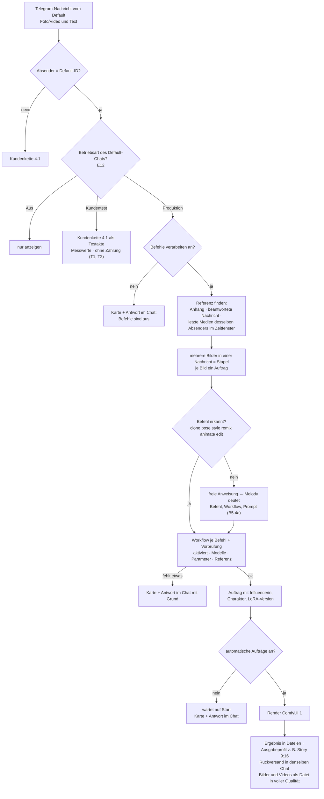

# Darkfluenzer – PHASENPLAN_BACKEND.md

**Stand:** 17.11.2026 (Änderungsblätter Einstellungen/Kundentest/Vollautomatik und B1, Korrektur nach den Prüfberichten von ChatGPT und Fable) · **Status:** Entwurf zur Betreiberfreigabe; nach der Freigabe verbindlich. Umgesetzt wird erst nach der Freigabe.
**Prüfbasis:** Code auf `main` ab `7a49b6a`, Planstand nach `d120562` mit Korrektur; echte Läufe vom 16./17.11. auf dem Mac (§5).
**Verbindlich sind genau drei Dateien:** diese, `docs/PHASENPLAN_FRONTEND.md` und `docs/bugs_v1.md` (Befundregister).
**Archiv (nicht verbindlich):** `docs/archiv/` mit `PHASENPLAN_V0.md`, `PHASENPLAN_BACK_V1.md`, `PHASENPLAN_FRONT_V1.md`, `ki_modelle.md`, `bugs_v1_20261117_vor_neufassung.md`. Code-Kommentare mit Verweisen auf V0/V1-Abschnitte beziehen sich auf diese Archivfassungen.
**Quellen dieser Fassung:** die bisherigen Pläne, die Konsolidierungen und Prüfberichte von ChatGPT und Fable, die Betreiberantworten E1–E16 vom 17.11.2026 und der Code.
**Wahrheit für Details:** Code auf `main`, `protocol/schemas/darkfluenzer/v1/*.proto` (Vertrag), `workflows/manifest.toml` (Modelle, Workflows), `config.example.toml` (Konfiguration).

---

## 1. Produktziel

Darkfluenzer ist ein lokaler **Flirt- und Verkaufsbot** auf einem MacBook Pro M4 Max (128 GB). Die vollständig synthetische, erwachsene Influencerin **Clara** flirtet über ihre eigenen Konten auf Instagram und Telegram, später auch auf WhatsApp und Fansly. Sie gewinnt Interessenten und verkauft ihnen personalisierte Fotos und Videos. Weitere Influencerinnen folgen über dieselbe Struktur.

Zwei gleichwertige Geschäftsfunktionen:
1. **Produktion:** maximal fotorealistische Fotos und Videos mit stabiler Identität (Charakter-LoRA), dazu der Referenz-Kloner für den Betreiber.
2. **Verkauf:** Kennenlernen, Flirt, Kaufinteresse, Angebot, Zahlung, Produktion, Zustellung, Nachlauf. Die Chat-KI (Melody in KI-ComfyUI 2) ist dabei der Verkaufskanal.

Clara wirkt menschlich (Tempo, Tippen, Vertrösten), bleibt ehrlich (KI-Hinweis, Regel 12) und führt zum Kauf, ohne zu drängen.

### 1.1 Vollautomatische Kette (Betreiberwunsch 17.11.2026)

**Kunde:**
1. Clara flirtet. Über mehrere Gespräche sammelt die KI, was der Kunde sehen will.
2. Wird der Wunsch konkret, fasst Clara ihn kurz zusammen und nennt Preis und Zahlungsweg.
3. Die Zahlung geht ein und wird automatisch zugeordnet. Bei PayPal geschieht das ohne den Betreiber. Amazon-Gutscheine lassen sich nicht automatisch prüfen, dort bestätigt der Betreiber den Betrag.
4. Das Backend übersetzt den Wunsch in einen Prompt und erzeugt mit Claras LoRA. Die automatische Prüfung bewertet die Kandidaten und wählt den besten.
5. Die gekennzeichnete Zustellkopie geht an den Kunden, Clara schreibt dazu.

Video läuft genauso: erst das Bild, dann die Animation. Der Betreiber gibt die Höchstlänge je Produkt vor.

**Default (Betreiber als Admin):** Der Chat des Defaults hat drei Betriebsarten (E12):
- **Produktion:** Der Betreiber schickt Claras Konto per Telegram Bilder oder Videos mit Befehl oder freier Anweisung. Die KI wählt Workflow und Prompt. Das Ergebnis kommt in denselben Chat zurück, Bilder und Videos als Datei in voller Qualität, auf Wunsch im Story-Format 9:16. Mehrere Bilder in einer Nachricht laufen als Stapel.
- **Kundentest:** Clara behandelt den Betreiber wie einen Kunden. Er sieht die Latenzen, Bilder kommen ohne Zahlung, Testaufträge gehen nur an ihn und erscheinen nie im Wallet (T1, T2).
- **Aus:** Nachrichten werden nur angezeigt.

**Grenzen, offen benannt:**
- Ohne Charakterfotos und das Training (B1) sieht kein Bild verlässlich nach Clara aus.
- Ohne menschliche Kontrolle geht gelegentlich ein fehlerhaftes Bild raus. Dafür gibt es die Reklamation mit kostenloser Neuauflage (C5.8).
- Video ist langsam: LTX 2.5 braucht für 5 s rund 13 bis 19 min (Jobs 63/64). Es läuft immer nur ein Render auf der Medien-Instanz.
- Ob Clara flüssig antwortet, während ein Video rendert, ist nicht gemessen. Das klärt SP4 (Schritt 1).

### 1.2 Betreiberentscheidungen (Stand 17.11.2026)

| # | Entscheidung | Stand |
|---|---|---|
| E1 | Nur Textflirt. Sprachnachrichten später (B5.8). Keine expliziten Texte; explizite Wünsche beantwortet Clara mit dem Verweis auf Fansly (Vorlage im Profil). | entschieden |
| E2 | Keine Altersfrage. Kunden erhalten nur `standard`. Hinweise auf Minderjährigkeit sperren Flirt und Angebote weiterhin sofort. Rechtliche Prüfung in D1. | entschieden |
| E3 | Antworten verzögert und unregelmäßig: im Gesprächsfluss schnell; bei Erstkontakt, nach Pausen und zufällig 30 s bis 30 min; nachts langsam (30 bis 60 min). Gelesen erst nach dauerhafter Verarbeitung. | entschieden |
| E4 | Nachts trotzdem zügig, wenn Kaufabsicht erkannt ist. | entschieden |
| E5 | Angebot nur bei Wunsch oder erkannter Kaufabsicht, nicht aufdringlich. | entschieden |
| E6 | Zahlungswege als Liste je Influencerin. Start: PayPal und Amazon-Gutschein. Krypto bleibt vorhanden und zuschaltbar, wird aber nicht ungefragt als Kundenweg aktiviert. | entschieden; Preisliste offen |
| E7 | Zustellung als Foto bzw. Video. Die Originaldatei in voller Qualität ist eine bezahlte Zusatzleistung. Selbstlöschende Medien nur, wo der Kanal es nachweislich kann. | entschieden |
| E8 | Freigabe automatisch nach bestandener Prüfung, Prüfwerte gespeichert, Liefer-Gate bleibt (C5.6a). Das Handy ist der Ausnahmeweg: Meldung und Entscheidung, wenn die automatische Prüfung scheitert (C5.10). Erprobung in C6. | entschieden |
| E9 | Zwei Pläne und `bugs_v1.md` ersetzen alle bisherigen Plandokumente; die alten liegen im Archiv. | entschieden, mit dieser Fassung umgesetzt |
| E10 | Fehlbetrag (z. B. 24,50 € statt 25 €): keine automatische Annahme. Vorschlag: Annahme bis zu einer Grenze aus der Konfiguration nur mit Betreiberbestätigung und Protokolleintrag; Standardgrenze 0 €. | **offen**, Betreiberantwort fehlt |
| E11 | Kundenkette vollautomatisch: Wunsch, Angebot, Zahlung, Produktion, Prüfung, Freigabe und Zustellung ohne Klick. Ausnahme: Amazon-Gutscheine bestätigt der Betreiber. | entschieden |
| E12 | Der Default ist der Admin. Sein Chat hat drei Betriebsarten: Produktion, Kundentest, Aus. | entschieden |
| E13 | Zugangsdaten und Einstellungen werden im Cockpit im Reiter „Einstellungen“ gepflegt (S1). | entschieden |
| E14 | Vorschlag: Kundenbilder entstehen mit `krea2_raw_turbo_lora_t2i` (Krea 2 Raw + Turbo-LoRA + Charakter-LoRA, Inhaltsstufe `standard`, 234 s je Bild gemessen). Die Charakter-LoRA wird mit `krea2_raw_lora_train` trainiert (gemessen 23,9 s je Schritt bei 768 px, 1500 Schritte ≈ 10 h). Vorbehalt: BUG-023 und der erste vollständige Trainingslauf. Bis zur Entscheidung ist kein Produkt lieferbar (C5.5). | **offen**, Betreiberantwort fehlt |
| E15 | Chat neben Video: Melody bleibt immer geladen. Ein Videojob startet nur, wenn er daneben in den Speicher passt; sonst wartet er auf ein Videofenster, in dem Clara ohnehin langsam antwortet. Die Regel wird nach der Messung in SP4 (Schritt 1) festgelegt. | **offen**, nach Messung |
| E16 | Prüfmodell für die Inhaltsstufe (C5.6a): noch nicht gewählt; Download nur nach Freigabe. Bis dahin keine automatische Freigabe, Freigabeart steht fest auf „Betreiber“. | **offen**, Voreinstellung gilt |

---

## 2. Regeln

### 2.1 Produktregeln 1–13

Wörtlich aus dem archivierten `PHASENPLAN_V0.md` §2 übernommen. Regel 12 ist um E1/E8 ergänzt, Regel 13 an E1/E2 angepasst; die Änderungen sind mit **[17.11.]** markiert.

1. **Leichte Tendenz zu besserem Bild, aber in angemessener Zeit** (Betreiberentscheidung 15.11.2026): Modell, Identitätsmethode, Modellvariante (z. B. Turbo/Raw, 3B/7B) und Auflösungsweg entscheiden reale A/B-Tests mit den Charakterbildern des Betreibers auf diesem Mac. Unter den Varianten, die das je Ausgabeart gemessene und vom Betreiber bestätigte Zeitbudget einhalten (festgelegt in B2/B4), gewinnt die beste Bildqualität; ist eine Variante deutlich besser, aber langsamer, entscheidet der Betreiber. Ranglisten und Herstellerangaben sind nur Kandidatenquellen.
2. **Identität hat Vorrang:** gleiches Gesicht, gleiche Figur/Anmutung über alle Stufen. LoRA ist Mittel, nicht Ziel; die messbar stabilste Methode oder Kombination gewinnt. „Identität gesperrt“ = Auftrag nutzt verbindlich dieses Profil; Abweichungen werden zurückgewiesen, keine Garantie.
3. **Explizite Bearbeitung nur abgeleitet** (maskiert vom freigegebenen Bild; im Bearbeitungsschritt 0 Pixel außerhalb der Maske, automatisch geprüft). **Video nur vom freigegebenen Foto** bzw. bei Bewegungsübertragung mit dem freigegebenen Charakterbild als Identitätsreferenz.
4. **Face-Swap ausschließlich auf eigenen, synthetisch erzeugten Bildern.** Nie auf fremden Referenzfotos/-videos; fremde Vorlagen liefern nur Pose, Komposition, Licht, Stil bzw. Bewegung. Gesichtszüge abgebildeter Personen werden nie Teil eines Charakterprofils; kein Ersetzen realer Personen in fremden Videos.
5. **Vollständige Reproduzierbarkeit** jedes Bildes/Videos (§9.3).
6. **Lokal, dokumentiert, nativ:** keine Cloud-Generierung, **kein Docker**, keine Electron-Pflicht, keine Parallelarchitektur; jede Modelldatei mit Quelle, Revision, SHA-256 und Nutzungsbedingungen im Manifest. Lizenzbedingungen sind **kein Auswahlkriterium** (Betreiberentscheidung 15.11.2026). Modelle werden nur nach ausdrücklicher Betreiberbestätigung gelöscht; ein Downloadplan ist keine Löschfreigabe.
7. **Präzision je Komponente** (Generierungsmodell, Encoder, VAE/Decoder, Adapter, Hilfsmodelle): beste verfügbare kompatible Originalpräzision; FP32-Komponenten bleiben FP32 (z. B. RelayVSR-Decoder); Umwandlung aus quantisierten Dateien gewinnt keine Genauigkeit zurück; Speicherformat und Rechendatentyp dokumentiert. Dokumentierte Ausnahme: mflux trainiert mit 8-Bit-Basis.
8. **Ein Cockpit:** die bestehende React-Oberfläche (**[17.11.]** sechs Hauptreiter **Übersicht · Nachrichten · ComfyUI · Dateien · Wallet · Einstellungen**, Graphite, ein Stylesheet); Gestaltung und Bedienlogik nach der freigegebenen Klickreferenz (`docs/design/Darkfluenzer_Cockpit_Interaktiv.html`, FRONTEND Anhang A). React spricht nur mit dem Python-Backend; **nie direkt mit Plattform- oder ComfyUI-APIs**.
9. **Zwei ComfyUI-Instanzen** (§3.2) mit getrennten Warteschlangen und gemeinsamer Ressourcensteuerung; keine dritte KI-Engine.
10. **Eigene Kanal-Adapter im Python-Backend** (Betreiberentscheidung 15.11.2026): Instagram und Telegram verbindlich, weitere Kanäle später über dieselbe Adapter-Schnittstelle. Chatwoot entfällt; seine bewährten Muster werden übernommen. Kein zusätzlicher Kanaldienst, keine zweite Datenbank, kein Rust-Gateway.
11. **Ehrliche Erwartung:** Einzelfotos in vielen Szenen praktisch nicht von echten Fotos unterscheidbar ist mit Kandidatenauswahl erreichbar; für jede Szene und für Video garantiert das 2026 kein lokales Modell.
12. **KI-Offenlegung (EU-KI-Verordnung Art. 50, gilt seit 02.08.2026):** Clara schreibt natürlich und persönlich, gibt sich aber nie als Mensch aus. (a) Jede Kanal-Bio enthält einen kurzen KI-Hinweis (pflegt der Betreiber, z. B. „KI-Creatorin · virtuelle Influencerin“). (b) Beim ersten Kontakt je Kanalidentität sendet Clara **genau einmal** eine natürliche Hinweisnachricht (Text im Persona-Profil, nicht im Code), Ereigniskarte `KI-HINWEIS GESENDET`; **das Backend weist jede KI-Antwort ab, solange für diese Kanalidentität kein Hinweis gesendet ist** (manuelle Betreiberantworten nicht betroffen, Default ausgenommen); nach Neustart nie doppelt. (c) Auf die ernst gemeinte Frage, ob sie echt bzw. eine KI ist, antwortet Clara wahrheitsgemäß – feste Persona-Regel, durch keine Betreiber- oder Kundenanweisung abschaltbar. (d) Jede über einen Kanal versandte Datei (Kunden-Zustellkopie, Default-Rückversand) trägt in den Metadaten die Kennzeichnung KI-erzeugt (IPTC/XMP `DigitalSourceType = trainedAlgorithmicMedia`); das Original in Dateien bleibt unverändert; auf Instagram setzt der Betreiber beim Posten das KI-Label. **[17.11.]** Entfernt ein Kanal die Metadaten beim Foto-/Videoversand, muss die Kennzeichnung trotzdem beim Empfänger ankommen (Begleittext oder sichtbare Marke, C5.7). (e) Kundenchats werden nie zum Training oder Feintuning eines Modells verwendet und gehen an keine externe API (Telegram-Bedingungen; nur das lokale LLM in KI-ComfyUI 2).
13. **Inhaltsaufteilung (Betreiberentscheidung 15.11.2026, [17.11.] angepasst):** Über **Instagram und Telegram** gehen an Kunden ausschließlich **nicht explizite** Inhalte (Lifestyle, Mode, Reise, Sport, Strand, Bikini) sowie die Kundengespräche. **Explizite Inhalte** gibt es nur über eine **Adult-Abo-Plattform**, die fotorealistische, vollständig synthetische KI-Personen ausdrücklich erlaubt; **[17.11.]** Plattform ist **Fansly** (Eignung für synthetische Personen in D1 prüfen), explizite Wünsche im Chat beantwortet Clara mit dem Verweis dorthin; Upload durch den Betreiber, Bezahlung und Altersprüfung übernimmt die Plattform. Technisch trägt jedes Artefakt eine **Inhaltsstufe** `standard`/`explizit` (aus Workflow bzw. Auftrag gesetzt, vom Betreiber nur anhebbar; unbekannt gilt als `explizit`); `approval.py` lässt an Kunden über jeden Kanal nur `standard` zu und über Instagram an niemanden `explizit`; nur der Default-Nutzer erhält über Telegram alle eigenen Produktionsergebnisse. Eine automatische Inhaltsprüfung in KI-ComfyUI 2 ergänzt die Stufe, sobald ein Prüfmodell qualifiziert ist (C5.6a); bei Widerspruch Sperre. **[17.11.]** Keine Altersfrage (E2); Hinweise auf Minderjährigkeit → Akte gesperrt, keine Angebote, kein Flirt.

### 2.2 Entwicklungsregeln

Wörtlich aus V0 §2.1, ergänzt um die Betreiberregeln vom 14.–17.11.:

- **NO HARDCODING:** keine fest codierten Modelle, Pfade, Ports, Parameter, Kunden, Workflows, Preise, Zeiten oder Grenzwerte – Konfiguration (`local/config.toml`), Registry (`workflows/manifest.toml`) und SQLite verwenden.
- **NO LEGACY:** keine Altlasten, Kompatibilitätsschichten oder parallelen veralteten Implementierungen; Überholtes sauber ersetzen.
- **NO MOCK:** keine simulierten Ergebnisse, Fake-Daten oder Scheinabnahmen; ausschließlich echte Funktionen und reale Tests – jede Abnahme läuft real auf dem M4 Max.
- **NO DOCKER / NO VM:** native Ausführung auf macOS/Apple Silicon (Python-venvs zulässig).
- **FREE ONLY:** lokal betreibbare, kostenlose Komponenten; keine Cloud-KI-API. Lizenzen werden dokumentiert, sind aber kein Auswahlkriterium.
- **NO JSON als Konfiguration:** TOML und Protobuf; JSON nur, wo externe APIs oder ComfyUI-Workflows es erfordern.
- **NO DUPLICATION:** vorhandene Funktionen wiederverwenden, keine doppelte Architektur.
- **MAIN ONLY:** keine Branches oder Worktrees. **MAX 2 AGENTS.**
- **GIT:** je abgeschlossenem Paket Tests, Commit, Push auf `main`.
- **Geheimnisse nur im macOS-Schlüsselbund** (Konto `darkfluenzer`): `darkfluenzer.telegram.api_id`, `darkfluenzer.telegram.api_hash`, `darkfluenzer.telegram.db_key`, Instagram-Token, Meta-App-Secret, PayPal-Zugang. Nie in `.env`, TOML, Git, Logs, STATE, EVENT, Receipt, Befehlsjournal oder LLM-Kontext. In den Befehlen `secret_set` und `channel_account_login` reist der Wert einmal über die angemeldete lokale Cockpit-Verbindung (Sitzung + CSRF) zum Backend und wird dort nicht gespeichert; der Journal-Hash wird ohne den Wert gebildet. Eingabe über `darkfluenzer secret set` (verdeckt bzw. stdin, Übergabe an `security -i` über stdin); vorhandene Einträge nur nach ausdrücklicher Bestätigung ersetzen. Telegram-Code und 2FA-Passwort gehen nur temporär an TDLib.
- **Ein Stylesheet:** `frontend/src/shared/graphite.css`, keine Datei je Seite (FRONTEND §1).
- **Datenbank-Migrationen** nur mit vorheriger Sicherung (`darkfluenzer.sqlite3.bak-<Zeit>-vor-migrationNN`), danach `PRAGMA integrity_check` und Fremdschlüsselprüfung.
- **Echte Kettenprüfung (Betreiberregel 17.11.):** Eine Kette gilt erst als funktionierend nach einem Lauf vom echten Eingang bis zum Ergebnis im Chat (Handy → Telegram → Cockpit → ComfyUI → Rückversand). Voraussetzungen (Workflows, Influencerin, Charakter) werden vorher eingerichtet oder offen als fehlend gemeldet. Jede Ablehnung wird im Chat beantwortet, aus dem sie kam, nicht nur als Cockpit-Karte.

### 2.3 PASS-Definition

- Ein **Paket** ist PASS, wenn Backend, Protobuf, Frontend und ein echter Lauf auf dem Mac vorliegen. Einzelne grüne Tests (auch mit FakeComfy/FakeTd) sind Teilnachweise.
- Ein **Auftrag** ist PASS, wenn eine echte Eingangsnachricht mit den richtigen Referenzen und dem richtigen Charaktermodell zu einem korrekten Ergebnis führt, dieses in Dateien gespeichert und an denselben Chat zurückgesendet wurde und der Zustand nach einem Neustart stimmt.
- Status in allen Tabellen: **OFFEN · CODE** (gebaut, kein Mac-Lauf) **· TEIL** (Teil am Mac belegt) **· PASS · BLOCKIERT** (mit Grund).

### 2.4 Arbeitsweise des Bearbeiters

1. Pakete in der Reihenfolge von §6, eines nach dem anderen.
2. Je Paket: betroffenen Code lesen, Befund bestätigen, Test rot, Umsetzung, Tests grün, Mac-Lauf, Protokoll in `bugs_v1.md` §7, Statuszeile in §5, Commit und Push.
3. Vertragsänderungen zuerst in den `.proto`-Dateien (`cd protocol && buf lint && buf generate`), nie eine Nummer wiederverwenden (§10).
4. Widerspricht dieser Plan dem Code, anhalten und den Widerspruch als `SPEC-*` in `bugs_v1.md` eintragen. Nichts erfinden.
5. Prüfungen: Backend `../local/.venv/bin/python -m pytest -q`, `ruff check`, `ruff format --check` in `backend/`; Frontend `npx tsc --noEmit`, `npx vitest run`, `npm run build` in `frontend/`. Neustart: `local/.venv/bin/python -m darkfluenzer restart` (verweigert bei laufenden Jobs). Nach Schemaänderungen das Cockpit im Browser neu laden.

---

## 3. Architektur

### 3.1 Komponenten


| Bereich | Owner (Datei) | Grenze |
|---|---|---|
| HTTP, WebSocket, Befehle | `server.py`, `stream.py`, `protocol/schemas/darkfluenzer/v1/*.proto` | ein Same-Origin-WebSocket `/ws/v1/stream`, Befehle per Protobuf über `/api/v1/command`, kein fachliches Browser-Polling |
| Persistenz | `store.py`, Migrationen (Stand 17) | genau eine fachliche SQLite; Ereignisjournal `events` unveränderlich |
| Medien | `pipeline.py`, `comfy.py`, `models.py`, `workflows/manifest.toml` | Graphen nur in der Registry; Medien über ID und SHA-256 |
| Kanäle | `channels/telegram.py`, `tdjson.py`, `instagram.py` | nur verifizierte Plattform-IDs; Default und Kunden getrennt |
| Betrieb | `runtime.py`, `app.py` (CLI), `launcher/Darkfluenzer.swift`, Schlüsselbund | Swift-Starter startet nur, keine zweite GUI |
| Cockpit | `frontend/src/core/{realtime,state,commands,channels}.ts`, `pages/*.tsx` | siehe FRONTEND |

### 3.2 Zwei ComfyUI-Instanzen und Ressourcen

- **ComfyUI 1 (127.0.0.1:8188, Medien):** Bilder, Inpaint, Refine, Pose/Tiefe, LoRA-Training, Video, Hochskalieren.
- **ComfyUI 2 (127.0.0.1:8189, KI):** Melody (Dialog, freie Anweisungen, Prompts), später Bildverständnis, Inhaltsprüfung, Sprache.
- Beide nutzen dieselbe Installation `local/ComfyUI` (ComfyUI 0.45.3, eigene venv), eigene Ordner und eigene Warteschlangen. Modelle liegen nur unter `local/models` (`extra_model_paths.yaml`, erzeugt von `launcher/setup_comfyui.sh`).
- Die Zulassung (`server._admit`) prüft vor jedem Medienjob den gemessenen freien Speicher gegen die Reserve aus der Konfiguration. Die KI-Bahn hat Vorrang: Kundenantworten dürfen nicht hinter einem Videorender warten; B5.1 misst das, die Regel für den Fall, dass es nicht reicht, ist E15.
- **Vorrang auf ComfyUI 1** (Klassen und Reihenfolge in der Konfiguration): (1) bezahlte Kundenaufträge, (2) Default-Produktion und Kundentest, (3) Training. Innerhalb einer Klasse gilt FIFO. Ein Training startet nur, wenn keine Aufträge der Klassen 1–2 warten, und wird nicht unterbrochen; währenddessen eingehende Kundenaufträge warten mit Lieferzeit-Hinweis; der Betreiber kann das Training abbrechen.

### 3.3 Protobuf-Rundweg (gilt für jede Funktion im selben Paket)

```text
Python-Owner + SQLite-Commit → Fachversion / Journal-Ereignis
  → Protobuf STATE (Snapshot, latest wins) oder EVENT (Cursor, Catch-up)
  → ein WebSocket → React-Store → richtiger Reiter / richtige Akte
React-Bedienung → Protobuf-Befehl (request_id, Scope, erwartete Revision)
  → Session/CSRF, Prüfung, CAS → einmalige Ausführung → persistiertes Receipt
  → STATE/EVENT → sichtbarer echter Zustand
```

`ACCEPTED` ist kein Erfolg; maßgeblich sind die Receipts `COMPLETED · REJECTED · FAILED · UNKNOWN · CANCELLED`. Dieselbe `request_id` erzeugt höchstens einen Effekt. Bei `UNKNOWN` nie blind ein zweites Mal senden, sondern über Provider-ID abgleichen. Große Dateien nur über die geschützten Medien-Endpunkte, nie im Stream.

### 3.4 Datenmodell und Zustände (Kurzfassung)

- `influencers`/`characters` → Fotos, Datensätze, LoRA-Versionen, Persona; `customers` → `channel_identities` → `channel_conversations` → `channel_messages` (Anhänge, Status); `orders` → `order_stages` → `jobs` → `media` → Freigaben → Zustellungen → Zahlungen.
- **Default** ist `customers.kind = internal`, kein Kunde, nie in Verkaufszahlen.
- **Kundenauftrag (Code):** `draft → offered → accepted → paid → producing → review → approved → delivered`, Endzustände `cancelled`, `refunded`. **Betreiber-/Kloner-Auftrag (Code):** `producing → review → approved`, `cancelled`. **Geplant:** `expired` aus `offered` (C5.5), `awaiting_operator` aus `review` bei gescheiterter Prüfung (C5.6a), `complaint` und `closed` nach `delivered` (C5.8), Quelle `test` mit `producing → review → approved → delivered` ohne Zahlungszustände und nur an die Default-Testidentität (T2). Bezahlte Aufträge tragen `order_id` von der Anlage bis zur Zustellung. Der Medienwunsch gehört zur Konversation; Angebot und Auftrag verweisen auf ihn.
- **Job:** `queued → running → done | failed | cancelled`; Pause der Warteschlange ist dauerhaft (SQLite). Nach Absturz wird anhand der gespeicherten `prompt_id` abgeholt statt neu gerendert.
- **Zustellung:** `queued → sending → sent | failed | unknown`; `unknown` wird abgeglichen, nie blind wiederholt.

---

## 4. Ketten

### 4.1 Kundenkette (Ziel)


### 4.2 Default-Kette (Betreiber per Telegram)



### 4.3 Live-Befund 17.11.2026: warum die Default-Kette nicht lief

Der Betreiber schickte von seinem privaten Telegram (Default 571334304) ein Foto und danach „Clone“. Ergebnis: nur die Cockpit-Karte „Kein Workflow für clone im Default-Kontakt gewählt“. Die Kette brach an vier Stellen:

| # | Stelle in 4.2 | Ursache | Paket |
|---|---|---|---|
| 1 | Vorprüfung | Medien-Workflow und Befehlszuordnung waren leer; niemand hatte sie eingerichtet, die Kette wurde nie vom Handy getestet. | SP1 |
| 2 | Antwort im Chat | Die Ablehnung ging nur auf eine Cockpit-Karte, nicht zurück nach Telegram. | SP1 (BUG-057) |
| 3 | Referenz finden | Foto und Befehl kamen als zwei Nachrichten im Abstand von 4 s. Der Kloner nimmt Referenzen nur aus derselben oder einer beantworteten Nachricht. | SP1 (BUG-075) |
| 4 | Charakter | Influencerin nicht gesetzt, „Charakter 01“ hat 0 Bilder, kein Workflow lädt eine Charakter-LoRA. Ein „clone“ hätte die fremde Person nachgebildet, nicht Clara. | SP3, SP1 (BUG-052) |

---

## 5. Ist-Stand (17.11.2026)

| Bereich | Stand | Beleg | Offen |
|---|---|---|---|
| Cockpit-Server, Stream, Befehlsjournal, Receipts | PASS | A1 15.11. (`d13e258`) | BUG-024 Zeitlimit |
| ComfyUI-Reiter, Workflow-Übernahme (0 Abweichungen) | PASS | A2 15.11. | einheitliche Videosteuerung (SP1) |
| Zwei Instanzen, Zulassung | TEIL | A3 15.11. | echter KI-Lauf (SP4); Starter startet Instanz 2 nicht (BUG-061) |
| Dateien, Herkunft, Weiterverarbeiten | PASS | A4 15.11. | Video-Vorschau im echten Chrome geprüft (BUG-045 widerlegt) |
| Bildworkflows | TEIL | je ein echter Lauf (§9.2) | keine Engine für Kunden freigegeben; kein LoRA-Lader |
| Video LTX 2.5 | TEIL | Job 63 (960×1280, 121 Frames, 24 fps, Ton, 1128 s, Swap ≤ 44,8 GB); **Job 64 aus dem Cockpit** (3:4, 5 s, 1 Kandidat, 780,9 s, Swap ≤ 42,7 GB) | einheitliche Bedienung (SP1), Zeitachse (B4), Vergleich mit Wan |
| Video Wan 2.2 / Remix | OFFEN | Wan-FP16 2408 s (A2); Langvideo nur mit Ersatz-ComfyUI | Abnahme, Langvideo real |
| Abbrechen, Pause | TEIL | 17.11. am Mac: Abbruch in der Startphase (Job 65) und im Lauf (Job 66) → Status abgebrochen, 0 Medien, ComfyUI-Queue leer, Speicher der Instanz 2,9 → 1,9 GB; Pause übersteht Neustart | Auftrag als Ganzes abbrechen (SP1) |
| Seed-Grenzen | PASS | 17.11.: „Generieren“ war bei LTX, FLUX-Vorlage, Qwen ×2 still blockiert; behoben `932c9ec`, Job 64 danach | – |
| Charakter-LoRA | OFFEN | Trainingsworkflows registriert; Krea-2-Training laut Manifest probehalber gemessen (768 px: 23,9 s je Schritt), kein vollständiger Lauf; LoRA-Registry vorhanden (`models.register_lora`), Lader im Workflow fehlt; 0 Charakterfotos | SP3, E14 |
| Telegram (TDLib) | TEIL | 17.11.: Anmeldung, Neustart ohne Code, Eingang vom Zweitkonto, Register, Name, Default per Klick, manuelle Antwort gesendet (ID 5006950400), Default „Hey“ → Rückfrage im Chat | Handoff vom Handy, Datei > 50 MB, Befunde in SP1/SP2 |
| Default-Kette (Kloner) | TEIL | Code für sechs Befehle, Befehl→Workflow-Zuordnung (`7a49b6a`); Live-Lauf 17.11. gescheitert (§4.3) | SP1, SP3 (H6b), T1/T2 |
| Instagram | CODE | Adapter + Tests | Meta-App, Tunnel |
| Zahlungen | CODE | Krypto-Beobachter, Gutschein-Erkennung, Zuordnung, Monatsliste | PayPal, echte Zahlung, SP2/C5a |
| Kundenauftrag von Hand | CODE | Hinweis, Alter, Angebot, Produktion, Freigabe, Zustellung | kein echter Kunde |
| Einstellungen (Reiter) | OFFEN | Geheimnisse bisher nur per CLI `darkfluenzer secret set` (Telegram) | SP2 (S1) |
| Chat-KI | OFFEN | Melody Q6_K geladen und SHA-geprüft (17.11. 01:14); Node ComfyUI-LLM-Session geprüft, Setup-Skript vorbereitet (nicht installiert) | SP4 |

### 5.1 Nachweise der abgenommenen Pakete (aus V0, gekürzt; Volltext im Archiv)

| Paket | Datum, Commit | Messwerte |
|---|---|---|
| Starter (Swift, früher „S1“) | 14.11. | Swift-App startet Backend, öffnet Cockpit, zweiter Doppelklick idempotent |
| A1 Vertrag, Wiederanlauf | 15.11., `d13e258` | Receipt nach Schalter, veraltete Version abgewiesen, dieselbe `request_id` → ein Effekt; SIGKILL mitten im Render → Job 26 nach Neustart abgeholt, genau ein ComfyUI-Auftrag |
| A2 ComfyUI-Reiter | 15.11., `515288f`, `9d9ddf0` | 16 offizielle Vorlagen, `graphToPrompt` 0 Abweichungen; Wan-FP16 2408 s, frei 73,1 → min 18,3 GB, Swap 8,9 → max 46,1 GB |
| A3 Zweite Instanz | 15.11., `3fd3edc` | KI-Instanz unabhängig gestartet/gestoppt; Zulassung wartete sichtbar auf Speicher |
| A4 Dateien | 15.11., `3fd3edc` | Wiederholen bitgleich (SHA = 0033), Weiterverarbeiten mit Eingabe-SHA = 0033 |
| C2d Telegram | 16./17.11., `ab1d9cf` ff. | Schlüsselbund, echte Anmeldung, Neustart ohne Code |
| P0 bugs_v1 | 17.11. 00:23 | BUG-001 bis 006 deployt; BUG-002 live: Weiterleitungs-Header 403 |

---

## 6. Reihenfolge (nach Freigabe): sechs Sammelpakete

| Paket | Inhalt (bisherige Nummern) | Steht am Ende |
|---|---|---|
| **SP1 Default-Kette** (§7.1, ausgeschrieben) | H0, H4, H5, H6a; aus H2 BUG-008/013/014; aus H3 Zeitlimit, Auftrag abbrechen, BUG-064 | Bild mit Befehl vom Handy, Datei kommt zurück |
| **SP2 Fundament** (§7.2, ausgeschrieben) | H1, H2-Rest, S1 mit Kanalkonten als Liste, Kontenteil von C5.1, Frontend-Härtung | kein stiller Stillstand, alle P0 zu, mehrere Konten, Einstellungen im Cockpit |
| **SP3 Charakter und Medien** (§7.6, ausgeschrieben) | B1, B2, H6b, C1/C3-Rest; dazu unverändert B4 (mit H3-Rest) und B5.6 | „clone“ liefert Clara mit Prüfwert, Video mit Zeitachse |
| **SP4 Clara chattet** (§7.3, ausgeschrieben) | B5.1–B5.4, B5.4a, C5.2–C5.4, T1; C5.1 (Influencerin-Block) | Kundentest-Chat mit Messwerten, Clara antwortet Kunden selbst |
| **SP5 Verkauf automatisch** | C5a, C5.5–C5.10 mit C5.6a, T2 | Zahlung rein, Bild raus, ohne Klick |
| **SP6 Betrieb und Abnahme** | D1–D3, C4, C6 | Probephase bestanden |

- **DOK-1** ist erledigt (Pläne neu, Altdokumente im Archiv).
- SP2 bis SP6 werden wie SP1 in Code-Tiefe ausgeschrieben, bevor sie beginnen; bis dahin gelten die bisherigen Paketbeschreibungen in §7.
- SP3 läuft parallel, sobald Charakterfotos vorliegen. Höchstens zwei Agenten, keine gleichzeitigen schweren GPU-Läufe.
- **P0-Regel:** Die P0-Befunde auf dem Default-Pfad schließt SP1 vor seiner Abnahme; alle übrigen P0 sind vor dem ersten KI-Kanaltest mit Kunden (SP4) behoben.

---

## 7. Pakete

### 7.1 SP1 Default-Kette lauffähig

Ersetzt H0, H4, H5, H6a sowie aus H2 BUG-008/013/014 und aus H3 Zeitlimit, Auftrag abbrechen und BUG-064. Grundlage: Code-Vergleich von Fable (17.11.) mit `cloner.py`, `pipeline.py`, `telegram.py` und der Cockpit-Klasse in `server.py`.

**Ziel:** Der Betreiber schickt per Telegram Bilder mit Befehl und bekommt die Ergebnisse als Datei in denselben Chat zurück. Jede Nachricht endet sichtbar, auch im Fehlerfall.
**Schließt:** BUG-007, 008, 013, 014, 053 bis 058, 064, 075, 079 bis 083, 086, 090, 093; BUG-052 bis auf die LoRA (SP3).
**Dateien:** `server.py`, `cloner.py`, `pipeline.py`, `models.py`, `channels/telegram.py`, `store.py`, `config.py`, `app.py`, `workflows/manifest.toml`, `commands.proto`, `channel.proto`, `comfy.proto`.
**Vorgaben (Betreiber kann ändern):** In der Default-Produktion entsteht ein Kandidat je Bild. Im Modus „Direkt“ mit mehreren Kandidaten kommen alle zurück, und der Auftrag ist danach geschlossen.

**Umsetzung in dieser Reihenfolge**

1. **Rückverfolgung (`app.py`).** CLI `darkfluenzer trace --message <id>` und `--order <nr>`, nur lesend: Nachricht, Identität, Default-Zuordnung, Schalter, Befehl, Referenzen, Workflow, Vorprüfung, Auftrag, Stufen, Jobs mit `prompt_id` und Fehler, Medien, Rückversand. Die erste Unterbrechung wird benannt.
2. **Render-Worker absichern (`server.render_worker`).**
   - Heute: `advance_order`, `_cloner_delivery`, die Pushes und `_admit` laufen ungeschützt. Ein Fehler beendet die Schleife der Instanz.
   - Neu: ganzer Schleifenkörper in `try/except Exception` mit Log; Nachbearbeitung in eigener Funktion `_after_job`. Zeitlimit je Workflow (`timeout_s` im Manifest, Vorgabe `production.render_timeout_s`) wird an `pipeline.run_render` übergeben.
   - Test: `_cloner_delivery` wirft, der nächste Job läuft trotzdem.
3. **Telegram-Eingang der Reihe nach (`telegram._on_update`, `_message`).**
   - Heute: je Nachricht eine eigene Aufgabe. Ein Befehl überholt das Foto, dessen Download noch läuft.
   - Neu: eine Warteschlange und ein Arbeiter je `chat_id`; `_reconcile` nutzt sie mit. `media_album_id` wird als `album_id` an der Nachricht gespeichert (Migration). Anhänge mit Status `pending` werden nach dem Start erneut geladen, nach drei Fehlversuchen `failed` mit Grund.
   - Test: Foto mit verzögertem Download, dann Befehl; Neustart mit `pending`.
4. **Referenzen sammeln (neu: `server._cloner_refs`).** Reihenfolge: eigene Anhänge samt Album; beantwortete Nachricht samt Album; sonst Medien desselben Absenders in dieser Konversation aus den letzten `cloner.reference_window_s`, die noch keinem Auftrag zugeordnet sind. Nachrichten mit `album_id` werden erst ausgewertet, wenn das Album `cloner.album_settle_s` ruhig ist. Nie Medien anderer Absender.
5. **Plan, Vorprüfung, Antwort (`server._cloner`, `_cloner_plan`, `_on_inbound`).**
   - Heute: Befehle aus → stiller Rücksprung. Fehlender Workflow, „edit nur für eigene Bilder“ und „wartet auf Start“ → nur Karte. Keine Prüfung, ob der Workflow startbar ist.
   - Neu: `_cloner_plan` prüft zusätzlich `_lane_of(wf)` und `_not_startable(wf)`. Jeder Ausgang läuft über eine Funktion `_cloner_state`, die Karte **und** Chat-Antwort schreibt. Zustände: `started`, `waiting_start`, `rejected`, `returned`, `return_blocked`, `failed`, `cancelled`. `_on_inbound` fängt jede Ausnahme und meldet `failed`. Der Hinweis „Befehle sind aus“ kommt höchstens einmal je `cloner.notice_interval_s`.
6. **Optionen aus dem Wunsch (neu: `cloner.options`).** Liest einen Formatnamen der Engine (`Engine.formats`, z. B. `9:16`) und eine Dauer (`8s`); der Rest bleibt Wunsch. Vorgabe ist das Ausgabeprofil je Befehl im Default-Kontakt. Format setzt `width` und `height`, wenn der Workflow beide hat, sonst Ablehnung mit Grund. Dauer setzt `duration_s`. Die Wan-Engines bekommen benannte Formate im Manifest (BUG-093). Die Fertigstellen-Stufe trägt eigene Werte am Auftrag, z. B. die Höhe 1920 für Story über `output_instagram` (BUG-090).
7. **Aufträge anlegen (`server._cloner_order`).**
   - Heute: nur `refs[0]`, immer `production.candidates_default`, kein Eltern-Medium, keine Figur.
   - Neu: bei einem Upload-Parameter je Referenz ein Auftrag (Stapel), bei mehreren Vorlagen-Parametern gemeinsam (mehr Bilder als Parameter → Ablehnung mit Grund). Kandidaten aus `production.cloner_candidates` (Vorgabe 1), Video aus `production.video_candidates_default` (1), immer 1 bei Workflows ohne Seed. Ist die Referenz ein eigenes Medium (`media_by_sha`), wird sie als `parent_media_id` übergeben. Der Auftrag speichert Influencerin und Charakter des Default-Kontakts; die Karte sagt „ohne Charakter-LoRA“ bis SP3. Video als Referenz: Ablehnung mit Grund bis B4.
8. **Abschluss und Rückversand (`pipeline.advance_order`, `server._cloner_delivery`).**
   - Heute: die Stufe wartet immer auf Auswahl; im Modus Direkt bleibt der Auftrag offen; eine Wiederholung sendet alles erneut.
   - Neu: genau ein erfolgreicher Kandidat wird automatisch gewählt. Modus Direkt mit mehreren: alle senden, Stufe ohne Auswahl schließen, Auftrag auf `review`. Rückversand je Auftrag und Medium genau einmal (Tabelle `cloner_returns`). Fehlschlag oder Abbruch melden `failed` oder `cancelled` mit Grund. Ein bitgleiches Ergebnis zählt als Kandidat.
9. **Postausgang (`telegram.outbox_worker`, `_pace`).** Sendungen an den Default gehen ohne Verzögerung und ohne Tippanzeige raus, vor wartenden Kundensendungen. Der Takt je Gespräch folgt in SP4.
10. **Video-Vertrag (`models.py`, `pipeline.video_plan`, `server._workflows`, Manifest).**
    - Heute: Wan und Remix haben einen `video`-Abschnitt und bekommen `duration_s` und `segment_s` vom Backend. LTX hat einen eigenen Parameter `duration`.
    - Neu: `VideoSpec.mode` mit `frames` (wie heute) und `seconds` (LTX: `duration_s` wird auf den Sekunden-Eingang geschrieben, ein Lauf bis zur Engine-Grenze). LTX bekommt einen `video`-Abschnitt, sein Parameter `duration` entfällt. `segment_s` erscheint nur bei `frames`. Damit zeigen alle Video-Workflows dieselben Felder an derselben Stelle (FRONTEND `VideoSettings`).
11. **Auftrag abbrechen (neu: Befehl 59 `order_cancel`).** Bricht alle wartenden und laufenden Jobs eines Auftrags ab, mit der Logik aus `_cancel`. Ein Chat-Wort im Default-Kontakt bricht den laufenden Auftrag dieses Chats ab.
12. **Betriebsart (Default-Kontakt, Befehl 37 additiv).** `production`, `test`, `off` je Kanalidentität. `off`: nur anzeigen. `test`: bis SP4 die Antwort „Kundentest noch nicht verfügbar“.

**Einrichtung vor der Abnahme:** Der Default-Chat steht in `test_chat_ids`, sonst verwirft der Testbetrieb jede Nachricht (571334304 ist eingetragen). Je Befehl ist ein Workflow gesetzt. Für volle Auflösung Referenzen als Datei senden, denn Foto-Nachrichten liefert Telegram verkleinert.

**Frontend im selben Paket:** Karte je Zustand; Default-Kontakt mit Betriebsart, Kandidatenzahl, Ausgabeprofil je Befehl und Chat-Wörtern; `VideoSettings`; „Auftrag abbrechen“.

**Abnahme am echten System (ersetzt H6a; technische Kettenabnahme, kein Auftrags-PASS nach §2.3)**

1. Foto mit „clone“: eine Datei kommt zurück.
2. Foto, 4 s später „clone“: ein Auftrag mit diesem Foto.
3. Album mit fünf Bildern und „style 9:16“: fünf Dateien im Format 9:16.
4. Foto mit „animate 5s“: ein Video als Datei.
5. „clone“ ohne Workflow, mit ausgeschalteten Befehlen und mit fehlendem Modell: je eine Antwort mit Grund.
6. Abbruch im Lauf: Antwort „abgebrochen“, Warteschlange leer.
7. Neustart im Lauf: der Auftrag läuft weiter, genau eine Datei kommt zurück.
8. `trace` zeigt jeden dieser Läufe vollständig.

### 7.2 SP2 Fundament

Ersetzt H1, H2-Rest, S1 und den Kontenteil von C5.1. Grundlage: Code-Vergleich von Fable (17.11.) mit dem Rest von `server.py`, `tdjson.py`, `vouchers.py`, `keychain.py`, `commands.ts`, `state.ts` und dem Großteil von `store.py`.

**Ziel:** Kein stiller Stillstand mehr, die Inhaltsstufe ist dicht, mehrere Konten sind möglich, Zugangsdaten werden im Cockpit gepflegt.
**Schließt:** BUG-015, 016, 021, 024 (Backend-Teil), 031, 047, 048, 049, 050, 062, 067, 087 bis 089.
**Dateien:** `server.py`, `store.py`, `pipeline.py`, `models.py`, `channels/telegram.py`, `channels/tdjson.py`, `channels/instagram.py`, `payments/vouchers.py`, `keychain.py`, `config.py`, `app.py`, `launcher/Darkfluenzer.swift`, neue `settings.proto`, `channel.proto`, `commands.proto`.

**Umsetzung in dieser Reihenfolge**

1. **Daueraufgaben beaufsichtigen (`server.create_app`, `lifecycle`).**
   - Heute: `outbox_worker`, `adapter.run` und `wallet.run` laufen als nackte Aufgaben. Ein unerwarteter Fehler beendet sie still.
   - Neu: jede Daueraufgabe läuft in einer Aufsicht, die den Fehler protokolliert, im STATE des Kanals oder der Datenquelle anzeigt und mit wachsender Pause neu startet.
   - Test: Fehler in `_send`, die nächste Nachricht geht trotzdem raus.
2. **Inhaltsstufe an einer Stelle (`pipeline.create_render`).**
   - Heute: Stufe aus Workflow und `parent_media_id`.
   - Neu: zusätzlich jede Eingabedatei eines Upload-Parameters. SHA-256 der Datei, Suche in `media`: Treffer ergibt dessen Stufe, kein Treffer `explizit`. Masken sind ausgenommen (Kennzeichen am Parameter im Manifest). „Wiederholen“ erbt die Stufe des Ursprungsjobs.
   - Folge: Ergebnisse aus fremden Vorlagen sind `explizit` und gehen nur über Telegram an den Default.
   - Test: explizites Bild als Upload, als Vorlage, als Medien-ID ohne Eltern und über „Wiederholen“.
3. **Kundenereignisse (`store.customer_events`).**
   - Heute: nur `created`, `named`, `read`, `age`, `updated`. Ein Eingang schreibt ein Nachrichtenereignis.
   - Neu: die Abfrage liefert zusätzlich die Nachrichtenereignisse `added`, die `customer_id` tragen. Keine Datenbankänderung.
4. **Ein TDLib-Empfänger (`channels/tdjson.py`).**
   - Heute: je `TdJson` ein Thread, der `td_receive` aufruft und Ereignisse anderer Clients verwirft. Nach dem Abmelden entsteht ein zweiter Thread.
   - Neu: genau ein Empfangsthread je Prozess, der nach `@client_id` an registrierte Clients verteilt. `TdJson.close()` meldet ab.
   - Test: zwei Clients erhalten je ihre Ereignisse; Abmelden und Anmelden ohne Verlust.
5. **Telegram-Eingang vervollständigen (`channels/telegram.py`).**
   - Chats aus `telegram.ignored_chat_ids` (Vorgabe 777000) werden nie gespeichert.
   - `updateMessageContent` und `updateDeleteMessages` ändern den Verlauf: neuer Text mit Ereignis, Löschmarke an der Nachricht. Ob der Inhalt gelöschter Nachrichten entfernt wird, entscheidet D1.
   - Ausgang: die Beschriftung steht nur am ersten Anhang.
6. **Ungeklärter Versand (`telegram.py`, `instagram.py`, `store.py`).**
   - Heute: `unknown` wird nie geklärt. Nach einem Neustart legt der Abgleich die eigene Nachricht als fremde an und erzeugt „ÜBERGABE AN BETREIBER“.
   - Neu: vor `record_external_outgoing` Abgleich mit Nachrichten derselben Konversation im Status `unknown` (gleicher Text oder gleiche Datei, Zeitfenster aus der Konfiguration); Treffer wird `sent` mit der Plattform-ID. Instagram hält seine offene Liste in `adapter_state`. Was nach dem Fenster offen bleibt, wird `failed` und ist erneut sendbar.
7. **KI-Hinweis (`store.queue_ai_notice`).** Erneut möglich, wenn die verknüpfte Nachricht `failed` ist; nie bei `queued`, `sending`, `sent` oder `unknown`.
8. **Gutscheine (`payments/vouchers.py`, `store.record_inbound`).** Erkennung nur mit Bindestrichen oder zusammenhängend in Großschreibung; Leerzeichen trennen nie. Neue Spalte `vouchers.original_text`. „Ablehnen“ im Wallet stellt den Text im Verlauf wieder her.
9. **Kanalkonten als Liste.**
   - Heute: je Plattform ein Konfigurationsabschnitt und ein Adapter (`Cockpit.telegram`, `Cockpit.instagram`). `default_contact` führt je Plattform eine Absender-ID. `channel_identities.account` und `adapter_state.account` tragen das Konto schon.
   - Neu: Tabelle `channel_accounts` (Kürzel, Plattform, Plattform-Konto-ID, Influencerin, Testbetrieb, Test-Chats, Status). `Cockpit.adapters` je Konto, `_adapter(platform, account)`, STATE 8 listet alle Konten. Default-Identität und Betriebsart je Konto. Konten anlegen, zuordnen und entfernen über Befehl 66 `channel_account_update`.
   - Die Abschnitte `[telegram_account]` und `[instagram]` entfallen; ihr Inhalt wird beim ersten Start als Konto übernommen.
   - Schlüsselbund: App-Zugänge je Plattform, Sitzungsschlüssel und Token je Konto.
   - Der Instagram-Webhook verteilt nach der Konto-ID im Ereignis.
   - `influencers[0]` wird nirgends mehr verwendet (heute in `_send_ai_notice`).
   - Regel: alle Identitäten einer Akte gehören zu Konten derselben Influencerin; dieselbe Person bei zwei Influencerinnen ergibt zwei Akten.
10. **Einstellungen (S1).**
    - Katalog aller Einträge mit Gruppe, Format und Prüfer, gemeinsam für Cockpit und CLI.
    - Gruppen:
      - Kanäle: Telegram (API-ID, API-Hash, Anmeldung, Test-Chats), Instagram (App-ID, App-Secret, Verify-Token, Tunnel-Adresse, Anmeldung); später WhatsApp, Fansly.
      - Zahlung: PayPal (Client-ID, Secret, Webhook-ID, Umgebung), Krypto-Adressen, Kulanzgrenze (E10).
      - KI und Render: Instanzen, Speicherreserve, Hugging-Face-Zugang, falls ein Modell ihn verlangt.
      - Admin und Test: Default-Identität, Betriebsart, Chat-Wörter.
      - Betrieb: Autostart, Sicherung, Ruhezustand.
    - Befehle 60 `secret_set`, 61 `config_update`, 62 `connection_test`; STATE 12.
    - `_command` leert den Wert vor dem Hash, wie bei `channel_account_login`.
    - `keychain.store_secret` lehnt `"`, `\` und Zeilenumbruch heute still ab: den Wert vor dem Speichern kodieren oder mit klarer Meldung abweisen.
    - `config_update` schreibt `local/config.toml` atomar über den Parser aus `config.py`; Werte, die einen Neustart brauchen, melden das.
11. **Befehlsstatus (neu: `GET /api/v1/command/<request_id>`).** Liefert die gespeicherte Quittung als Protobuf oder 404. Grundlage für BUG-024.
12. **Starter (`launcher/Darkfluenzer.swift`).** Rückgabe von `down` je Instanz auswerten.

**Frontend im selben Paket:** FRONTEND §4.1.

**Abnahme am echten System**

1. Zwei Telegram-Konten sind angemeldet. Nachrichten an beide landen in getrennten Akten mit der richtigen Influencerin. Abmelden und Anmelden eines Kontos ohne Neustart verliert nichts.
2. Ein Fehler im Versand ist im Kanalstatus sichtbar, die Aufgabe läuft weiter.
3. Ein explizites Bild über vier Wege ergibt ein explizites Ergebnis.
4. Die zweite Nachricht eines bekannten Kunden zählt in Liste und Übersicht, ohne die Akte zu öffnen.
5. Versand bei getrennter Verbindung: nach der Wiederverbindung als gesendet erkannt, keine Übergabe-Karte, kein Doppelversand.
6. PayPal-Zugang im Cockpit eingetragen und geprüft; der Wert ist nirgends lesbar; ein Wert mit Sonderzeichen funktioniert oder wird klar abgewiesen.
7. 20 normale Sätze mit Zahlen bleiben unverändert; ein abgelehnter Fehltreffer wird wiederhergestellt.

### 7.3 SP4 Clara chattet

**Verbindliche Modellentscheidung (16.11.2026):** einziges Chatmodell ist **ReadyArt Melody1437-26B-A4B-v2.0, GGUF Q6_K**: Datei `Melody1437-26B-A4B-v2.0-Q6_K.gguf`, Revision `b22520a5c83db6ff0d12aef1fd461c932ba86fbf`, 22.638.399.456 Byte, SHA-256 `07a3b8b756a212926900b42927e51a3b116c105f878eb5c2b272d689a9a710dc`, Ablage `local/models/llm/melody1437-26b-a4b-v2.0/` (geladen und geprüft 17.11.2026 01:14). Keine weiteren Chatmodelle oder Quantisierungen ohne neue Freigabe. Anforderungen (**[17.11.] geändert auf Vorschlag aus dem SP4-Code-Vergleich**; ersetzt „erstes Token ≤ 2 s, kurze Antwort ≤ 5 s“ vom 16.11., weil ComfyUI Text erst am Ende liefert und Clara ohnehin verzögert antwortet): Flirt ohne Verweigerung im zulässigen Rahmen (E1); die Antwort ist vor der geplanten Sendezeit fertig (Gesamtzeit p95, Startwert 20 s, auch bei laufendem Bildrender); natürliches Deutsch; Gedächtnis; stabile versionierte Persona; nur ComfyUI 2. Die Zeit bis zum ersten Token wird nur gemessen, wenn der Knoten sie liefert. Laufzeit-Knoten: **ComfyUI-LLM-Session** (kantan-kanto, gepinnt `ec2b293c`, Gemma4-26B-A4B laut Kompatibilitätsliste bestätigt; Code am 17.11. auf Netzwerk-/Prozess-/eval-Aufrufe geprüft: keine) mit `llama-cpp-python==0.3.37` als Metal-Build; Skript `launcher/setup_llm_session.sh`, Modellpfad `LLM: llm` in `setup_comfyui.sh` (BUG-036).

Ersetzt B5.1 bis B5.4, B5.4a, C5.2, C5.3, C5.4 und T1. Grundlage: Code-Vergleich von Fable (17.11.) mit `comfy.py` und `instagram.py`.

**Ziel:** Clara beantwortet Kunden selbst, mit Persona, Gedächtnis und menschlichem Tempo. Der Betreiber kann als Testkunde mit ihr schreiben und sieht die Messwerte.
**Schließt:** BUG-017 (Textteil), 061 (KI-Instanz), 077, 085, 095 bis 098.
**Braucht:** SP2 (Kanalkonten, Aufsicht, Kundenereignisse).
**Dateien:** neue `llm.py`, `dialog.py`, `persona.py`, `memory.py`, `behavior.py`; `server.py`, `store.py`, `comfy.py`, `models.py`, `channels/telegram.py`, `channels/instagram.py`, `config.py`, `launcher/*`, `workflows/manifest.toml`, neue `ai.proto`, `channel.proto`, `commands.proto`.

**Umsetzung in dieser Reihenfolge**

1. **KI-Laufzeit (`models.py`, Manifest, `llm.py`, `server._admit`).**
   - Registry: Engine-Art `text`, Instanz `ai`; Melody als Datei mit Revision und SHA-256; Workflow `clara_chat_melody` mit den Parametern, die der Graph wirklich hat.
   - Eigener Weg `llm.generate(workflow, werte)`: reicht den Graphen bei ComfyUI 2 ein und liest das Textergebnis aus dem Verlauf. Kein Eintrag in `jobs`, keine Herkunftsdatei, kein `git`-Aufruf, kein `runtime.start` je Nachricht (BUG-095, 098).
   - Heute kennt `comfy.collect_graph` nur Datei-Ausgaben und meldet sonst „keine Ausgabedatei“.
   - Messwerte je Lauf in Tabelle `ai_runs`: Art, Workflow, Persona-Version, Wartezeit, Dauer, Fehler.
   - `[comfyui_ai] keep_loaded`: `_admit` entlädt eine so gekennzeichnete Instanz nie und rechnet ihren Speicher bei Medienjobs mit (BUG-085).
   - Starter und `up` starten beide Instanzen; nach dem Start ein Aufwärmlauf (BUG-061).
   - STATE 11 KI-Status: geladenes Modell, Warteschlange, letzte Messwerte.
   - Messung: 20 zusammenhängende deutsche Nachrichten, kalt und warm, ohne Last, bei laufendem Bildrender und bei laufendem Videorender. Das Ergebnis entscheidet E15.
2. **Persona (`persona.py`, `store.py`).**
   - Heute: `influencers.persona` ist ein Textfeld; eine Änderung überschreibt die alte Fassung.
   - Neu: Tabelle `persona_versions` je Influencerin mit Charaktertext, Beispieldialogen, Regeln und Vorlagen (Hinweis, Wunsch-Zusammenfassung, Angebot, Vertrösten, Fansly-Verweis). Der vorhandene Text wird Version 1.
   - Die Ehrlichkeitsregel (`HONESTY_RULE`) hängt das Backend immer an.
   - Jeder Lauf speichert die verwendete Version.
3. **Regelprüfung (`dialog.py`).**
   - Vor jedem Versand: verbotene Wörter der Persona, Behauptung ein Mensch zu sein, Aussagen zu Preis, Zahlung oder Lieferung, die nicht aus den Fakten stammen.
   - Verstoß: ein neuer Versuch mit Hinweis; danach Entwurf an den Betreiber mit Karte, kein Versand.
4. **Strukturierte Funktionen (`llm.py`, `dialog.py`).**
   - Ein Aufruf je eingehender Nachricht liefert ein geprüftes Schema: Kaufbereitschaft 0 bis 3 mit Beleg, Hinweis auf Minderjährigkeit mit Beleg, expliziter Wunsch, Medienwunsch-Felder mit Quellnachricht.
   - Ungültige Ausgabe: ein neuer Versuch, danach keine Automatik für diese Nachricht (Entwurf).
   - Hinweis auf Minderjährigkeit setzt `customers.age_mark = under_18`, sperrt Flirt und Angebote und zeigt eine Karte. Aufheben kann nur der Betreiber (Befehl 44, protokolliert).
   - Expliziter Wunsch: Antwort aus der Vorlage „Fansly-Verweis“, kein Auftrag.
   - Freie Default-Anweisungen (bisher B5.4a): Schema mit Befehl, Workflow, Prompt, Optionen und Bezug auf frühere Medien.
   - Abnahme je Funktion: mindestens 50 deutsche Testfälle mit notierter Trefferquote; bei Minderjährigkeit Fehlalarme und Verfehlungen getrennt (Verfehlungen 0 im Testsatz).
5. **Gedächtnis (`memory.py`, `store.py`).** Vier Ebenen mit FTS5, Quelle und Zeit je Eintrag, Kunden strikt getrennt, eigener Bereich für den Kundentest. Zusammenfassungen entstehen nachrangig, nie vor einer wartenden Antwort.
6. **Dialogbetrieb (`server._on_inbound`, `dialog.py`, `store.py`).**
   - Heute: für Kunden passiert nach dem Speichern nichts.
   - Neu: der Kundenzweig ruft `dialog.on_inbound`. Automatisch geantwortet wird nur, wenn alle Bedingungen gelten: Automatik des Kontos an, Text-KI der Influencerin an, Modus der Konversation „automatisch“, KI-Hinweis gesendet, Akte nicht gesperrt, Instagram-Fenster offen.
   - Fehlt der KI-Hinweis, geht er zuerst automatisch raus (genau einmal).
   - `channel_conversations.mode`: `auto`, `draft`, `manual`. Eine Nachricht vom Handy schaltet auf `manual`.
   - `channel_messages.status` bekommt `draft` und `cancelled`, dazu die Spalte `scheduled_at`. Das ist ein Tabellenumbau wie in Migration 7 (BUG-097).
   - Die Altersbedingung in `_create_offer` entfällt; geprüft wird nur noch `under_18` (BUG-077).
7. **Verhalten (`behavior.py`, `channels/telegram.py`, `channels/instagram.py`).**
   - Verhaltensprofil je Influencerin in SQLite, versioniert. `reply_delay_min_s`, `reply_delay_max_s` und `typing_chars_per_s` entfallen aus der Konfiguration; `max_messages_per_minute` bleibt als Schutz.
   - Bündeln: nach der letzten Kundennachricht ein Wartefenster aus dem Profil, erst dann eine Antwort für alle.
   - Planung: Lesezeit, Bedenkzeit und Tippzeit ergeben `scheduled_at`. Die Erzeugung läuft in dieser Zeit im Hintergrund.
   - Schreibt der Kunde vor dem Senden neu, wird die geplante Antwort `cancelled` und neu erzeugt.
   - Ist die Antwort zur Sendezeit nicht fertig, wird gewartet; nach der Grenze aus dem Profil geht eine Vertröst-Vorlage raus (Höchstzahl je Gespräch und Tag).
   - Telegram: `viewMessages` für Kunden erst zur geplanten Lesezeit; Online-Status ein beim Lesen und Tippen, sonst aus; Tippanzeige wird bis zum Senden erneuert (BUG-096).
   - Instagram: Text über `max_text_bytes` wird an Satzgrenzen geteilt (BUG-017 Textteil); Gelesen- und Tippsignal, falls die API sie anbietet (am echten Konto prüfen).
   - Postausgang: eine Sendeaufgabe je Konversation statt einer Schlange je Konto.
   - Nacht und Kaufbereitschaft nach E3 und E4.
8. **Kundentest Chat (bisher T1).** Betriebsart `test` des Default-Chats führt in denselben Dialog, mit eigenem Gedächtnisbereich und eigener Testakte. Schalter „Verzögerung wie Kunde“. „Zurücksetzen“ leert Gedächtnis und Hinweisstatus des Tests. Messwerte je Antwort aus `ai_runs`.

**Frontend im selben Paket:** FRONTEND §4.2.

**Abnahme am echten System**

1. 20 Nachrichten im Kundentest vom Handy: jede Antwort hat Messwerte; Gesamtzeit p95 unter dem Startwert, auch bei laufendem Bildrender.
2. Persona ändern: neue Version, andere Antwort; ein Regelverstoß wird nicht gesendet.
3. Drei schnelle Nachrichten ergeben eine Antwort. Eine neue Nachricht vor der Sendezeit storniert die geplante Antwort.
4. Die Tippanzeige ist bis zum Senden sichtbar; gelesen wird zur geplanten Zeit.
5. Zwei Kunden gleichzeitig: keine Vermischung, keiner bremst den anderen.
6. Testfall „ich bin 16“: Akte gesperrt, Karte sichtbar, keine weitere KI-Antwort.
7. Testfall expliziter Wunsch: Antwort mit Fansly-Verweis, kein Auftrag.
8. Neustart mitten in einer geplanten Antwort: nichts doppelt, nichts verloren.
9. 100 bis 200 Gesprächsschritte mit Widerspruch: das Gedächtnis korrigiert sich; zwei Kunden bleiben getrennt.

**Weiter gültig, nicht Teil von SP4:**
- **B5.6 Referenzanalyse (FL-5, Teil von SP3).** Bild oder Vorlage analysieren → bearbeitbarer Prompt (Motiv, Haltung, Perspektive, Kamera, Licht, Kleidung, Hintergrund, Komposition); Kern-Node `TextGenerate` mit Bildeingang ist in ComfyUI vorhanden, das Bildmodell wird vor Nutzung qualifiziert. Pose (SDPose) und Tiefe (DA3) sind bereits registriert.
- **B5.7, B5.8** Text-LoRA (nicht aus GGUF) und Sprache später. Spracherkennung (Kandidaten Whisper, Parakeet) und **Sprachausgabe (TTS): Modell noch nicht festgelegt** (Kandidat u. a. Qwen3-TTS); nichts davon ist zur Installation freigegeben. Sprachnachrichten kommen nach dem Textflirt (E1).

### 7.4 Block C5 – Kundenbetrieb (C5.1 gehört zu SP4; C5.5 bis C5.10 und T2 bilden SP5, Ausschreibung folgt)

**C5.1 Influencerin vollständig** (BUG-020). Influencerin je Kanalkonto und je Akte; Schalter Text-KI, automatische Antworten, Bildautomatik, Freigabeart (automatisch · Betreiber), Zahlungswege; nie `influencers[0]`.
- Konten, Zuordnung Konto → Influencerin und die Akten-Regel liefert SP2 (Schritt 9); C5.1 ergänzt je Influencerin den Charakter und die Bedienung im Influencerin-Block.
- Persona, Preise, Verhalten, Gedächtnis und LoRA gelten je Influencerin und werden nie über Figuren hinweg verwendet.
- Jede Kundenakte trägt Kanalkonto und Influencerin ab dem ersten Eingang; `CustomerSummary` und die Kundenseiten liefern Influencerin (ID, Name, Farbe) und Konto mit, die Kundenliste ist serverseitig nach Influencerin filterbar (FRONTEND §3.2).
- Abnahme: zwei Figuren auf zwei Konten ohne Vermischung; je eine Nachricht an Clara und an Lucy erscheint mit der richtigen Figur, der Filter zeigt nur die eigene.

**C5.5 Wunsch und Angebot** (BUG-012, 019, 060).
- Der Wunsch entsteht über mehrere Gespräche als Datensatz an der Konversation; jede Angabe trägt ihre Quellnachricht; höchstens eine Rückfrage oder ein Vorschlag. Angebot und Auftrag verweisen auf diesen Datensatz.
- Angeboten werden nur **lieferbare** Preispositionen: Engine mit allen Gates (E14), aktive LoRA der Figur, Inhaltsstufe `standard` geprüft und Zustellweg getestet.
- Vor dem Angebot fasst Clara den Wunsch in einem Satz zusammen. Das Angebot geht automatisch raus: Faktenblock aus dem Backend (Produkt-ID, Preislistenrevision, Betrag, Frist), Formulierung aus der Vorlage, Zahlungswege aus der Liste der Influencerin.
- Nicht aufdringlich: nach Ablehnung Sperrzeit aus dem Profil, begrenzte Zahl von Verkaufsimpulsen je Tag.
- Zusatzleistungen als Preispositionen: Originaldatei, selbstlöschend. Video: Höchstlänge je Preisposition, vom Admin gesetzt.
- Abnahme: Preis immer aus der Liste; abgelaufenes Angebot nimmt keine Zahlung mehr automatisch an.

**C5.6 Produktion nach Zahlung** (BUG-022, 023, 051). Dank und Lieferzeit aus gemessenen Laufzeiten; Prompt aus den strukturierten Funktionen (SP4); Start automatisch; nur freigegebene Engines mit der LoRA der Figur; „Neu erzeugen“ als neue Kandidatenstufe ohne neue Zahlung, mit Obergrenze. Abnahme: bezahlter Testauftrag läuft ohne Klick bis zur Freigabe.

**C5.6a Automatische Prüfung und Freigabe** (E8, E11).
- Prüfungen je Kandidat, Ergebnis gespeichert:
  1. Identität: Ähnlichkeit zum Referenzsatz über der Schwelle (`identity.py`, Schwelle aus der Konfiguration).
  2. Inhaltsstufe: Ein lokaler Bildklassifikator bestätigt „nicht explizit“; sonst wird die Stufe angehoben und der Kandidat gesperrt. Das Modell dafür braucht die Freigabe des Betreibers.
  3. Technik: Auflösung, Format, nicht leer; bei Video Frame-Zahl und Dauer.
  4. Qualität: Anatomie und Bildfehler sowie Treue zum Wunsch und Prompt, bewertet in ComfyUI 2 (Modell mit B5.6 qualifiziert); bei Video zusätzlich zeitliche Konsistenz.
- Video wird an Stichprobenbildern geprüft: erstes, letztes und jedes n-te Bild (n aus der Konfiguration), Identität und Qualität je Stichprobe.
- Schwellen sind kalibriert (SP3 Schritt 7), nicht geschätzt.
- Auswahl: unter den Kandidaten, die alle Pflichtprüfungen bestehen, der beste Gesamtwert aus Identität und Qualität (Gewichte in der Konfiguration), nicht allein Identität.
- Fehlt ein Prüfmodell (Inhaltsstufe E16, Qualität B5.6), gibt es keine automatische Freigabe; die Freigabeart steht dann auf „Betreiber“.
- Systemfreigabe in **einer** Transaktion: Prüfwerte, SHA-256 des geprüften Kandidaten und Freigabe mit Freigeber „system“. Der SQLite-Trigger lässt sie nur zu, wenn alle Pflichtprüfungen gespeichert und bestanden sind und der SHA übereinstimmt. Vor dem Versand prüft das Liefer-Gate (`approval.py`) erneut: Zahlung bestätigt (bzw. Quelle `test` an die Default-Testidentität), Inhaltsstufe `standard`, Zustellkopie aus genau diesem SHA abgeleitet.
- Fehlschlag: automatisch neu erzeugen bis zur Obergrenze aus der Konfiguration, dann Zustand „wartet auf Betreiber“ und Meldung nach C5.10.
- Schalter je Influencerin: Freigabeart „automatisch“ oder „Betreiber“.
- Abnahme: 20 Testaufträge ohne Klick zugestellt; ein Bild mit fremdem Gesicht und ein explizites Testbild werden nie zugestellt.

**C5.7 Freigabe und Zustellung** (BUG-017, 059). Standard: Versand als Foto oder Video; mit Zusatzleistung Originaldatei als Dokument mit neutralem Namen; selbstlöschend über TDLib, soweit der Privatchat es erlaubt (real prüfen); Kennzeichnung kommt beim Empfänger an (Begleittext oder sichtbare Marke, wenn der Kanal Metadaten entfernt); Zustellkopie je Kanalgrenze, nie unter 1K; WebP/WebM vorher umwandeln oder abweisen. Abnahme: Foto und Video je Kanal genau einmal zugestellt, Kennzeichnung nachweisbar.

**T2 Kundentest mit Bild ohne Zahlung** (braucht C5.7).
- Das Angebot entsteht normal. Statt der Zahlung gilt die Testfreigabe, automatisch oder per Wort (Startwert „Cash“, im Default-Kontakt änderbar).
- Der Auftrag hat die Quelle `test`: kein Zahlungsdatensatz, nicht im Wallet, nicht in der Monatsliste.
- Zustellung nur an die verifizierte Default-Identität. Migration: Auftragsquelle `test` (Erweiterung von `ORDER_SOURCES` und Prüfbedingung), eigenes Test-Liefer-Gate als SQLite-Trigger, das Quelle `test` nur an dieses Ziel lässt; der bestehende Zahlungs-Trigger für Kundenaufträge bleibt unverändert. Keine künstliche Zahlung.
- Messwerte je Auftrag: Prompt, Wartezeit, Renderzeit, Prüfung, Zustellung.
- Abnahme: ganze Kette ohne Zahlung; ein Testauftrag lässt sich nicht an eine Kundenidentität zustellen; das Wallet bleibt leer.

**C5.8 Nachlauf** (BUG-051). Reklamation als Karte, Neuauflage als abgeleiteter Auftrag, Erstattung als protokollierter Befehl mit Provider-Beleg (`refund_requested` ist keine Erstattung; bei Gutschein-Zahlung erstattet der Betreiber manuell, z. B. per neuem Gutschein oder PayPal, Status erst mit seinem Beleg), Abschluss mit Eintrag ins Gedächtnis. Abnahme: Erstattung sperrt jede weitere Zustellung.

**C5.9 Wechsel Instagram zu Telegram.** Einmal-Code mit Ablauf, Prüfung im Backend, gleiche Akte. Abnahme: zwei Plattformen, eine Akte.

**C5.10 Freigabe vom Handy** (Ausnahmeweg, E8).
- Scheitert die automatische Prüfung, erhält der Default über Telegram die Vorschau und antwortet mit Freigeben, Neu oder Erstatten.
- Nur von der verifizierten Default-Identität; dieselben Gates wie im Cockpit.
- „Freigeben“ wirkt nur bei technischen oder qualitativen Fehlschlägen. Harte Gates – Inhaltsstufe `explizit` oder unbekannt, fehlende Zahlung, gesperrter Kanal, LoRA einer fremden Figur – lassen sich nie per Freigabe umgehen, weder vom Handy noch im Cockpit.
- Abnahme in C6: Entscheidung vom Handy wirkt genau einmal; fremde Absender haben keine Wirkung.

### 7.5 Block C5a – Zahlungen

- **C5a.1 Krypto** (BUG-009, 010, 011): robuste Beobachter, Blockzeit statt Erkennungszeit; je eine kleine echte Zahlung.
- **C5a.2 PayPal:** Zahlungslink je Auftrag, Webhook über den öffentlichen Eingang (`server.public_port`), Statusabfrage bei PayPal, Zugang im Schlüsselbund (`secret set` erweitert, BUG-067); `paid` nur mit Provider-Beleg.
- **C5a.3 Lebenszyklus:** verspätet, doppelt, zu hoch → „nicht zugeordnet“; Fehlbetrag nach E10.
- **C5a.4 Gutscheine** (BUG-050): Erkennung ohne Fehlmaskierung, Original geschützt abrufbar; Einlösung und Betrag bestätigt der Betreiber in zwei Schritten; Codes maskiert, nie in Logs, STATE oder LLM.

### 7.6 SP3 Charakter und Medien

Ersetzt B1 (bisher §7.6.1), B2, H6b und „C1/C3-Rest“. Grundlage: Code-Vergleich von Fable (17.11.) mit `models.py`, `training.py`, `identity.py` und dem Manifest.

**Ziel:** Fotos in den Ordner legen, trainieren, aktiv setzen. Danach erzeugt jeder Auftrag der Figur Bilder mit ihrem Gesicht, und eine automatische Prüfung belegt das.
**Schließt:** BUG-052, 068, 069, 078, 091, 092, 094; Voraussetzung für C5.6a.
**Braucht:** SP1 (Zeitlimit je Workflow, Kloner-Kette), SP2 (Inhaltsstufe).
**Dateien:** `training.py`, `models.py`, `identity.py`, `pipeline.py`, `server.py`, `store.py`, `comfy.py`, `config.py`, `workflows/manifest.toml`, Workflow-Graphen, `character.proto`, `commands.proto`.

**Vorher zu wissen:** Ein Training läuft über Stunden (Krea 2 ≈ 10 h für 1500 Schritte bei 768 px) und blockiert die Medien-Warteschlange; Start nur per Knopf. Für Kundenbilder gilt E14. Video braucht zunächst keine eigene LoRA, weil es aus dem fertigen Bild entsteht.

**Umsetzung in dieser Reihenfolge**

1. **Ordner und Profil (`store.py`, `training.profile_folders`).**
   - Heute: Profil 1 unter `local/character/`, weitere unter `local/characters/<nr>/`; Datensätze im Unterordner `dataset`.
   - Neu: ein Schema `local/characters/<kürzel>/` mit `photos/`, `reference/` (5–10 Gesichtsfotos für die Prüfung), `datasets/`, `training/`. Tabelle `characters` bekommt `slug`, `trigger`, `class_word`. Migration verschiebt die vorhandenen Ordner mit Datenbanksicherung, Hash-Abgleich je Datei, Aktualisierung aller gespeicherten Pfade und Rückfalltest; die alten Ordner werden erst danach entfernt (BUG-078).
   - Fotos auch per Ziehen/Ablegen im Cockpit (Befehl 67 `character_photos_add`, kopiert nach `photos/`; Betreiberanforderung FL-3).
   - `MIN_SIDE`, `MIN_IMAGES`, `SETTLE_S` und die Formate wandern aus `training.py` in die Konfiguration.
2. **Datensatz (`training.build_dataset`).**
   - Heute: Trigger `dfchar`, Klasse `woman` und Beschriftung fest; die Datensatz-ID entsteht nur aus den Foto-Hashes.
   - Neu: Trigger und Klasse aus dem Profil. Eine gleichnamige `.txt` neben dem Foto ist dessen Beschriftung. Trigger, Klasse und Beschriftungen gehen in die Datensatz-ID ein.
   - Fotoprüfung mit `identity.FaceIdentity`: zusätzliche Hinweise „kein Gesicht“ und „andere Person“ (Abstand zum Schwerpunkt aller Fotos). `dataset.json` hält das Ergebnis fest.
3. **Training (`server._render`, `pipeline._render`, `pipeline._adopt_lora`).**
   - `_render` übergibt Trigger und Klasse des gewählten Charakters an `build_dataset`.
   - Das Zeitlimit kommt aus der Registry (SP1). Vor dem Start zeigt das Cockpit die geschätzte Dauer aus den Messwerten der Engine.
   - Start nur per Befehl, nie automatisch. Ein Training startet nicht, solange bezahlte Kundenaufträge warten (§3.2).
   - Der alte Trainer `training.train_sdxl_lora` und die CLI `character train-sdxl` entfallen.
4. **LoRA-Registry (`models.Lora`, `models.engine_model_names`).**
   - Heute: `Lora` ohne Figur; ladbar nur in Workflows mit `base_engine` gleich der Engine des Workflows (BUG-094).
   - Neu: `Lora` bekommt `character` (Kürzel). Ladbar in jeder Engine derselben Architektur (`arch`). Ablage `loras/characters/<kürzel>/<key>.safetensors`.
   - Lokale Einträge (`[loras]`, `enabled`) wandern in eine nicht versionierte Datei `local/registry.toml`, die derselbe Lader einliest. Das versionierte Manifest bleibt unverändert (BUG-092, Ursache von BUG-037).
5. **LoRA im Workflow (Manifest, Graphen, `comfy.py`).**
   - Neuer Abschnitt je Workflow: `[workflows.<key>.lora]` mit Lader-Knoten, Namens- und Stärke-Eingang.
   - Lader einbauen und neu abnehmen in: `krea2_raw_turbo_lora_t2i`, `lustify_v10_krea_t2i`, `lustify_sdxl_t2i`, `lustify_sdxl_refine`, `lustify_sdxl_inpaint`, `lustify_sam31_edit`. Der Weg ist der vorhandene: im Editor öffnen, übernehmen (0 Abweichungen), ein echter Lauf.
   - Das Backend setzt den LoRA-Namen aus der aktiven LoRA der Figur und stellt dem Prompt den Trigger voran (Vorlage im Charakterprofil).
   - Ohne LoRA entfernt das Backend den Lader und reicht dessen Eingänge durch. Kundenaufträge laufen nie ohne LoRA; Default-Aufträge nur mit Kennzeichnung „ohne Charakter-LoRA“.
6. **Aktive LoRA und Probebilder (`store.py`, `server.py`).**
   - Tabelle `character_loras` (Charakter, Architektur, LoRA-Schlüssel): genau eine aktive je Paar.
   - Befehl 64 `lora_activate`. Probebilder: die Probe-Prompts des Profils in drei Stärken, je mit Identitätswert.
   - Ein Auftrag für eine Figur lädt nie die LoRA einer anderen Figur.
7. **Gesichtsprüfung als Dienst (`identity.py`, `pipeline.py`, `store.py`).**
   - Heute: Baustein ohne Aufrufer. Die Dateien `face_yunet`, `face_sface`, `face_auraface` gehören zu keiner Engine (BUG-091).
   - Neu: Engine `identity` im Manifest mit diesen drei Dateien, damit Bereitschaft und Download sichtbar sind. Referenzsatz ist `reference/` der Figur; der Schwerpunkt wird je Satz zwischengespeichert.
   - Schwellen je Modell in der Konfiguration. Ein Kalibrierlauf schlägt sie vor: Werte der Referenzfotos untereinander gegen Werte fremder Gesichter (ersetzt B2.1).
   - Prüfwerte je Medium in Tabelle `media_checks` (Identität, „nicht prüfbar“ als eigener Wert).
   - Gegenprüfung für den Kloner (Regel 4): Das Ergebnis darf dem Gesicht der fremden Vorlage nicht ähnlicher sein als die Schwelle; sonst wird es verworfen.
8. **Kloner-Methode je Befehl festlegen (Vergleich nach Regel 1).**
   - Kandidaten: (A) `flux3_klein_reference` mit zweiter Referenz aus `reference/` der Figur; (B) `krea2_raw_turbo_lora_t2i` mit Charakter-LoRA und Prompt aus der Vorlagen-Analyse (B5.6); (C) LUSTIFY SDXL mit Charakter-LoRA für `edit` und Verfeinern.
   - Ablauf: zehn echte Vorlagen je Befehl, Identitätswert und Gegenprüfung je Ergebnis, Entscheidung des Betreibers.
   - Ergebnis: Workflow je Befehl als Vorschlag im Manifest (`cloner = ["clone", …]`) und im Default-Kontakt.
9. **Abnahme der Default-Kette mit Figur (ersetzt H6b).** Die Läufe aus der SP1-Abnahme mit aktiver LoRA; jede Herkunft nennt LoRA-Schlüssel und SHA. Erst das ist der Auftrags-PASS der Default-Kette nach §2.3.

**Abnahme am echten System**

1. Fotos in `local/characters/clara/photos/`: jedes Foto zeigt Status und Gesichtshinweis.
2. Ein vollständiges Training mit `krea2_raw_lora_train`; Dauer und Speicherverlauf notiert; die LoRA steht in `local/registry.toml`.
3. Probebilder in drei Stärken mit Identitätswert; „Aktiv setzen“.
4. `krea2_raw_turbo_lora_t2i` mit Claras LoRA: Identitätswert über der Schwelle; ohne LoRA darunter.
5. Zweite Figur mit eigenem Ordner: ein Auftrag für Figur A lädt nie die LoRA von Figur B.
6. „clone“ mit fremder Vorlage: das Ergebnis zeigt Clara; ein Ergebnis mit dem fremden Gesicht wird verworfen.
7. Abbruch und Neustart mitten im Training hinterlassen keinen halben Eintrag.

**Unverändert aus dem bisherigen Plan (Teil von SP3):**
- **B4 Video** (FL-2, FL-4): Wan-Abnahme, Vergleich LTX/Wan mit Messwerten, Registry gegen Platte (BUG-028, 029, 030). **Zeitachse:** Schlüsselbilder je Zeitpunkt (z. B. 0/5/10/15 s) mit Referenzbild aus Dateien, Prompt des folgenden Abschnitts, Kamera/Bewegung, Übergangsstärke. Bis zur Engine-Grenze ein LTX-Lauf mit `LTXVAddGuide` je Schlüsselbild (im ComfyUI-Kern vorhanden; `LTXVContextWindows` für Prompt je Fenster), darüber eine Abschnittskette mit `WanFirstLastFrameToVideo` (Start- und Endbild je Abschnitt) und Zusammensetzen mit Ton/FPS-Prüfung. Bewegungsübertragung mit Wan Animate 2 (Node vorhanden, Modell vor Nutzung qualifizieren). Abnahme: 15-s-Video mit vier Schlüsselbildern, Bilder zu diesen Zeitpunkten entsprechen den Referenzen, Übergänge ohne Sprung, Neustart mitten im Lauf. **Dazu (bisher H3-Rest):** Fortschritt langer Läufe (Schritt, Abschnitt) im STATE; ein Lauf über 3600 s besteht mit dem Zeitlimit aus SP1.
- **B5.6 Referenzanalyse** (§7.3): Für das Bildmodell fehlt die Wahl; sie braucht eine Betreiberfreigabe.
- **Ausgabe (aus B2):** 2K/4K (Hochskalieren nie als nativ ausgeben), Instagram-Profile 1080×1440, Reels 1080×1920.

### 7.7 Block D und Abnahme

- **D1 Recht** (Sperre vor dem ersten zahlenden Kunden): KI-Offenlegung, Jugendschutz ohne Altersfrage (E2), Verbraucherrecht für digitale Inhalte, Impressum/Datenschutz, Steuer, Plattformbedingungen für Flirt und Verkauf, Fansly für synthetische Personen, Nutzungsbedingungen der Zahlungswege (PayPal bei digitalen Inhalten mit Erotikbezug, Amazon-Gutscheine als Zahlungsmittel). Produktteile: Pflichttexte im Profil, Auskunft und Löschung je Akte (Befehl `customer_erase`).
- **D2 Betrieb** (BUG-035, 061, 065, 066): Autostart, beide Instanzen, kein Ruhezustand im Betrieb, verschlüsselte Sicherung, Rückfallweg bei gesperrtem Konto.
- **D3 Release-Einheit:** Backend, Frontend und Protokoll zusammen; geöffnete Cockpits laden nach einem Schema-Wechsel automatisch neu (BUG-076); altes Release bleibt startbar.
- **C4 Default über Instagram-DM:** geteilter Beitrag/Reel als Referenz, sofern Meta die Datei liefert; sonst ehrliche Meldung. Kein Scraping.
- **C6 Probephase und Gesamtabnahme:** ganze Kundenkette real mit Testkunden, automatische Prüfung und Freigabe, Freigabe vom Handy, Lasttest mit Render, zwei Chats und Zustellung.
- **C8 Weitere Kanäle (später):** WhatsApp und Fansly über die Kanalfähigkeiten aus SP4 (Schritt 7), je mit eigener Freigabe.

### 7.8 Zuordnung der Funktionslücken FL-1 bis FL-7 (Betreibermeldung 17.11.)

| FL | Inhalt | Paket |
|---|---|---|
| FL-1 | Telegram-Eingang, Kundenregister, Antwort | großteils behoben 17.11.; Rest SP1/SP2 |
| FL-2 | LTX/Video manuell aus dem Cockpit | Job 64 PASS; einheitliche Bedienung SP1 |
| FL-3 | Charakter-LoRA mit Referenzbildern | B1 |
| FL-4 | Zeitgesteuerter Szenenverlauf | B4 |
| FL-5 | Referenzanalyse → Prompt | B5.6 |
| FL-6 | Default-Befehle per Telegram | SP1, SP3, B5.4a |
| FL-7 | Abbrechen | großteils PASS 17.11.; Rest SP1 (Auftrag abbrechen) |

---

## 8. Datenmodell (additiv, je Paket mit Migration und Sicherung)

- **Neue Tabellen:** `persona_versions`, Verhaltensprofile, Erinnerungen (FTS5), `ai_runs` (Messwerte je KI-Lauf), Medienwünsche, `cloner_returns` (SP1), Prüfwerte je Kandidat, Zeitachsen-Schlüsselbilder.
- **Charakter (SP3):** `characters.slug`, `trigger`, `class_word`, Probe-Prompts; `character_loras` (genau eine aktive LoRA je Figur und Architektur); `media_checks` (Prüfwerte je Medium); LoRA-Einträge und lokale Schalter in der nicht versionierten `local/registry.toml`. **Nachricht:** `album_id` (SP1). **Gutschein:** `original_text` (SP2). **Kanalkonten:** `channel_accounts` mit Default-Identität und Betriebsart je Konto (SP2). **Kanalkonten:** `channel_accounts` (S1) mit Zuordnung Konto → Influencerin → Charakter (C5.1); Kundenakte → Influencerin, mehrere Identitäten je Akte. **Medienwunsch** an der Konversation.
- **Neue Spalten:** Influencerin je Akte und Kanalkonto, `channel_conversations.mode` (`auto`/`draft`/`manual`) und Kaufbereitschaft je Konversation, stabile ID je Preisposition, Zahlungswege je Influencerin, Trigger und Klasse je Charakter, Influencerin und LoRA-Version je Auftrag, `scheduled_at` je ausgehender Nachricht.
- **Neue Zustände:** Nachricht `draft` und `cancelled` mit `scheduled_at` (Tabellenumbau, SP4); Auftrag „abgelaufen“, „reklamiert“, „abgeschlossen“, „wartet auf Betreiber“.
- **Default und Test:** Betriebsart und Chat-Wörter am Default-Kontakt, Ausgabeprofil je Befehl, Auftragsquelle `test`, Testakte (Art `test`), Prüfwerte je Kandidat, Freigeber `system`, Höchstlänge je Preisposition.

## 9. Modelle, Workflows, Reproduzierbarkeit

### 9.1 Modellpolitik

Nur Modelle aus `workflows/manifest.toml` mit Quelle, Revision, SHA-256 und Ablage. Kandidaten werden nach Qualität, Deutsch/Flirt (Chat), Latenz, Identitätstreue und M4-Eignung gewählt (Regel 1, 6). Neue Downloads nur nach Betreiberfreigabe; Löschen nur nach ausdrücklicher Bestätigung. Die bisherige Modell- und Downloadliste liegt im Archiv (`ki_modelle.md`).

Engine-Gates im Code: `load`, `render`, `quality`, `license_pass`. `license_pass` bedeutet: Quelle und Nutzungsbedingungen sind im Manifest dokumentiert; der Betreiber setzt das Gate über die Registry (Regel 6: kein Auswahlkriterium). Kundenproduktion verlangt alle vier Gates (BUG-022).

### 9.2 Registrierte Workflows (17.11.2026)

Status `PASS` = ein echter Lauf mit Registrierungsprüfung; das ist **keine** Freigabe für Kundenaufträge (die Engine-Gates stehen auf `evaluation`).

| Art | PASS | OFFEN |
|---|---|---|
| Bild | LUSTIFY SDXL Text zu Bild, Inpaint, Verfeinern; LUSTIFY v10 (Krea); Krea 2 Turbo; Krea 2 Raw + Turbo-LoRA; FLUX 3 Klein Text zu Bild und Foto nach Vorlage; Qwen-Image 2512 und 2.1; SeedVR2 Hochskalieren | LUSTIFY Bearbeiten mit SAM 3.1; Ausgabe Instagram-Format |
| Analyse | Pose (SDPose), Tiefe (Depth Anything 3) | – |
| Video | LTX 2.5 Bild zu Video | Wan 2.2 Bild zu Video, Wan 2.2 Remix v3.0 |
| Training | – | LUSTIFY Charakter-LoRA, Krea 2 Charakter-LoRA |
| Text | – | `clara_chat_melody` (SP4) |

Die Registrierung weist seit 17.11. Graph-Standardwerte außerhalb der deklarierten Grenzen oder Auswahl ab (`models.graph_problems`).

### 9.3 Reproduzierbarkeit

Jedes Medium trägt Graph-Snapshot, Workflow-Version, alle Parameter (Prompt, Negativ, Seed, Sampler, Scheduler, CFG, Schritte), Modell-/VAE-/Encoder-/LoRA-Hashes, Eingabe-Medien mit SHA-256, Eltern-/Kind-Verweise, native und ausgegebene Auflösung, FPS, Frames, Ton und den Speicherverlauf des Laufs.

## 10. Vertragsnummern

Frei laut `stream.proto` und `commands.proto` am 17.11.2026: Befehle 31–33, 36 und ab 49 (48 = `default_sender_assign`); STATE ab 11; EVENT ab 31. Vor Vergabe erneut prüfen, nie eine Nummer wiederverwenden.

| Paket | STATE | EVENT | Befehle |
|---|---|---|---|
| SP1 | 2, 3 additiv | 27 additiv | 59 `order_cancel`, 37 additiv (Betriebsart, Kandidaten, Ausgabeprofil, Chat-Wörter) |
| SP4 Laufzeit | 11 KI-Status | 31 KI-Ergebnis | 49 `studio_chat`, 50 `studio_session_reset` |
| SP4 Persona | 9 additiv | – | 35 additiv, 51 `llm_settings_update` |
| SP4 Gedächtnis | – | 32 Gedächtnis geändert | 52 `memory_edit` |
| SP4 Dialog | – | 27 additiv | 31, 32, 33; 30 additiv |
| SP4 Verhalten | 9 additiv | – | 53 `behavior_update`, 54 `outbox_control` |
| C5.5, C5.6 | 4 additiv | 23 additiv | 55 `order_wish_update`, 58 `order_regenerate`; 46 additiv |
| C5.8 | – | – | 56 `order_aftercare` |
| C5.9 | – | – | 36 `link_identity` |
| D1 | – | – | 57 `customer_erase` |
| SP2 | 8 (alle Konten), 12 Einstellungen | 26 additiv | 60 `secret_set`, 61 `config_update`, 62 `connection_test`, 66 `channel_account_update`; HTTP `GET /api/v1/command/<request_id>` |
| SP4/SP5 Kundentest | – | 31 additiv | 37 additiv, 63 `test_reset` |
| C5.6a | 4 additiv | 23 additiv | 35 additiv |
| SP3 | 5 additiv | – | 25 additiv, 64 `lora_activate`, 65 `reveal_folder`, 67 `character_photos_add` |
| SP4 | – | – | 44 umgewidmet (Sperre „minderjährig vermutet“ setzen/aufheben) |

## 11. Kanäle und Zustellung (Kurzvertrag)

- **Telegram:** Claras echtes Nutzerkonto über TDLib (`tdjson`, TDLib 1.8.70 aus gepinntem Quellcode), kein Bot. TDLib ohne Nachrichten-, Datei- und Chatinfo-Datenbank; lokal liegt nur die verschlüsselte Sitzung. Testbetrieb mit `test_chat_ids`; Nachholen nach Neustart je Chat ab der gespeicherten Nachrichten-ID, für Chats ohne Position nur die ungelesenen Nachrichten. Gelesen erst nach Speichern und Verarbeitung. Bis zur eigenen SIM spielt das Betreiberkonto Claras Rolle.
- **Instagram:** offizielle Instagram-API mit Instagram-Login, signierte Webhooks, Medien sofort sichern, 24-h-Fenster mit Human-Agent-Ausnahme nur für Betreiberantworten; öffentlicher Eingang nur auf `server.public_port` (Webhook, OAuth, signierte Medien), das Cockpit lehnt Weiterleitungs-Header ab.
- **Default:** interne Identität je Kanal; „Als Default festlegen“ an einer Kanalidentität (Befehl 48) zieht samt Verlauf um. Betriebsarten Produktion · Kundentest · Aus (E12); Verkaufsdialog nur im Kundentest, ohne Zahlung und nie im Wallet.
- **Zustellung:** Kopie inhaltsadressiert und gekennzeichnet (`aimeta.py`), Liefer-Gate in SQLite, genau einmal; Regel 13 entscheidet den Kanal.

## 12. Vom Betreiber zu liefern

Charakterfotos in `local/characters/clara/photos/` (mindestens 15, besser 25–40, nur diese Person), Claras SIM und Telegram-Konto, Meta-App und Tunnel, PayPal-Geschäftskonto, Preisliste und Zahlungswege je Influencerin, Höchstlänge je Videoprodukt, Klickprototyp des KI-Studios (falls vorhanden), Antworten zu E10, E14, E15, E16; nach Claras Fotos die Wahl der Kloner-Methode je Befehl (SP3 Schritt 8) und die Freigabe eines Bildmodells für B5.6.
